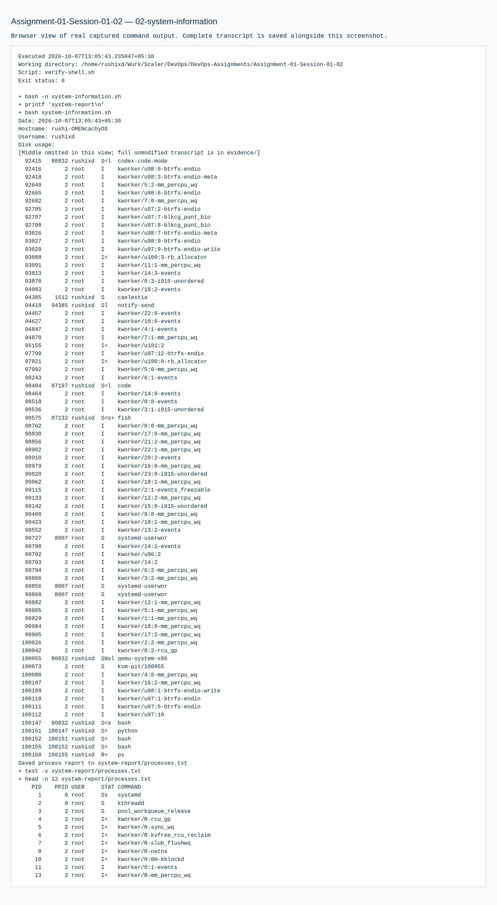
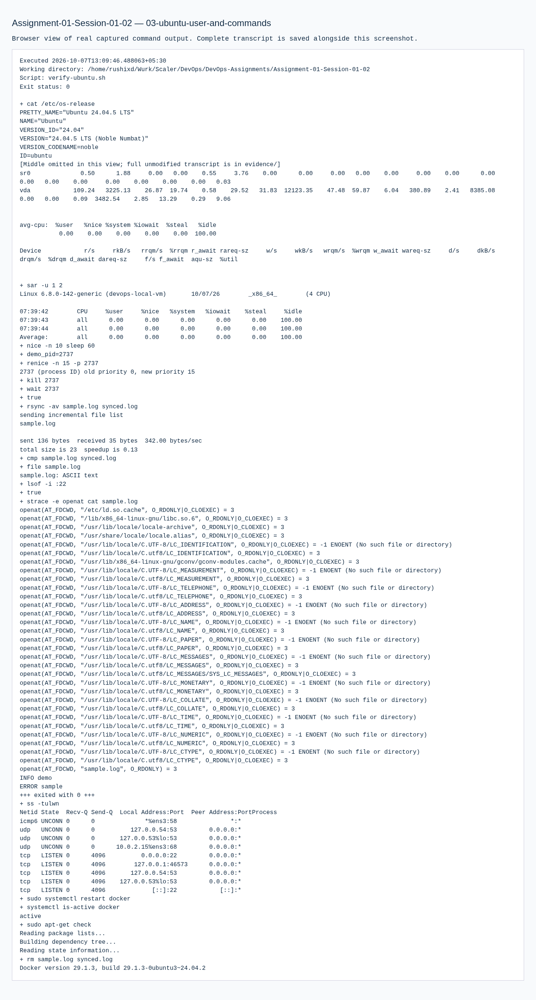

# Assignment 01 — Linux Homework Tasks and Shell Scripting Homework Task

Sessions 01-02. [Exact PDF requirements](REQUIREMENTS.md).

## Objective

Demonstrate Linux links, user management, logs, command practice and the system-information shell script required by PDF pages 1–2.

## Tasks Performed

Host link creation/deletion and Linux commands were executed. The shell script used variables, `read -p`, `mkdir`, `touch`, `df`, `ps` and process redirection. Ubuntu user creation and command practice ran in the local Ubuntu VM.

## Tools Used

Host: CachyOS, Bash, coreutils, systemd. Privileged exercises: Ubuntu 24.04 local QEMU/KVM VM, adduser, systemd and ShellCheck. The transcripts include observed versions.

## Implementation

`practice-host.sh` isolates temporary link/file examples. `practice-ubuntu.sh` creates the locked-password `practicaltest` account, verifies its home/passwd entry, then removes it. `system-information.sh` accepts a safe report directory name and writes a real process snapshot.

## Verification

The hard link shared the original inode; after deleting the original, its content remained readable, while the symlink became dangling. The Ubuntu account was created and removed. Syntax checking, ShellCheck and report-file verification passed.

## Output / Results

The real system report is `system-report/processes.txt`. All executed command output is in `evidence/`.

## Troubleshooting / Observations

`adduser` is Ubuntu's higher-level user-creation interface with home-directory setup; `useradd` is the lower-level utility. This preference is distribution-specific. `journalctl -u docker` selects service logs. Host Docker was inaccessible due to group permissions, so privileged tasks ran in the clearly identified local VM.

## External Steps Pending

The PDF asks for a public GitHub repository and script push. Publication is deferred to the owner and was not performed.

## Lessons Learned

Hard links keep file data alive while an inode still has a link. Symlinks depend on a target path. `>` replaces a file's contents with command output.

## Commands Executed

The linked transcripts contain the exact executed scripts, stdout/stderr and exit status.

- [01-links-linux-journal.md](evidence/01-links-linux-journal.md)
- [02-system-information.md](evidence/02-system-information.md)
- [03-ubuntu-user-and-commands.md](evidence/03-ubuntu-user-and-commands.md)

## Screenshots

Command screenshots are browser views of real captured output, labeled as such; application screenshots show actual accessed pages.

