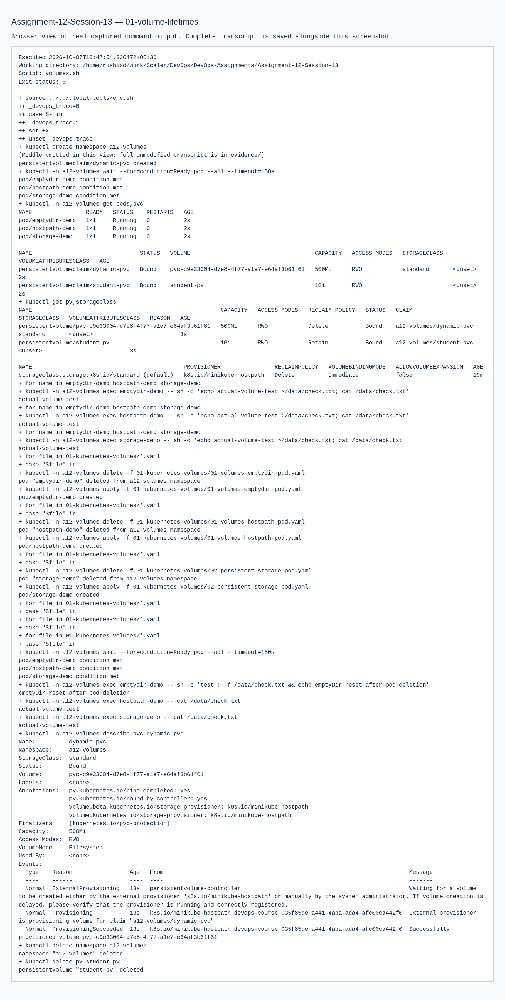
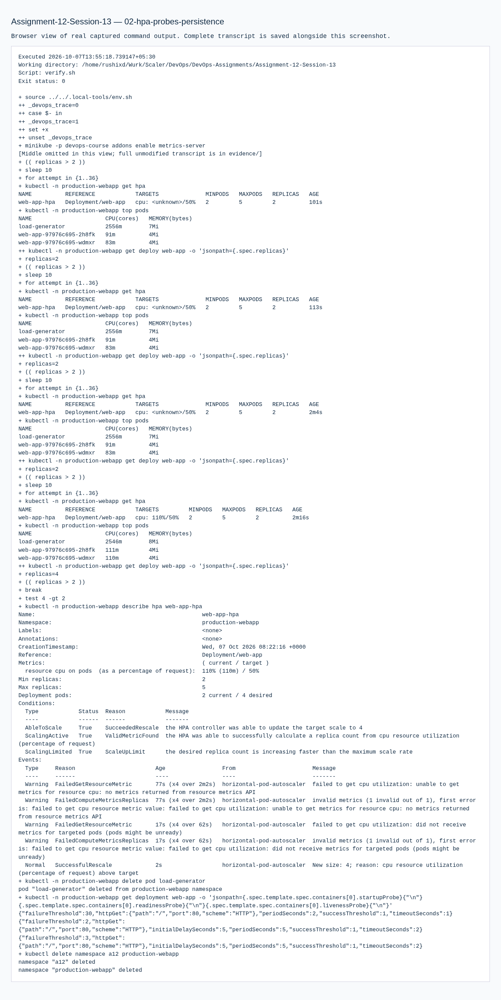
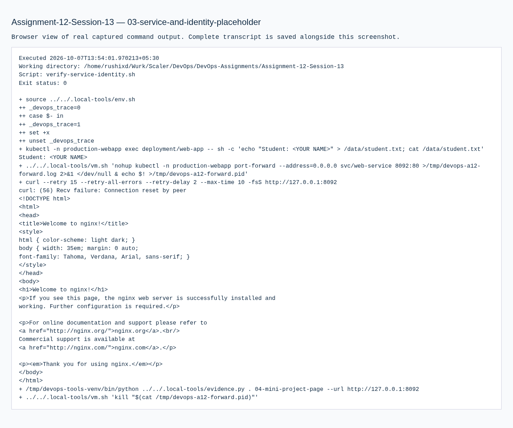
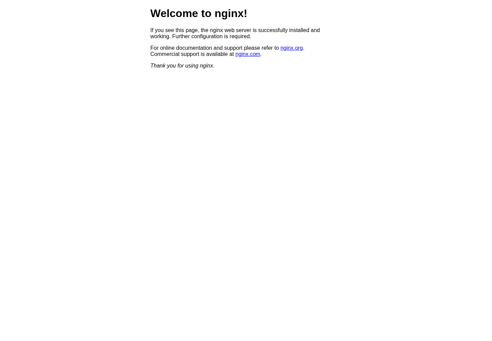
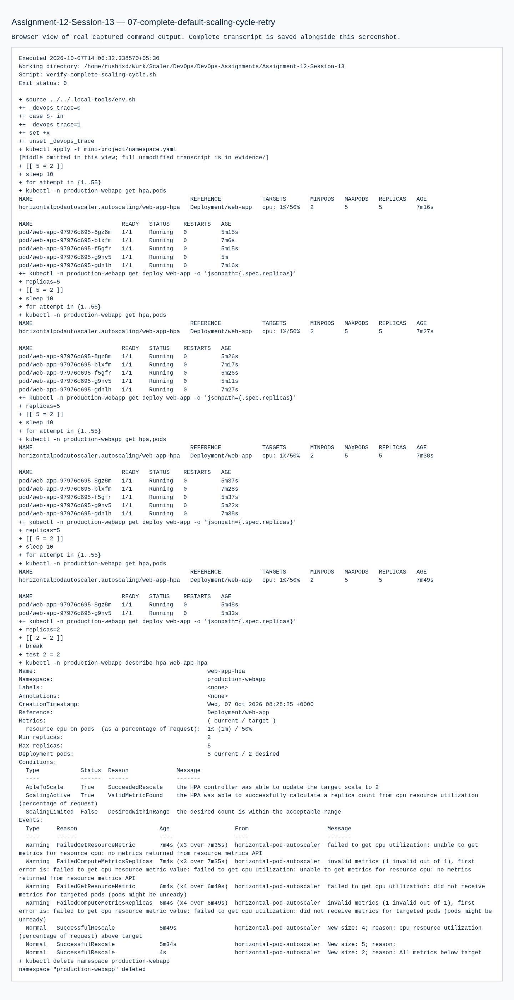

# Assignment 12 — Kubernetes Storage, HPA & Probes

Sessions 13. [Exact PDF requirements](REQUIREMENTS.md).

## Objective

Demonstrate Kubernetes volumes, CPU-driven autoscaling and the persistent web mini project with all three probe types.

## Tasks Performed

Executed emptyDir, hostPath, static PV/PVC and dynamic PVC examples. Applied the HPA exercise, generated actual HTTP load and inspected scaling/CPU. Deployed the course mini project with persistent storage, startup/readiness/liveness probes, Service and HPA; replaced a Pod and read back the stored marker.

## Tools Used

Minikube, kubectl, Kubernetes metrics-server and BusyBox/Nginx inside the local Ubuntu VM.

## Implementation

Volume manifests and explanations are in `01-kubernetes-volumes/`. `hpa/hpa.yml` targets measured CPU utilization relative to requested CPU. `mini-project/` contains the complete namespaced application.

## Verification

Transcripts show bound claims, file contents before/after replacement, metrics-server readings, HPA descriptions and replica growth under actual load. All three configured probes are read back from the running Deployment. Exercise namespaces and static PV were cleaned up.

## Output / Results

See the measured replica counts and CPU in evidence, rather than an assumed scaling time or fabricated percentage. The stored persistence marker is a neutral test string; no personal name was invented.

## Troubleshooting / Observations

HPA requires resource requests and the metrics API. Metrics appear after collection starts, and scaling is asynchronous. The one-node learning cluster permits multiple replicas to use this ReadWriteOnce claim on the same node; that does not establish multi-node storage portability. Probe responsibilities differ: startup allows initialization, readiness controls traffic eligibility, liveness triggers restart.

## Lessons Learned

Use separate observations to prove storage persistence, application readiness and load-driven scaling.

The full mini-project cycle was repeated to retain the default five-minute scale-down stabilization behavior and verify return to two replicas after stopping load. A preliminary directory apply attempted namespaced resources before their Namespace existed; the retry creates the Namespace first. The course's three standalone probe examples were inspected and removed from the default namespace; their submission manifests now declare the mini-project namespace explicitly. An earlier downscale observation raced cleanup and failed; its transcript is retained rather than represented as successful. The final successful cycle is the completion evidence.

The initial neutral persistence marker was followed by `Student: <YOUR NAME>` from the identity-placeholder demonstration; the repeated cycle verified that placeholder file also survived Pod replacement. See [IDENTITY.md](../IDENTITY.md) for the fields to replace before personal submission.

## Commands Executed

The linked transcripts contain the exact executed scripts, stdout/stderr and exit status.

- [01-volume-lifetimes.md](evidence/01-volume-lifetimes.md)
- [02-hpa-probes-persistence.md](evidence/02-hpa-probes-persistence.md)
- [03-service-and-identity-placeholder.md](evidence/03-service-and-identity-placeholder.md)
- [05-observed-scale-down.md](evidence/05-observed-scale-down.md)
- [06-complete-default-scaling-cycle.md](evidence/06-complete-default-scaling-cycle.md)
- [07-complete-default-scaling-cycle-retry.md](evidence/07-complete-default-scaling-cycle-retry.md)
- [08-probe-examples-and-owned-cleanup.md](evidence/08-probe-examples-and-owned-cleanup.md)

## Screenshots

Command screenshots are browser views of real captured output, labeled as such; application screenshots show actual accessed pages.

