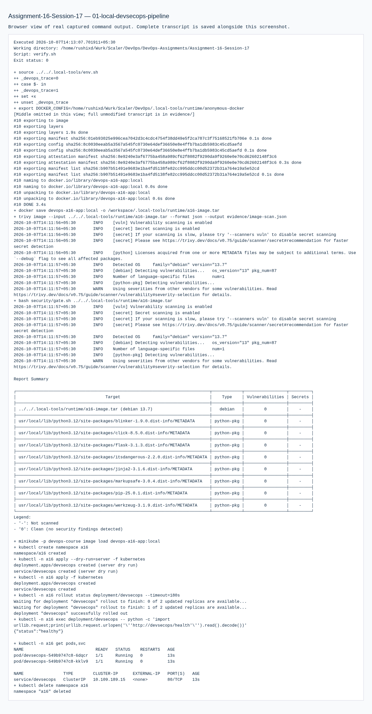
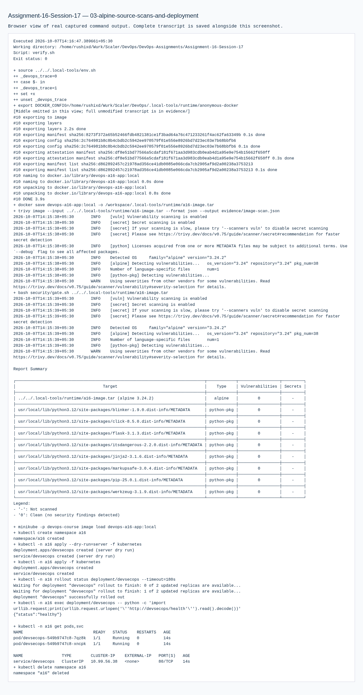

# Assignment 16 — Complete CI/CD & DevSecOps

Sessions 17. [Exact PDF requirements](REQUIREMENTS.md).

## Objective

Build a runnable application and prepare the complete test/security/build/deployment pipeline while exercising all permitted stages locally.

## Tasks Performed

Implemented health and calculator endpoints with unit tests. Executed compilation, pytest, Bandit SAST, pip-audit SCA, Gitleaks secret scanning, Docker build, Trivy image scanning and a HIGH/CRITICAL vulnerability gate. Loaded the local image into Minikube and verified the application behind its Service.

## Tools Used

Python/Flask, pytest, Bandit, pip-audit, Gitleaks, Trivy, actionlint, Docker and local Minikube/Kubernetes. Versions appear in installation/runtime records and command evidence.

## Implementation

`security/` specifies SAST scope and the real image gate. `.github/workflows/devsecops.yml` preserves the PDF's ordered stages and owner-gates publication/deployment. `kubernetes/` defines a probed two-replica application. Local image loading supplies the cluster without a remote push.

## Verification

Actual scanner reports and command exit statuses are in evidence. Service health is checked from the deployed Pod. Workflow YAML was validated, but was not run on GitHub.

## Output / Results

Security findings are reported exactly as produced by the tools. The final gate rejects all HIGH/CRITICAL vulnerabilities, including unfixed ones; the unrestricted report preserves lower-severity findings. Local results do not claim registry publication.

## Troubleshooting / Observations

SAST examines code, SCA checks dependency advisories, secret scanning detects credential patterns, and image scanning includes operating-system and language packages. A passing one-stage scan does not substitute for another.

## External Steps Pending

BLOCKED: registry authentication/image push, actual hosted CI/CD run and its successful pipeline screenshots. The future deployment job needs owner-approved registry and Kubernetes secrets; no existing remote credentials or cluster were accessed. Workflows assume this assignment is a standalone repository; adjust paths when activating within a combined repository.

## Lessons Learned

Gate the artifact before publication and verify the deployed endpoint separately from the build.

The initial Debian runtime had 171 entries, including 44 unfixed HIGH/CRITICAL findings. Rebuilding with Alpine reduced this to seven entries and zero HIGH/CRITICAL. Bandit, pip-audit and source Gitleaks reported zero findings/advisories. Public GPG fingerprints in generated image metadata produced two redacted Gitleaks false positives; `.gitleaks.toml` excludes generated evidence from the source scan. Original and final reports are retained. The strengthened all-HIGH/CRITICAL gate was rerun explicitly.

The prepared hosted workflow saves the scanned image as an artifact and loads/tags that same image for publication. Local save/load/tag checks verified identical image IDs for Assignments 16 and 20; the joint transcript is retained in both folders. This avoids rebuilding an unscanned image in the delivery job. No registry login or push was executed.

## Commands Executed

The linked transcripts contain the exact executed scripts, stdout/stderr and exit status.

- [01-local-devsecops-pipeline.md](evidence/01-local-devsecops-pipeline.md)
- [02-smaller-runtime-security-verification.md](evidence/02-smaller-runtime-security-verification.md)
- [03-alpine-source-scans-and-deployment.md](evidence/03-alpine-source-scans-and-deployment.md)
- [04-strict-high-critical-gate.md](evidence/04-strict-high-critical-gate.md)
- [05-actual-alpine-runtime-page.md](evidence/05-actual-alpine-runtime-page.md)
- [06-shared-image-artifact-identity.md](evidence/06-shared-image-artifact-identity.md)

## Screenshots

Command screenshots are browser views of real captured output, labeled as such; application screenshots show actual accessed pages.

