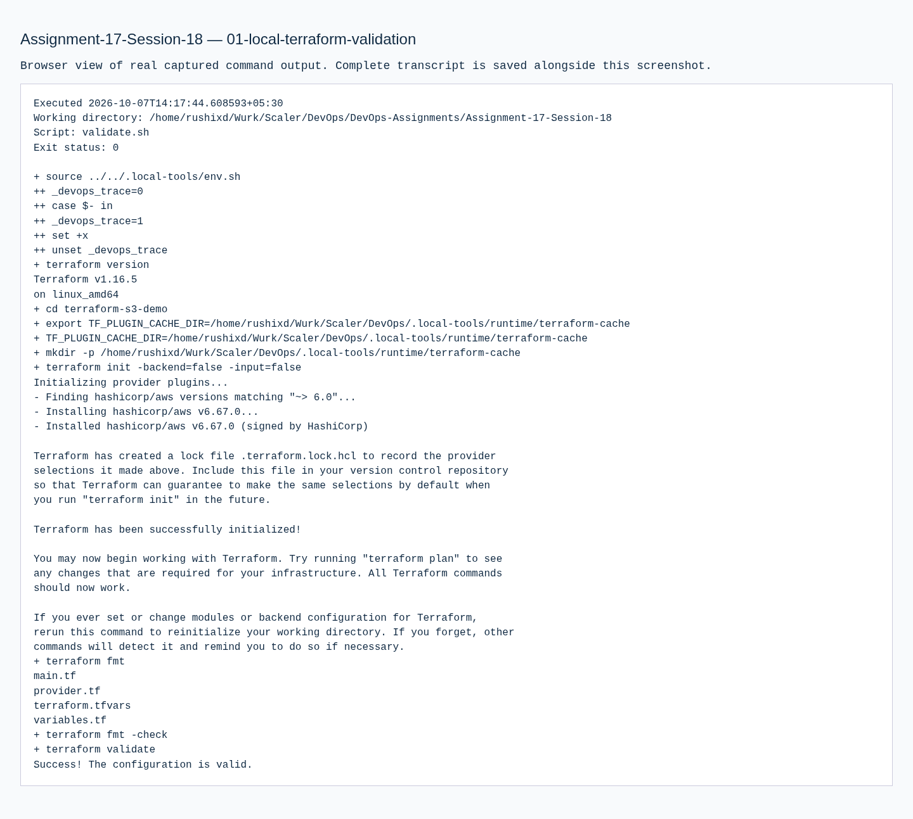

# Assignment 17 — Terraform & Infrastructure as Code

Sessions 18. [Exact PDF requirements](REQUIREMENTS.md).

## Objective

Prepare the S3 Terraform project and document all requested AWS services without using cloud credentials or creating resources.

## Tasks Performed

Created provider, bucket/public-access configuration, variables, outputs and nonsecret placeholder tfvars. Ran initialization, formatting and provider-schema validation locally. Wrote the five separate service research READMEs under `aws-services/`.

## Tools Used

Terraform 1.16.5 and the downloaded HashiCorp AWS provider. Installation and validation require anonymous dependency downloads only.

## Implementation

`terraform-s3-demo/` has the exact requested project files. `terraform.tfvars` and `.example` contain placeholders. A bucket plus Public Access Block are declared, but do not exist from this work. Service documentation covers IAM identities/policies/least privilege; EC2 images/instance/network/storage/lifecycle; S3 objects/classes/versioning/lifecycle/encryption; VPC routing/subnets/security; DynamoDB keys and RDS availability/backups/read replicas.

## Verification

The transcript records successful init, fmt/check and validate. Provider validation checks configuration; it does not confirm AWS provisioning or account access.

## Output / Results

No plan, apply, show, output or destroy was executed. No AWS state, bucket or cloud screenshot is fabricated.

## External Steps Pending

BLOCKED: the PDF's real S3 creation and subsequent plan/apply/show/output/destroy evidence. The owner must approve cloud access, replace the globally unique bucket placeholder, supply appropriate IAM access outside submission files and execute/review that workflow. Those commands may create/delete real billable resources and remain unexecuted.

## Lessons Learned

IaC validation is a local configuration check; provisioning requires a separately approved account-backed operation.

## Commands Executed

The linked transcripts contain the exact executed scripts, stdout/stderr and exit status.

- [01-local-terraform-validation.md](evidence/01-local-terraform-validation.md)

## Screenshots

Command screenshots are browser views of real captured output, labeled as such; application screenshots show actual accessed pages.

