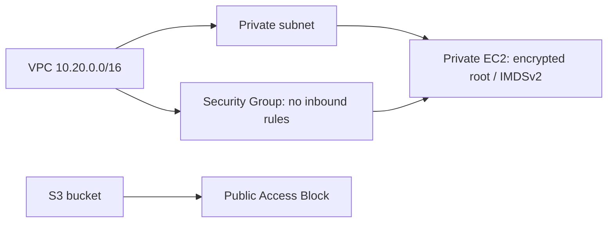

# Assignment 18 — Cloud & Terraform in Action

Sessions 19. [Exact PDF requirements](REQUIREMENTS.md).

## Objective

Prepare and validate an end-to-end Terraform AWS infrastructure definition; keep actual provisioning pending approval.

## Tasks Performed

Declared a VPC, private subnet, Security Group, private EC2 instance with encrypted root volume and IMDSv2, and an S3 bucket with Public Access Block. Created variables, outputs, example inputs and an architecture diagram. Executed only local init/fmt/check/validate.

## Tools Used

Terraform 1.16.5 and the HashiCorp AWS provider; no AWS CLI login or credentials were used.

## Implementation

`terraform-project/` contains the provider/resource/input/output separation. References connect the subnet to the VPC, Security Group to the VPC and EC2 to the subnet/Security Group. The bucket is independent. The regional AMI and globally unique bucket values are owner-supplied placeholders. The isolated EC2 has no public IP or inbound access; the locally running application/Kubernetes cluster is separate from this unprovisioned cloud definition.

## Verification

Init and formatting/provider-schema validation succeeded. No existing cloud state was read, and no resource-existence claim is made.

## Output / Results

`.terraform.lock.hcl` records selected provider versions. Terraform state would track provisioned object identities after a future apply; this workspace contains no account-backed state from this assignment.

## External Steps Pending

BLOCKED: cloud credential access, plan review, resource creation, actual outputs/screenshots and destroy. The owner must approve the exact account/region/resources and costs, choose a valid AMI and bucket name, then perform the PDF's plan/apply/verify/destroy sequence. No public application deployment is claimed for the deliberately isolated private EC2 configuration.

## Lessons Learned

Implicit references define ordering, variables separate deployment inputs, and local validation cannot establish that an infrastructure deployment works.

## Commands Executed

The linked transcripts contain the exact executed scripts, stdout/stderr and exit status.

- [01-local-cloud-configuration-validation.md](evidence/01-local-cloud-configuration-validation.md)

## Screenshots

Command screenshots are browser views of real captured output, labeled as such; application screenshots show actual accessed pages.

