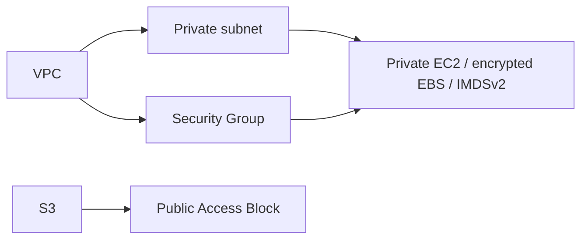

# Terraform local preparation

Only `init -backend=false`, `fmt`, `fmt -check` and `validate` are authorized and executed in the assignment transcript. The tfvars file contains public placeholders, not credentials. Replace values before owner-approved cloud execution.

The PDF's remaining workflow is `plan`, review the resource changes, `apply`, inspect with `show` and `output`, and `destroy` after collecting evidence. None of those cloud/state operations were executed. They require explicit owner approval, an appropriate account and permissions, region-specific values and cost review. AWS resources and real execution screenshots remain blocked.

Terraform configuration references define dependencies; state records real object identities when provisioned. Local validation checks configuration/provider schemas and does not prove resources were created. Never commit real state or credential files.

## Proposed architecture (unprovisioned)

There is no Internet/NAT Gateway or public instance IP in this definition. It does not claim a public app deployment.
