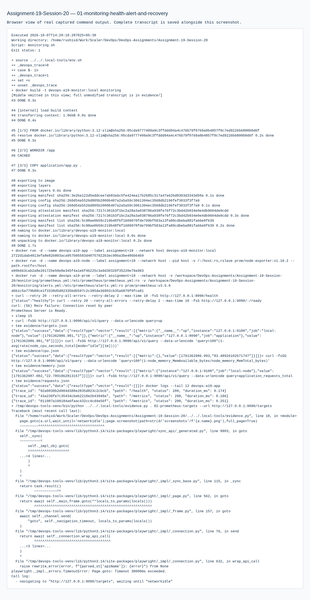
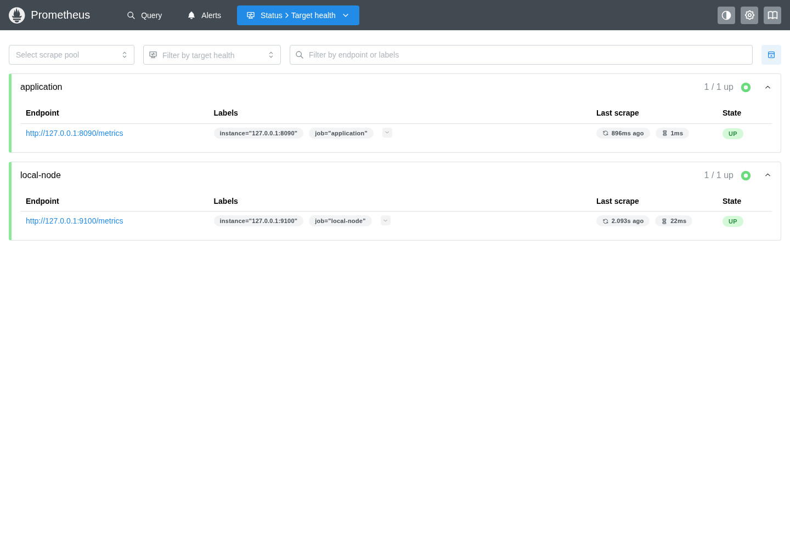
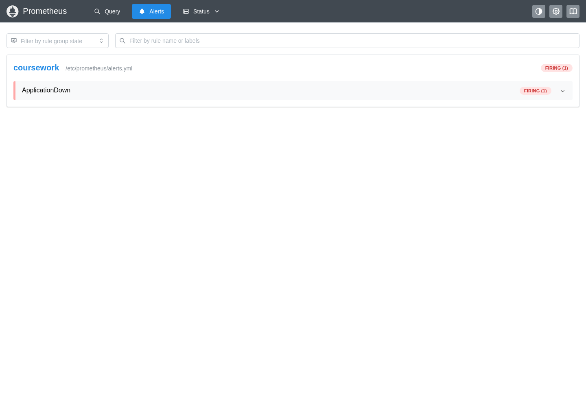
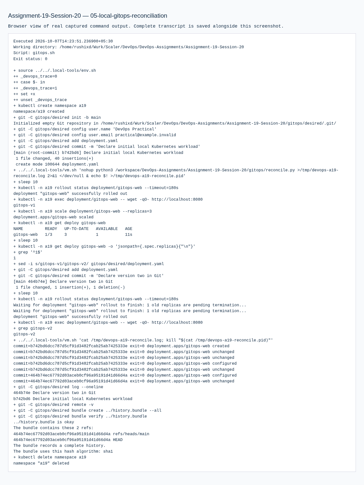

# Assignment 19 — Monitoring, Observability & GitOps

Sessions 20. [Exact PDF requirements](REQUIREMENTS.md).

## Objective

Demonstrate real local metrics, logs, alerts and health; document observability and run continuous Kubernetes reconciliation from local Git.

## Tasks Performed

Built a metrics/health application; ran Prometheus and node-exporter; queried CPU, memory, application requests and scrape health. Stopped the actual application to fire an alert, captured it and restored service to clear the alert. Ran a local GitOps controller, demonstrated drift correction and committed a version change that reached Kubernetes.

## Tools Used

Docker, Python, Prometheus, node-exporter, Git and Kubernetes/Minikube in the local Ubuntu VM. Browser screenshots show actual local Prometheus pages.

## Implementation

`monitoring/` holds app/config/alert rules. `observability.md` covers metrics/logs/traces and Kubernetes diagnosis. `gitops/` holds committed desired state and the five-second reconciler, with portable commit history.

## Verification

Live Prometheus API output and logs, firing/recovered alert assertions, Kubernetes replica restoration and actual v2 HTTP output are in the transcripts. Assignment containers/controller/namespace were cleaned up after evidence.

## Output / Results

This is entirely local. No hosted monitoring service, remote Git repository or paid resource was accessed. The monitored node is the local VM; its CPU and memory are not labeled as host-machine measurements.

## Troubleshooting / Observations

Scrape health, application HTTP response and workload readiness measure distinct things. Generated request IDs support correlation; there is no fabricated distributed trace. Git reconciliation uses committed contents and ignores uncommitted edits.

## Lessons Learned

Verify an alert by causing and recovering an actual failure, and prove reconciliation by observing the real cluster after deliberate drift.

The initial application answered HTTP but Prometheus rejected its blank Content-Type, so `up` was 0 and the request metric was absent. The target API exposed the exact protocol error. Added the correct Prometheus text-exposition Content-Type, rebuilt/restarted and asserted both targets were up before exercising the alert. The initial failed transcript is retained. Prometheus UI polls continuously; screenshots now wait for page rendering rather than indefinite network idle.

## Commands Executed

The linked transcripts contain the exact executed scripts, stdout/stderr and exit status.

- [01-monitoring-health-alert-and-recovery.md](evidence/01-monitoring-health-alert-and-recovery.md)
- [04-monitoring-content-type-fix-and-verification.md](evidence/04-monitoring-content-type-fix-and-verification.md)
- [05-local-gitops-reconciliation.md](evidence/05-local-gitops-reconciliation.md)

## Screenshots

Command screenshots are browser views of real captured output, labeled as such; application screenshots show actual accessed pages.

