# Assignment 20 — Final DevOps Project & Troubleshooting

Sessions 21. [Exact PDF requirements](REQUIREMENTS.md).

## Objective

Integrate the PDF's application, Docker, security, Kubernetes, Helm, Terraform preparation, monitoring and GitOps components, with real local verification and documented remote blockers.

## Tasks Performed

Built/tested the application and multi-stage image; ran SAST/SCA/secret/image scans and the vulnerability gate. Deployed ConfigMap, hidden runtime Secret, Deployment, Service, Ingress, HPA, all probe types and persistent storage. Verified persistence and load-driven scaling. Installed/upgraded/rolled back/uninstalled the Helm chart. Demonstrated local GitOps drift repair and a committed version promotion. Queried real metrics/logs and captured an alert/recovery. Validated Terraform locally. Introduced and repaired image, readiness and Service-selector faults with actual before/after evidence.

## Tools Used

Python/Flask, pytest, Bandit, pip-audit, Gitleaks, Trivy, actionlint, Docker, Minikube/Kubernetes, Helm, Git, Prometheus, node-exporter and Terraform. Privileged/container/cluster execution used the one local Ubuntu VM; scans and Terraform validation used host tools.

## Implementation

`final-devops-project/` has every directory required by the PDF. Its README explains setup and component behavior. The assignment's executed scripts and transcripts are linked below.

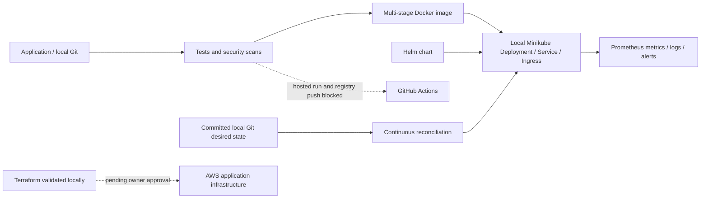

## Verification

Transcripts and scanner reports retain actual results. HTTP health confirms configuration and Secret presence without exposing values. Stored marker survives Pod replacement; CPU load triggers actual replica growth. Helm history and HTTP version responses confirm upgrade/rollback. The reconciler corrects manual version drift and applies a new Git commit. Monitoring transport interruption causes a real scrape alert; restoring the forward clears it.

## Output / Results

The local project works; remote/cloud stages remain incomplete. See the subproject README and `evidence/` for measured results and before/after faults.

## Troubleshooting / Observations

An invalid image/tag prevents new replicas starting. A missing readiness endpoint makes new Pods unready despite a running process. A mismatched Service selector removes selected endpoints and breaks service access. Each root cause was inspected before correction and endpoint verification. A disconnected monitoring port-forward also causes target unavailability even when Pods remain healthy; the alert is a scrape-health alert, not proof that the underlying application crashed.

## External Steps Pending

BLOCKED: GitHub publication and hosted CI/CD success screenshots; authenticated registry push; any remote Kubernetes use; Terraform AWS plan/apply/show/output/destroy and actual infrastructure evidence. All configuration is prepared, but no existing external credentials were used. The owner must review and explicitly approve these actions, configure secrets outside source files and replace infrastructure placeholders. The final cloud template prepares a public HTTP EC2 application route, encrypted storage and an Ubuntu Docker bootstrap referencing an owner-published public image; it remains unprovisioned and its inputs require approval.

## Lessons Learned

Verify each transition—tests, scan gate, image, workload readiness, HTTP response, storage, monitoring and reconciliation. A local green result does not establish that a hosted pipeline or cloud deployment ran.

The first Bandit run flagged a predictable `/tmp` default storage directory (B108). The application now uses its explicit configured storage directory, with a relative local fallback and validation before writes; rerunning tests and SAST passed without suppressing that finding. Final SAST/SCA/source-secret scans report zero findings, and the image contains seven lower-severity entries with zero HIGH/CRITICAL. A clean rebuild also verified that host Python bytecode was excluded from the runtime.

The prepared hosted workflow saves the scanned image as an artifact and loads/tags that same image for publication. Local save/load/tag checks verified identical image IDs for Assignments 16 and 20; the joint transcript is retained in both folders. This avoids rebuilding an unscanned image in the delivery job. No registry login or push was executed.

After GitOps promotion, the first `kubectl top` call arrived before metrics-server had sampled the replacement Pods. The failed transcript is retained. The follow-up verification waited for samples, recorded measured CPU/memory, then confirmed both scrape targets UP, an actual firing alert after disconnecting the forward, and an empty alert list after recovery.

## Commands Executed

The linked transcripts contain the exact executed scripts, stdout/stderr and exit status.

- [01-source-git-initialization.md](evidence/01-source-git-initialization.md)
- [03-build-tests-scans-and-terraform.md](evidence/03-build-tests-scans-and-terraform.md)
- [04-build-scans-validated-after-storage-fix.md](evidence/04-build-scans-validated-after-storage-fix.md)
- [05-clean-image-rebuild-and-scan.md](evidence/05-clean-image-rebuild-and-scan.md)
- [08-real-docker-smoke-test.md](evidence/08-real-docker-smoke-test.md)
- [10-kubernetes-storage-hpa-fault-repair.md](evidence/10-kubernetes-storage-hpa-fault-repair.md)
- [11-cloud-bootstrap-local-validation.md](evidence/11-cloud-bootstrap-local-validation.md)
- [12-cloud-application-template-validation.md](evidence/12-cloud-application-template-validation.md)
- [13-final-helm-install-upgrade-rollback.md](evidence/13-final-helm-install-upgrade-rollback.md)
- [14-gitops-monitoring.md](evidence/14-gitops-monitoring.md)
- [15-final-monitoring-verification.md](evidence/15-final-monitoring-verification.md)
- [16-scanned-image-artifact-identity.md](evidence/16-scanned-image-artifact-identity.md)
- [17-verified-local-source-history.md](evidence/17-verified-local-source-history.md)

## Screenshots

Command screenshots are browser views of real captured output, labeled as such; application screenshots show actual accessed pages.

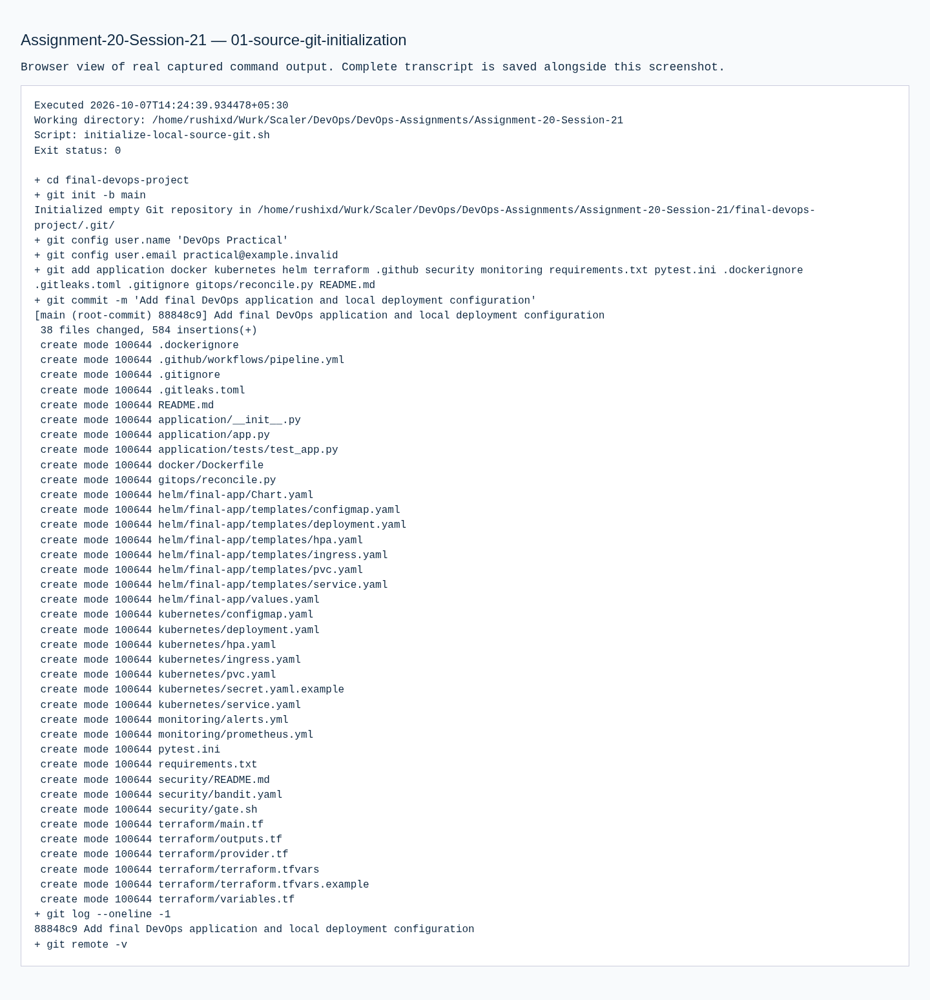
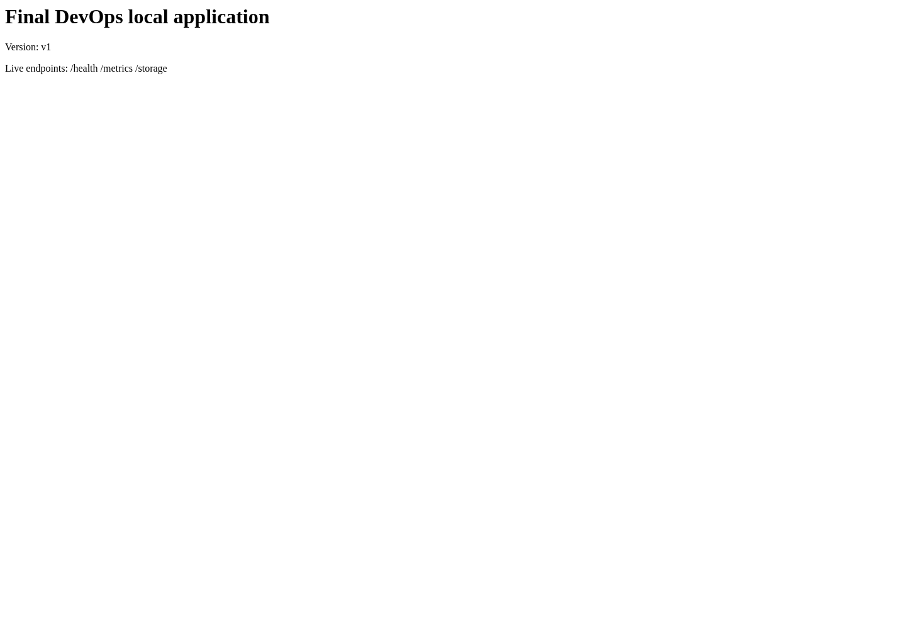

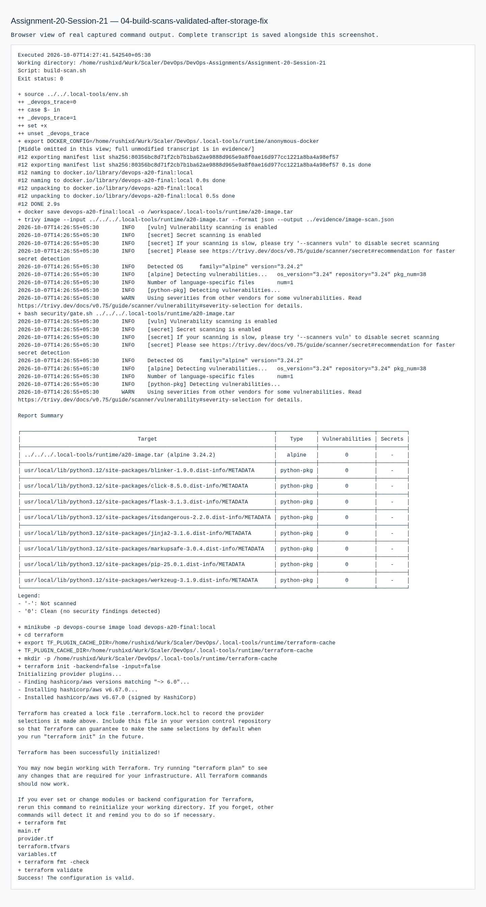

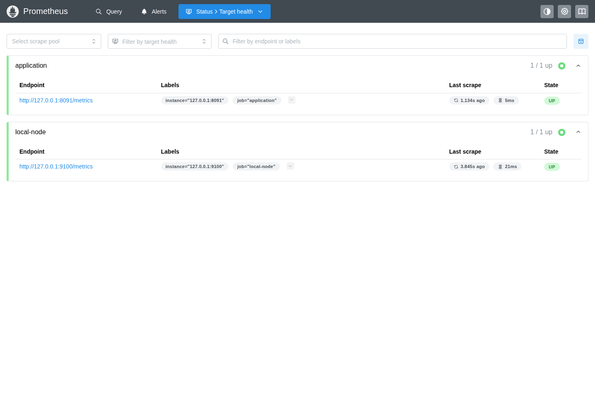

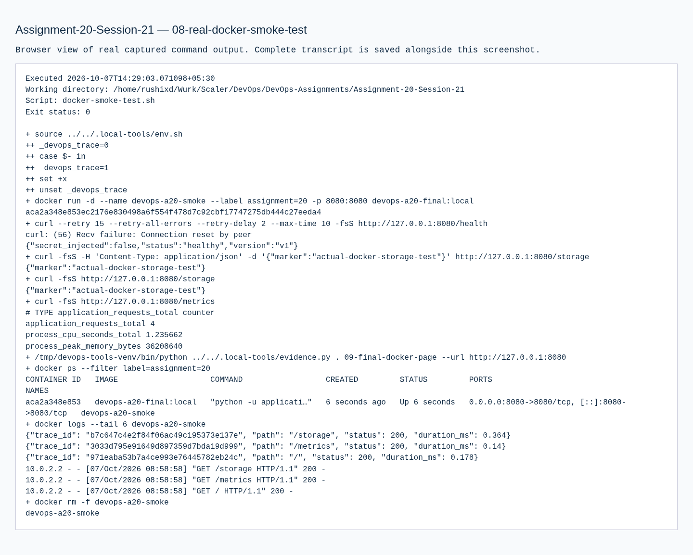
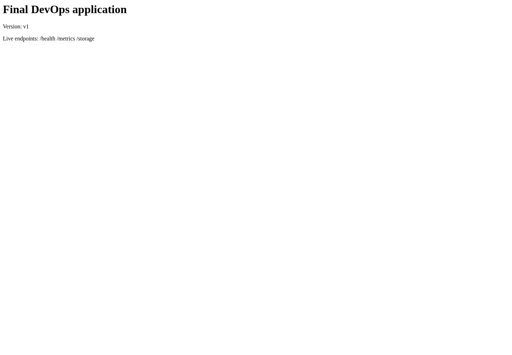
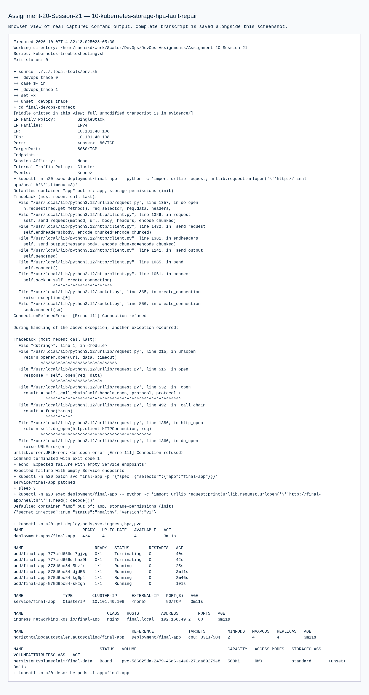
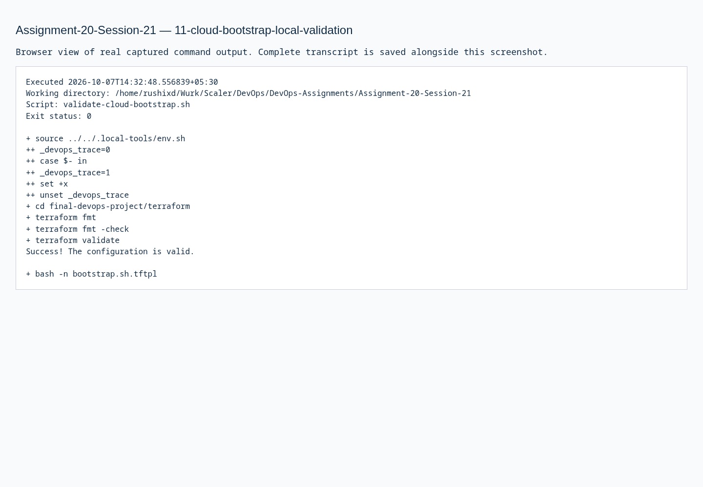
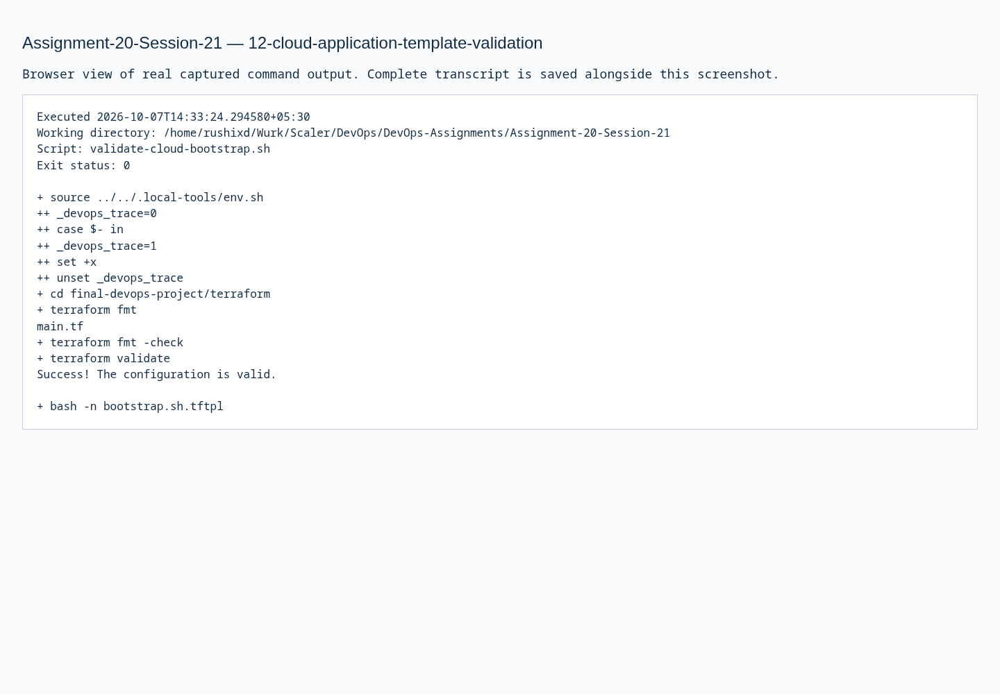

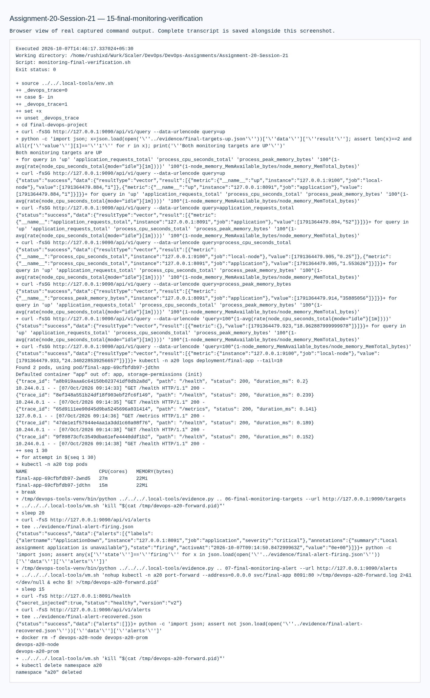
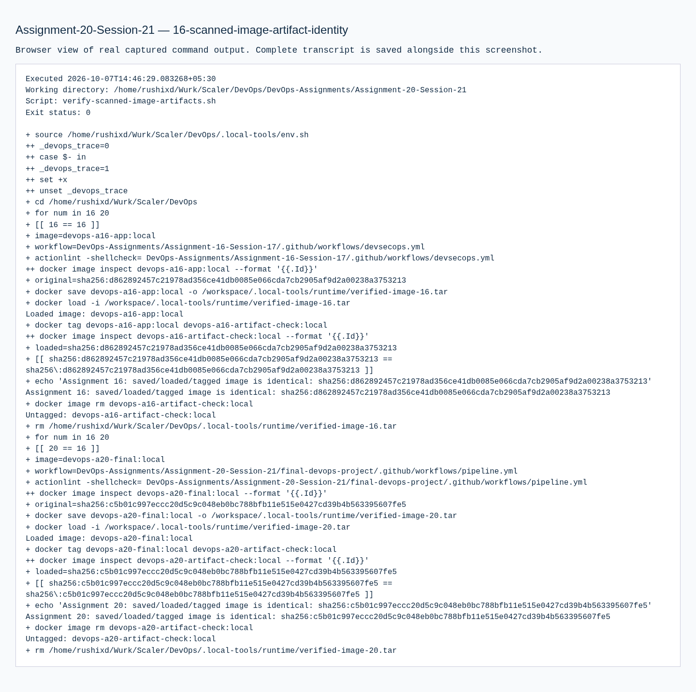

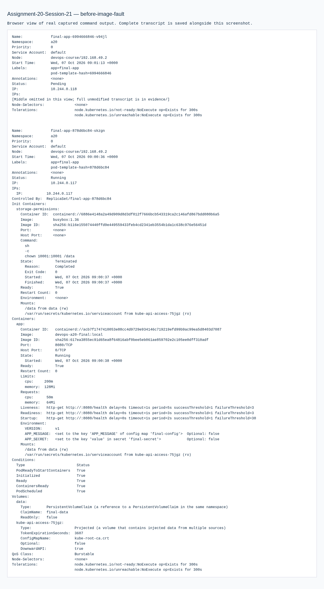
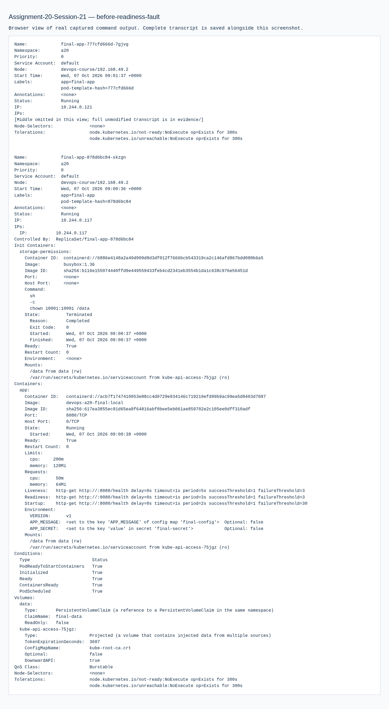
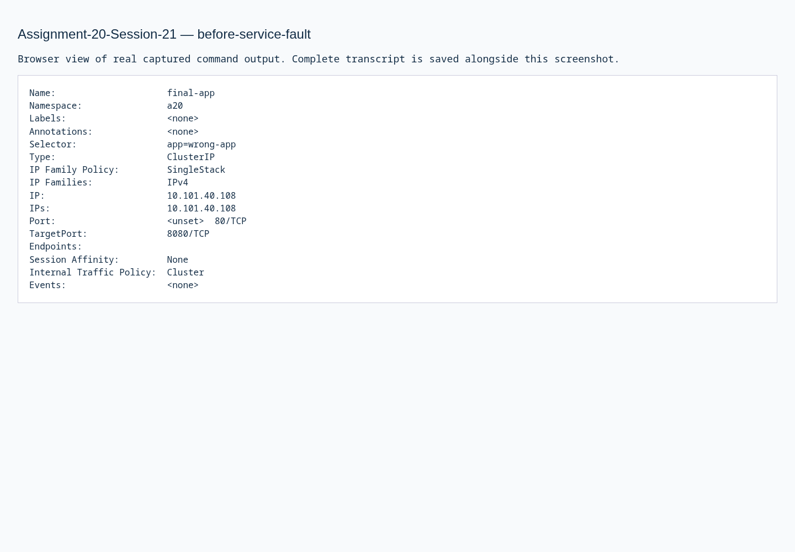
