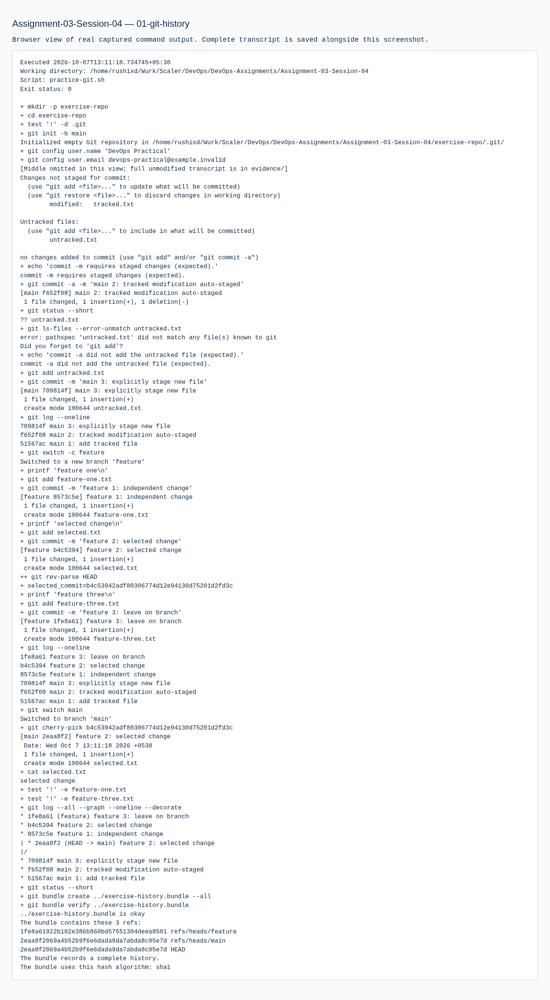

# Assignment 03 — Git Homework Tasks

Sessions 04. [Exact PDF requirements](REQUIREMENTS.md).

## Objective

Demonstrate tracked versus staged commits and selective transfer of a feature-branch change.

## Tasks Performed

Created an isolated local repository. Made three initial main commits and three feature commits. Tested an unstaged `git commit -m` failure, then `git commit -a -m` success while the new file remained untracked. Cherry-picked only the second feature commit into main.

## Tools Used

Host Git. Repository-local demonstration identity uses the reserved `.invalid` domain and is not the student's identity.

## Implementation

`practice-git.sh` performs the exercise from an empty repository. `exercise-history.bundle` preserves both branches and their real history. The exercise's `.git` directory is a local runtime artifact; the bundle is the portable submission evidence.

## Verification

The selected file appeared on main, while the first and third feature files remained absent. Git bundle verification passed. Repository status was clean.

## Output / Results

The complete graph and commit IDs are in the executed transcript.

## Troubleshooting / Observations

`git commit -m` commits the index. `git commit -a -m` first stages modifications/deletions to tracked files; it does not include an untracked file until `git add` is used. Cherry-pick created a new main commit for the selected change.

## External Steps Pending

The PDF requests uploading screenshots or Markdown to GitHub. No remote was configured for this exercise and nothing was pushed.

## Lessons Learned

Commit messages do not stage files. Cherry-pick applies a specific commit rather than merging all branch changes.

## Commands Executed

The linked transcripts contain the exact executed scripts, stdout/stderr and exit status.

- [01-git-history.md](evidence/01-git-history.md)

## Screenshots

Command screenshots are browser views of real captured output, labeled as such; application screenshots show actual accessed pages.

