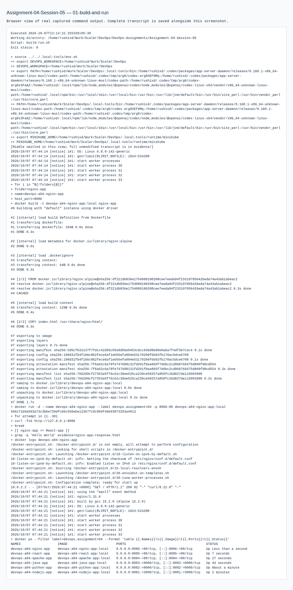
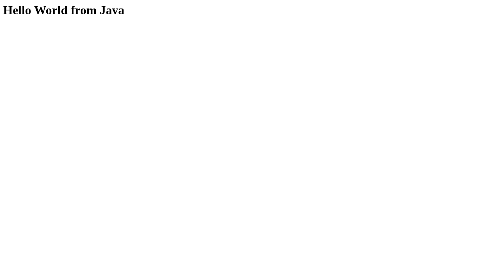
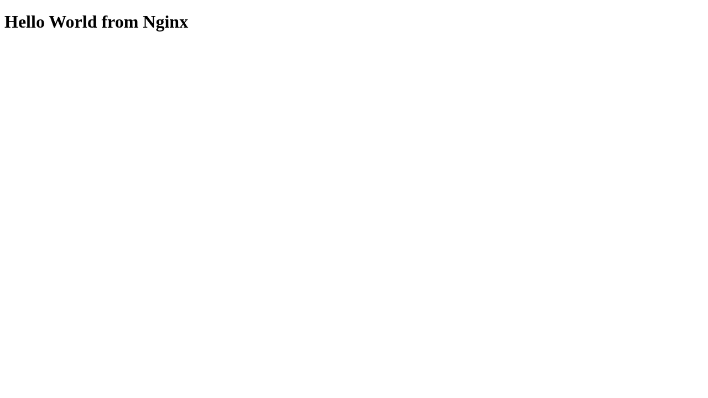
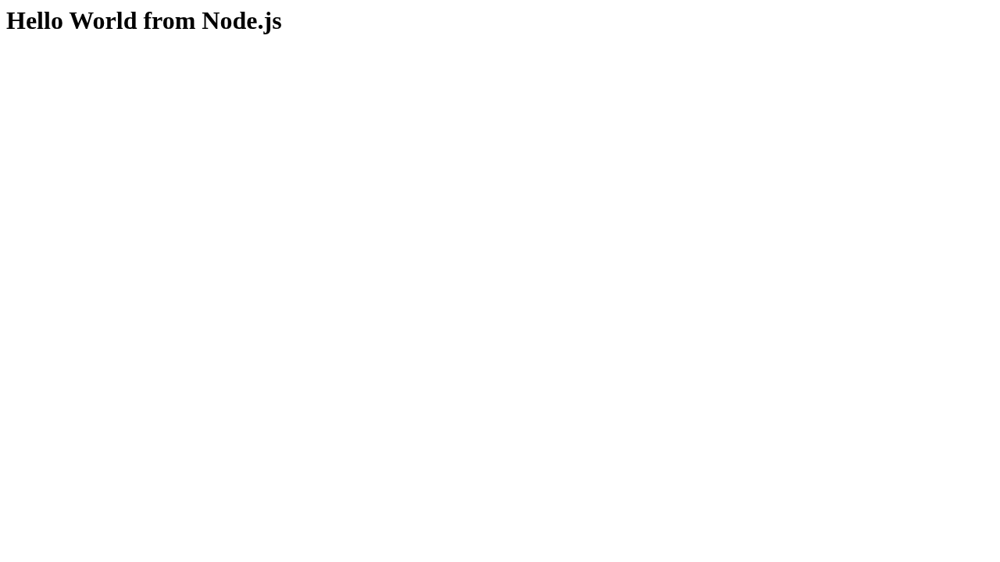

# Assignment 04 — Docker Hello World Applications

Sessions 05. [Exact PDF requirements](REQUIREMENTS.md).

## Objective

Build and run all six Docker Hello World web applications requested by the PDF.

## Tasks Performed

Created the exact case-sensitive application folders with application source and Dockerfiles. Built six images and ran six containers on ports 8081–8086. The React app was bundled from React source and rendered in a real browser.

## Tools Used

Local Ubuntu VM Docker 29.1.3 and Buildx; Node 24, Python 3.13, Java 21, Apache httpd 2.4 and Nginx image runtimes. React 19.2.0 and esbuild 0.25.12 are locked in package-lock.json. Host Playwright captured actual forwarded webpages.

## Implementation

`build-run.sh` builds each image and verifies HTTP access. Java and React use build stages. Containers execute inside the local VM; host browser ports forward to that VM.

## Verification

All six HTTP endpoints succeeded. Browser checks asserted Hello World text for every page, including React after its JavaScript executed. Docker's process listing recorded every container and port mapping.

## Output / Results

All required webpages displayed Hello World. Screenshots and response files are retained. Assignment-owned containers were removed after evidence capture.

## Troubleshooting / Observations

Buildx was installed in the VM because Docker lacked the build plugin. Java compilation occurs inside its build image, avoiding a duplicate host JDK installation.

## External Steps Pending

GitHub publication of application source and Dockerfiles is deferred to the owner. No images or code were pushed.

## Lessons Learned

EXPOSE documents a container port; `-p` actually publishes it. A React HTML response alone does not prove rendering, so browser text was checked.

## Commands Executed

The linked transcripts contain the exact executed scripts, stdout/stderr and exit status.

- [01-build-and-run.md](evidence/01-build-and-run.md)

## Screenshots

Command screenshots are browser views of real captured output, labeled as such; application screenshots show actual accessed pages.

