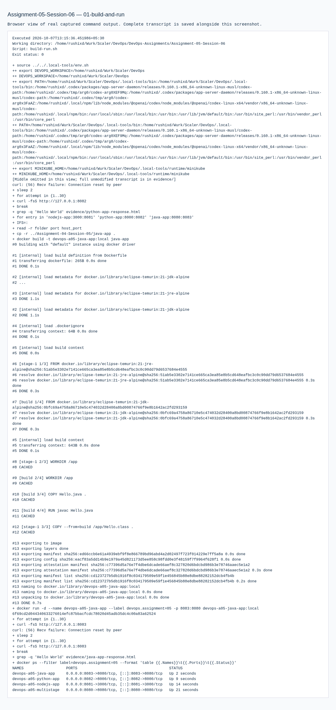
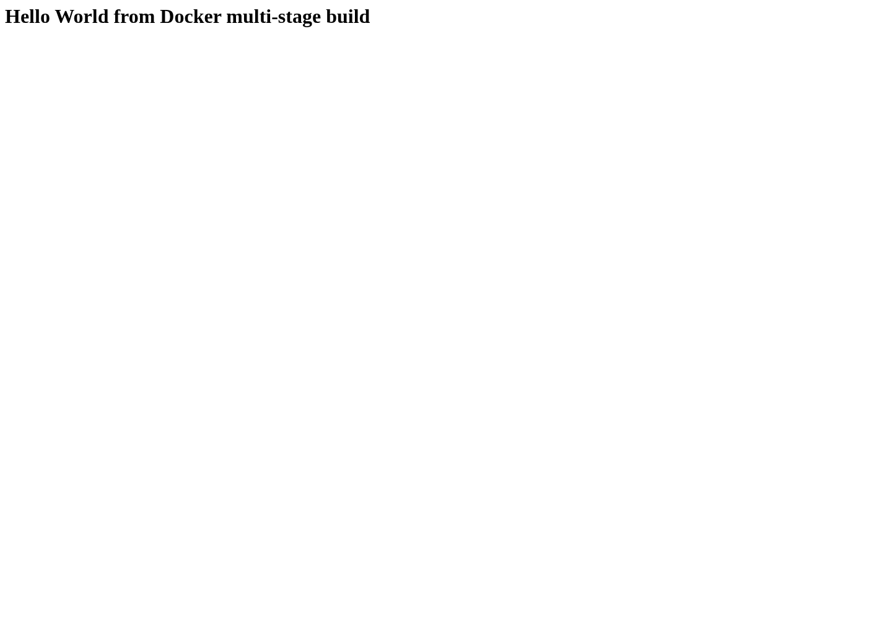

# Assignment 05 — Docker Multi-Stage Build

Sessions 06. [Exact PDF requirements](REQUIREMENTS.md).

## Objective

Demonstrate a multi-stage Docker build and deployments of three different application runtimes.

## Tasks Performed

Used the multi-stage source from the instructor's anonymously cloned devops-heros repository. Adapted its displayed text and application/container port to the PDF's literal requirements. Built and ran the multi-stage application plus Node.js, Python and Java deployments.

## Tools Used

Local Ubuntu VM Docker/Buildx, Node 24 with Express, Python 3.13, Java 21; host browser forwarding.

## Implementation

`multi-stage-app/Dockerfile` separates dependency/build work from production dependencies. `npm ci` uses the included lockfile. All four containers are labeled for Assignment 05.

## Verification

HTTP returned `Hello World from Docker multi-stage build` on port 8080. `docker ps` recorded the port mapping. Each of the three additional application types returned Hello World.

## Output / Results

Real builds, container listings and HTTP responses are in the transcripts. Containers were removed after evidence capture.

## Troubleshooting / Observations

The course example used port 3000 and different capitalization. These were adjusted to satisfy the PDF. No source-repository changes were made remotely.

## External Steps Pending

Required identity fields are centralized in [IDENTITY.md](../IDENTITY.md): `<YOUR NAME>` and `<YOUR ENROLLMENT NUMBER>`. Replace them before submission. GitHub upload is deferred to the owner.

## Lessons Learned

A build stage can keep development dependencies out of the production stage. The published port must match the verified URL.

## Commands Executed

The linked transcripts contain the exact executed scripts, stdout/stderr and exit status.

- [01-build-and-run.md](evidence/01-build-and-run.md)

## Screenshots

Command screenshots are browser views of real captured output, labeled as such; application screenshots show actual accessed pages.

