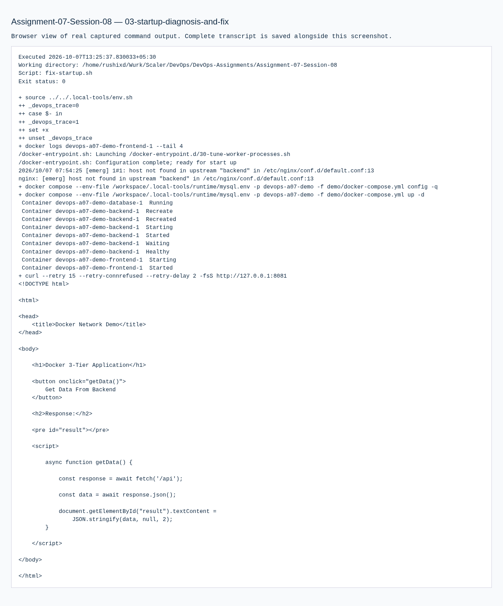

# Assignment 07 — Docker Networking & Volume: remaining session exercises

Sessions 08. [Exact PDF requirements](REQUIREMENTS.md).

## Objective

Complete the PDF page-10 remaining networking/volume exercises using the referenced Session 8 Compose material.

## Tasks Performed

Executed the instructor's basic Compose example, compose-app example, and three-tier demo. Validated each configuration, started the services, checked HTTP responses and process listings, and removed each project after evidence collection.

## Tools Used

Docker Compose 2.40.3 in the local Ubuntu VM, Nginx, Python/Flask, MySQL 8.0.

## Implementation

The course examples were adapted to avoid hardcoded database passwords and use port 8081. Password interpolation comes from a temporary env file outside the submission. The backend reads its password from the runtime environment. The full demo keeps frontend/backend and backend/database networks separate and uses a named database volume.

## Verification

`docker compose config -q` passed for all three projects. All websites responded. The full demo API returned backend success and `Hello from MySQL!`, proving a real database create/insert/select workflow. Backend resolved the database service by its Compose DNS name. Volume and process listings were captured.

## Output / Results

Real Compose output, API JSON and a webpage screenshot are retained. `down -v` removed only the three assignment-owned Compose projects and volumes.

## Troubleshooting / Observations

The PDF has no independent Session 8 heading. This folder implements its explicit remaining-exercises instruction using the course's Session 8 references, as documented in REQUIREMENTS.md. It does not invent a new topic. The original frontend could start before backend DNS existed and exited with upstream host-not-found. Added backend health checking and frontend depends_on: service_healthy, restarted the project and verified recovery. Database readiness was polled.

## External Steps Pending

GitHub submission is deferred to the owner.

## Lessons Learned

Compose creates service-name DNS, networks and volumes from declarative configuration. API success is stronger evidence than a frontend page alone.

## Commands Executed

The linked transcripts contain the exact executed scripts, stdout/stderr and exit status.

- [01-compose-exercises.md](evidence/01-compose-exercises.md)
- [03-startup-diagnosis-and-fix.md](evidence/03-startup-diagnosis-and-fix.md)

## Screenshots

Command screenshots are browser views of real captured output, labeled as such; application screenshots show actual accessed pages.

