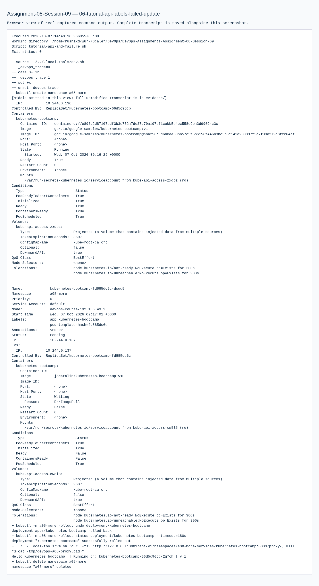

# Assignment 08 — Kubernetes Fundamentals

Sessions 09. [Exact PDF requirements](REQUIREMENTS.md).

## Objective

Install a real local Minikube cluster and perform the Kubernetes Basics tutorial.

## Tasks Performed

Started the devops-course profile, inspected nodes/control-plane components, deployed the tutorial application, examined Pods/logs/environment, exposed it, scaled from one to four replicas, updated its image, then rolled back.

## Tools Used

Minikube 1.39.0, kubectl 1.37.1, Kubernetes 1.36.0 and the Docker driver in the local Ubuntu VM. Host browser accessed a forwarded local port.

## Implementation

`tutorial.sh` runs the tutorial in namespace a08. The real tutorial images and replica/image changes are retained in command output and exported resource YAML. The profile is shared by later assignments, while exercise namespaces remain isolated.

## Verification

Minikube reported running components, the node was Ready, the application responded over HTTP, four Pods became ready, the v2 rollout succeeded and rollback restored v1. Namespace and port-forward cleanup followed evidence capture.

## Output / Results

See cluster/tutorial transcripts, exported Deployment/Service resources and actual application screenshot.

## Troubleshooting / Observations

Architecture: the API server handles resource requests; etcd stores desired state; scheduler assigns Pods; controllers reconcile objects. The node's kubelet and container runtime execute workloads. Service routing and cluster DNS support communication. This single-node learning cluster hosts both control plane and workloads.

## External Steps Pending

GitHub publication requested by the PDF is deferred.

## Lessons Learned

A Deployment manages ReplicaSets and Pod replacement; a Service provides stable access despite changing Pod IPs. Scaling and rollout are separate operations.

References: [PDF-linked tutorial](https://kubernetes.io/docs/tutorials/kubernetes-basics/), [architecture](https://kubernetes.io/docs/concepts/architecture/), [Minikube start](https://minikube.sigs.k8s.io/docs/start/).

The initial node was NotReady because the CNI image pull stalled. `repair-cni.sh` imported the actual required kindnet image and restarted the assignment-owned node's containerd/kubelet; subsequent output shows Ready and all system Pods Running. An early HTTP check raced the port-forward; retries now cover connection resets. Failed transcripts are retained separately from the successful tutorial.

The tutorial audit also executed API access through `kubectl proxy`, Service proxy HTTP, label/selector queries, Pod replacement, and the tutorial’s invalid-v10 update. The actual rollout timed out with ErrImagePull, then undo restored the v1 application response. Those results are retained in `06-tutorial-api-labels-failed-update`.

## Commands Executed

The linked transcripts contain the exact executed scripts, stdout/stderr and exit status.

- [01-cluster-and-tutorial.md](evidence/01-cluster-and-tutorial.md)
- [02-local-image-preload.md](evidence/02-local-image-preload.md)
- [03-cni-diagnosis-repair.md](evidence/03-cni-diagnosis-repair.md)
- [04-tutorial-verified.md](evidence/04-tutorial-verified.md)
- [05-tutorial-success.md](evidence/05-tutorial-success.md)
- [06-tutorial-api-labels-failed-update.md](evidence/06-tutorial-api-labels-failed-update.md)

## Screenshots

Command screenshots are browser views of real captured output, labeled as such; application screenshots show actual accessed pages.

