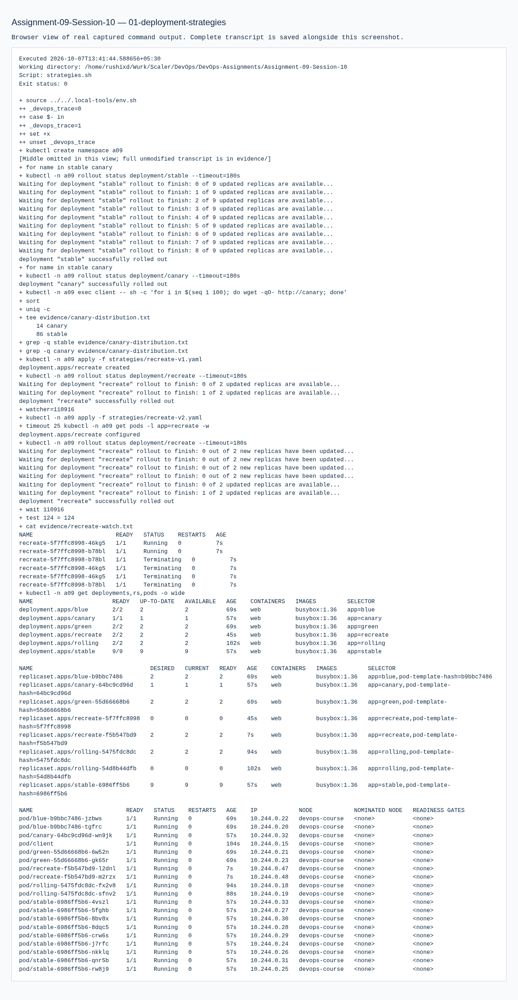
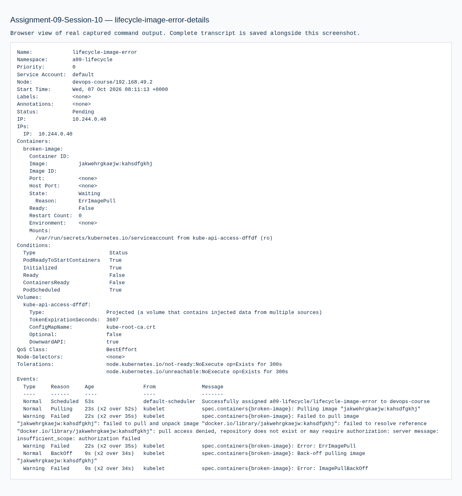
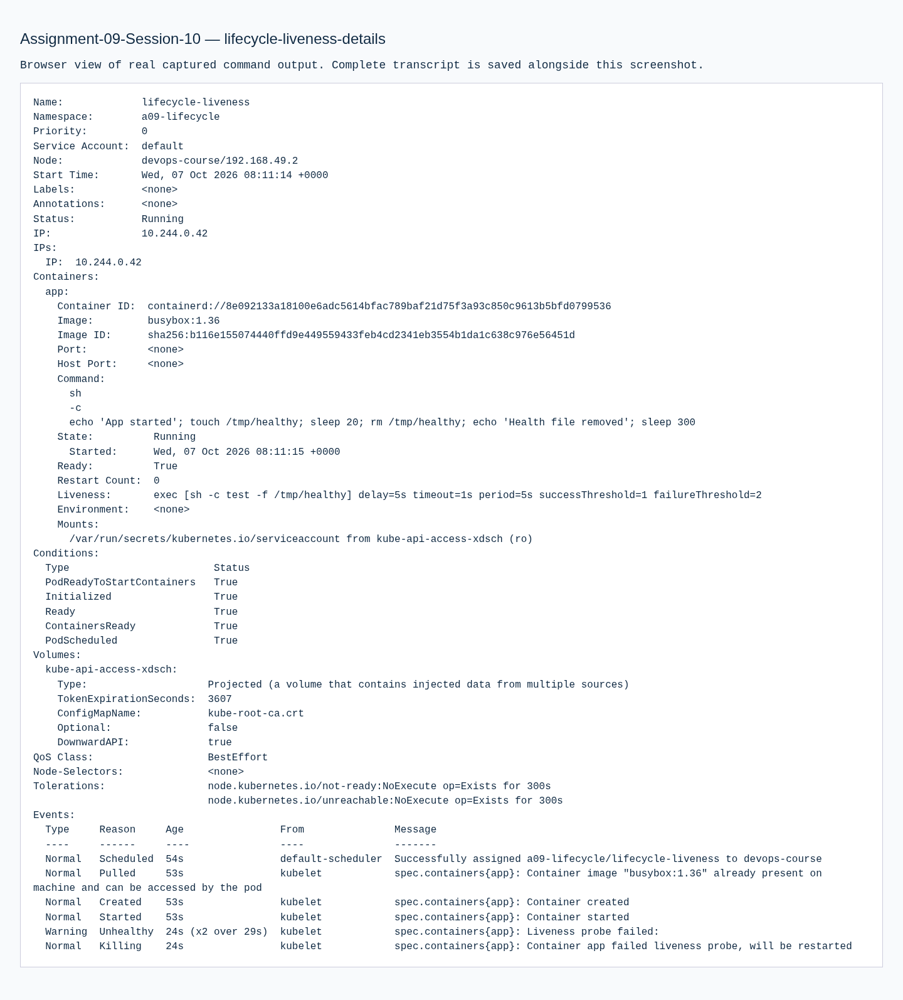
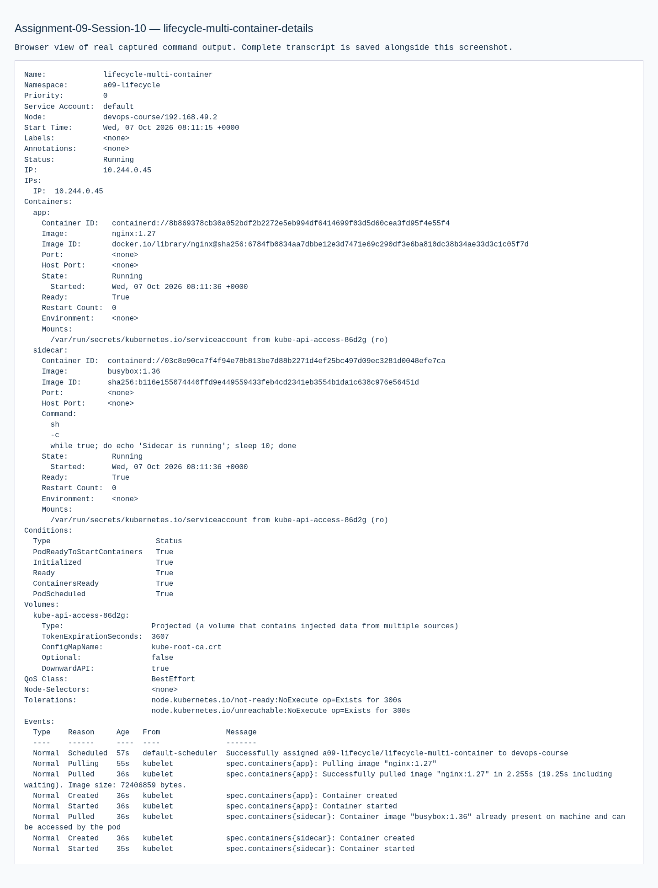
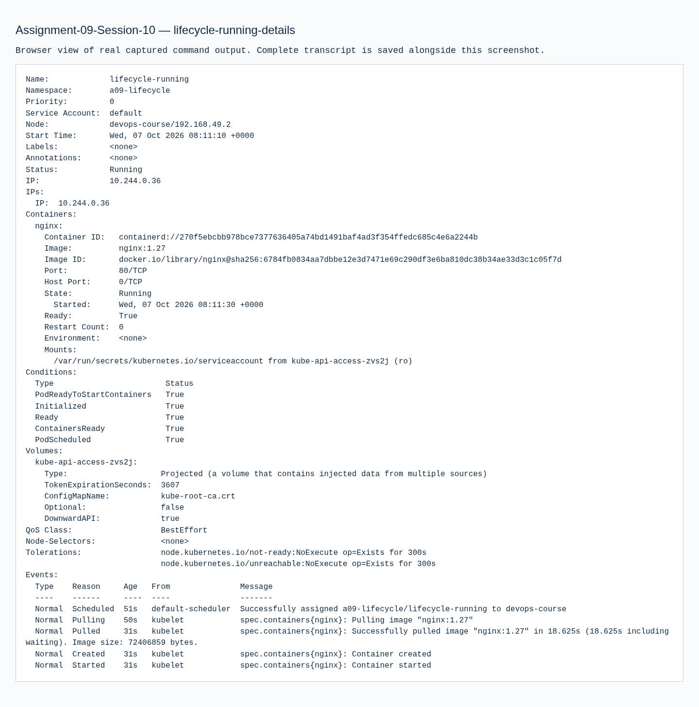
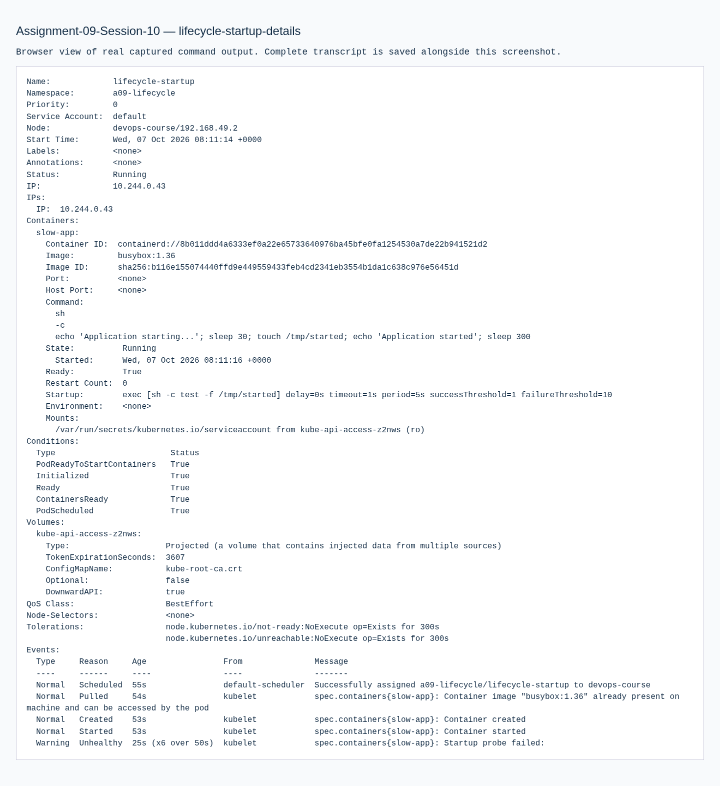
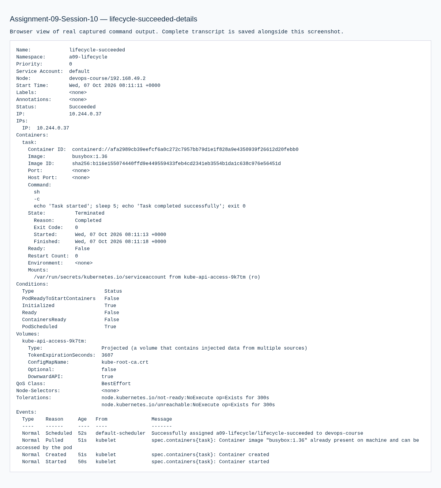
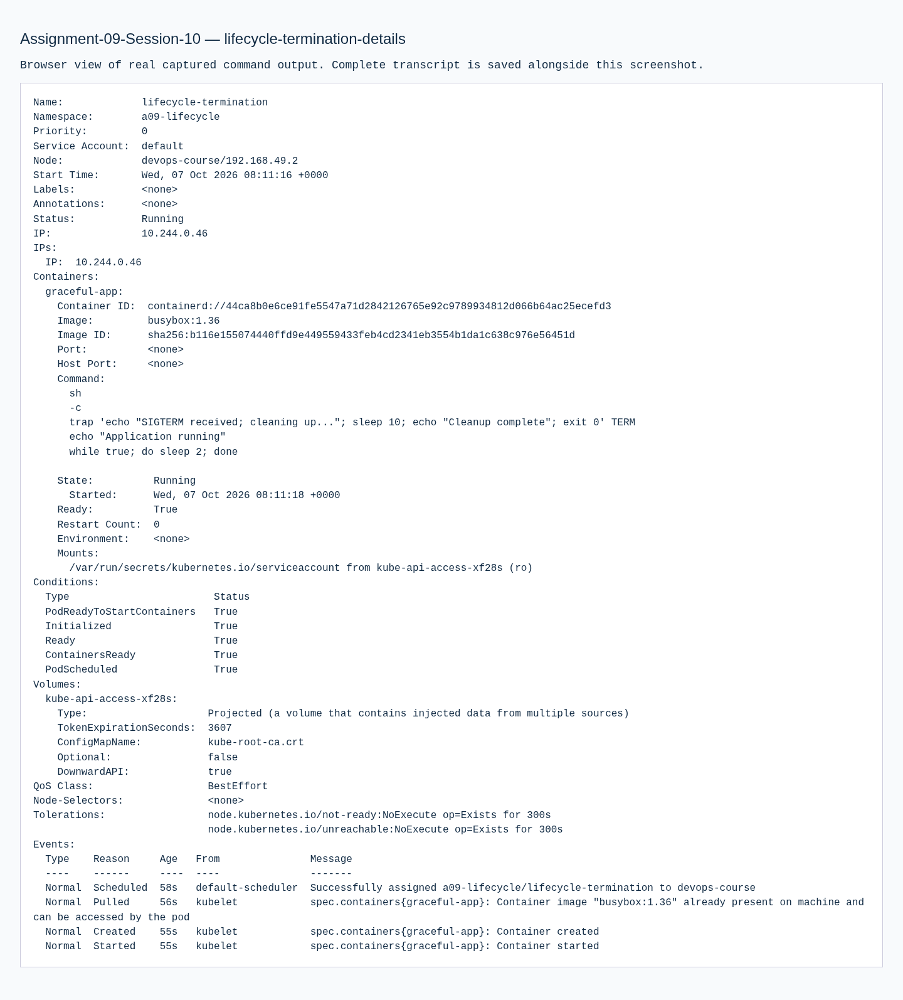

# Assignment 09 — Kubernetes Pods, ReplicaSets & Deployments

Sessions 10. [Exact PDF requirements](REQUIREMENTS.md).

## Objective

Run all four rollout strategies and every course Pod lifecycle manifest in the local Minikube cluster.

## Tasks Performed

Applied rolling, blue-green, canary and recreate deployments. Switched the blue-green Service selector and sampled 100 canary requests. Applied all 12 lifecycle examples and collected each Pod's status, description and logs, including successful/failed jobs, insufficient-memory Pending, invalid image, crash loop, readiness/liveness/startup probes, init/sidecar containers and graceful termination.

## Tools Used

Kubernetes 1.36.0, kubectl 1.37.1 and BusyBox/Nginx in the local Ubuntu VM.

## Implementation

`strategies/` contains versioned declarative manifests. `pod-lifecycle/` contains the complete PDF-linked course examples. Separate namespaces isolate intentional failures.

## Verification

The strategy transcript records ReplicaSets, watched transitions and HTTP responses. Per-Pod descriptions retain conditions, scheduling, probes and events. Phase assertions check Succeeded, Failed and Pending; graceful termination logs show SIGTERM cleanup.

## Output / Results

Rolling update keeps existing replicas available while replacing them. Blue-green changes the Service's entire selected population. Canary uses nine stable and one canary replicas; observed traffic counts are in `evidence/canary-distribution.txt`, not an assumed exact ratio. Recreate removes old replicas before starting replacements, producing a service availability gap.

## Troubleshooting / Observations

Pending requests 9Gi on a 4Gi node. Image error names a nonexistent image. CrashLoopBackOff comes from repeated exit 1. Liveness removes its own health file and is restarted. Startup's 30-second delay is tolerated. Readiness controls eligibility for Service traffic. Init must finish before the main container starts; both sidecar and app contribute to Ready. Completed and Error are display states for phase Succeeded and Failed. Graceful deletion allows the SIGTERM trap to finish before removal.

## Lessons Learned

Pod phase, container state and readiness report different aspects of health. A successful manifest apply does not prove a workload is ready.

## Commands Executed

The linked transcripts contain the exact executed scripts, stdout/stderr and exit status.

- [01-deployment-strategies.md](evidence/01-deployment-strategies.md)
- [02-all-pod-lifecycle-cases.md](evidence/02-all-pod-lifecycle-cases.md)

## Screenshots

Command screenshots are browser views of real captured output, labeled as such; application screenshots show actual accessed pages.

