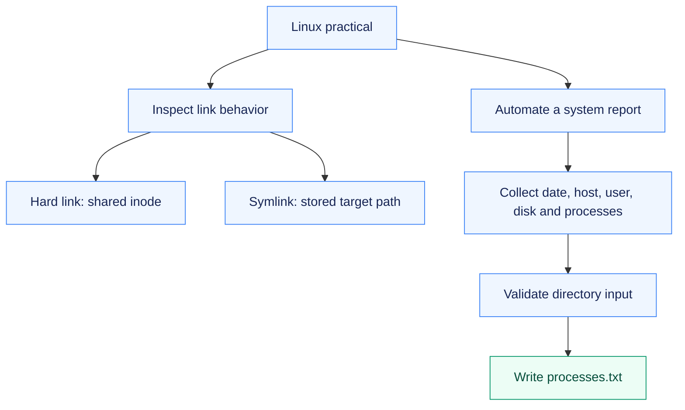
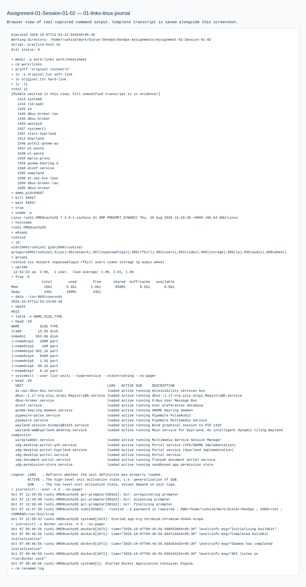

# Assignment 01 — Linux & Shell Automation

Linux inspection commands and a shell report, verified through link behavior, account/log exercises and actual file output.

[Portfolio](../README.md) · [Requirements](REQUIREMENTS.md) · [Execution evidence](evidence/)

## The problem

Routine system checks need repeatable output, while Linux links, account creation and service logs require hands-on inspection to understand their behavior.

## Approach

1. Compared hard links and symbolic links before and after deleting the original path.
2. Practised account and journal commands in Ubuntu, then cleaned up the temporary account.
3. Automated date, host, user, disk and process inspection, with a validated report-directory prompt and redirected process output.

## How it works



## Implementation

| Component | Implementation | Behavior verified |
| --- | --- | --- |
| Soft and hard links | [practice-host.sh](practice-host.sh) | Create/delete links, compare inodes and observe a dangling symlink. |
| Ubuntu user management and logs | [practice-ubuntu.sh](practice-ubuntu.sh) | Create a locked test user with adduser; inspect system and Docker service journal entries; clean up the test account. |
| Linux command practice | [work/](work/) | Filesystem, search, permissions, processes and log commands are captured in the execution record. |
| System-information script | [system-information.sh](system-information.sh) | Date, hostname, username, disk/process data, variables, read -p, mkdir, touch and redirected process output. |

**Tools:** Bash, GNU coreutils, procps, Ubuntu account tools and systemd journal.

### Command comparisons

| Comparison | What the exercise establishes |
| --- | --- |
| Hard link / symbolic link | A hard link shares the inode; a symbolic link stores a target path and can become dangling. |
| adduser / useradd | Ubuntu adduser provides higher-level account setup; useradd is the lower-level account tool. The exercise created a locked temporary account with adduser and inspected useradd help. |
| Journal / process report | journalctl reads service/system events; redirected ps output captures a process snapshot in a file. |

## Commands used

These are representative recorded commands. Complete scripts and output are linked in the evidence section.

```bash
ln -s original.txt soft-link
ln original.txt hard-link
ls -li
journalctl -u docker -n 10 --no-pager
bash system-information.sh
```

## Verification & results

All three verification transcripts completed successfully. The script produced a process-report file; the link and user-management exercises were executed rather than described only.

The linked records preserve the original command output and exercise history.

## Troubleshooting & decisions

A hard link shares an inode; a symbolic link stores a path and can become dangling. Ubuntu adduser supplies higher-level account setup. journalctl queries the systemd journal.

## Evidence

- [01 links linux journal](evidence/01-links-linux-journal.md) — successful execution
- [02 system information](evidence/02-system-information.md) — successful execution
- [03 ubuntu user and commands](evidence/03-ubuntu-user-and-commands.md) — successful execution

## Screenshots

Actual application pages and recorded command-output views from the practical execution.



<details>
<summary>More screenshots: implementation, diagnostics and verification</summary>


</details>

## Key takeaways

Link behavior depends on whether a directory entry references an inode or another path. Shell variables, input validation and redirection turn individual inspection commands into a repeatable report.
