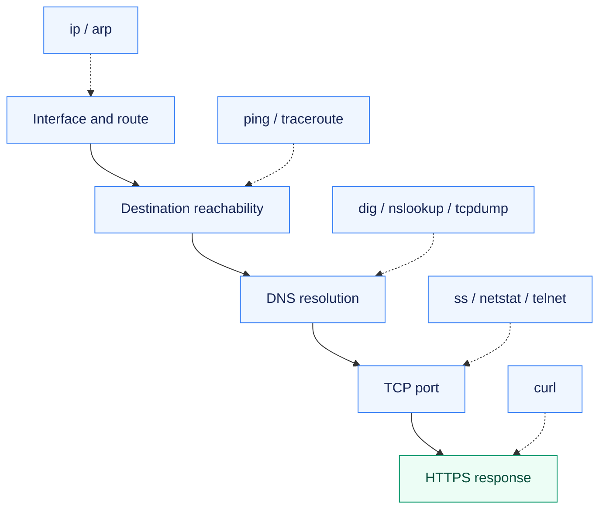
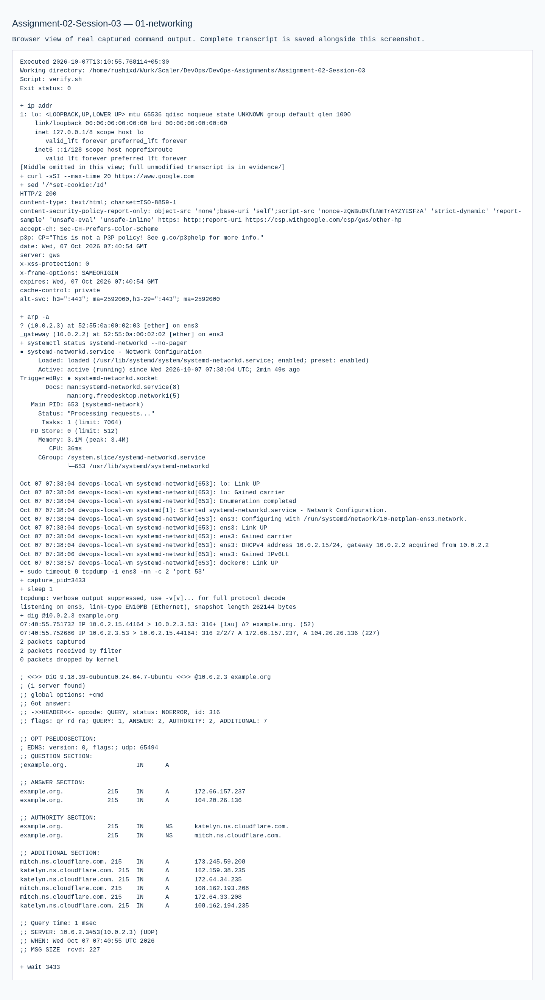

# Assignment 02 — Networking & Connectivity Diagnosis

A layered investigation of interfaces, routing, DNS, TCP and HTTP, backed by real command output and packet capture.

[Portfolio](../README.md) · [Requirements](REQUIREMENTS.md) · [Execution evidence](evidence/)

## The problem

A failed request can come from addressing, routing, name resolution, a closed port or the application itself. One successful network command cannot establish that the whole path works.

## Approach

1. Inspected interfaces, routes, neighbors and listening sockets before testing external connectivity.
2. Checked ICMP, DNS, TCP and HTTPS independently, keeping timeouts and traceroute hops bounded.
3. Generated a DNS lookup while capturing packets, then connected the output to the command explanations.

## How it works



## Implementation

| Component | Implementation | Behavior verified |
| --- | --- | --- |
| Referenced networking commands | [practice-networking.sh](practice-networking.sh) | Ten command families plus socket/interface inspection and a bounded DNS packet capture. |
| Outputs and understanding | [networking.md](networking.md) | Actual command output and short explanations, including the limits of ICMP, DNS, TCP and HTTP observations. |

**Tools:** iproute2, ping, traceroute, net-tools, telnet, nslookup, dig, curl and tcpdump.

## Commands used

These are representative recorded commands. Complete scripts and output are linked in the evidence section.

```bash
ip addr
ip route
ss -tuln
ping -c 3 127.0.0.1
traceroute -m 6 -w 1 google.com
nslookup google.com
dig google.com
curl -sSI --max-time 20 https://www.google.com
```

## Verification & results

Loopback/external ping, DNS resolution, HTTPS HTTP 200 and generated DNS packet capture are recorded. Traceroute was deliberately bounded to six hops; it is not presented as reaching the remote destination.

The linked records identify the original local execution environment. Privileged Docker/Minikube exercises used the prepared Ubuntu VM; application endpoints shown in that evidence are historical.

## Troubleshooting & decisions

A working DNS lookup, reachable TCP port and successful HTTP response prove different parts of the network path. The VM used systemd-networkd for its service-log example.

## Evidence

- [01 networking](evidence/01-networking.md) — successful execution

## Screenshots

Actual application pages and recorded command-output views from the practical execution.



## Key takeaways

Read each result at the layer it tests. A bounded traceroute is diagnostic output, while an HTTP 200 demonstrates an actual application response.
