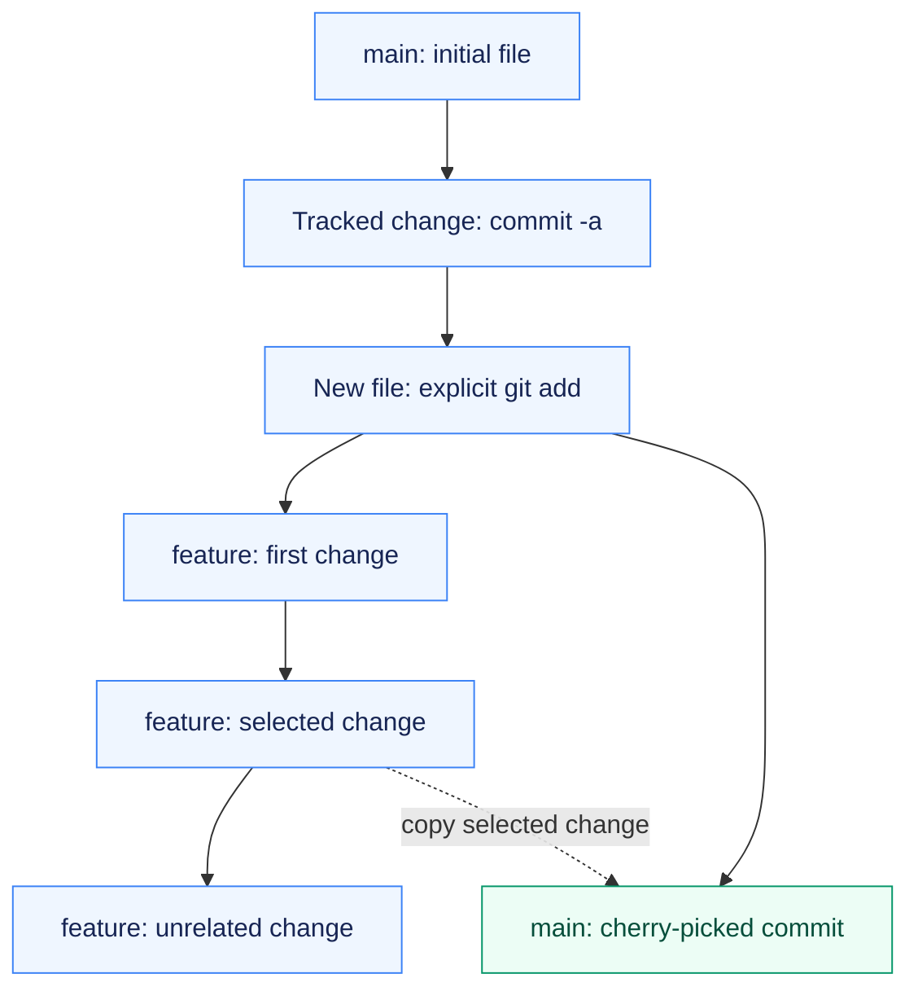

# Assignment 03 — Git Branching & Selective Integration

An isolated Git exercise showing what gets committed, how branches diverge and how one change reaches main.

[Portfolio](../README.md) · [Requirements](REQUIREMENTS.md) · [Execution evidence](evidence/)

## The problem

A commit message does not stage changes, and a feature branch may contain changes that should not all land on main. The exercise separates staging behavior from selective integration.

## Approach

1. Built a three-commit main history and compared explicitly staged commits with automatic staging of tracked changes.
2. Created three feature commits and selected one for cherry-picking back to main.
3. Verified that only the selected feature file arrived and preserved the complete history in a portable Git bundle.

## How it works



## Implementation

| Component | Implementation | Behavior verified |
| --- | --- | --- |
| commit -m versus commit -a -m | [practice-git.sh](practice-git.sh) | Observe an unstaged commit failure; verify -a includes tracked changes while leaving a new file untracked. |
| Main and feature history | [exercise-history.bundle](exercise-history.bundle) | Three initial main commits, three feature commits and one selected cherry-pick into main. |
| Verify the selected change | [evidence/01-git-history.md](evidence/01-git-history.md) | Selected feature file is present on main; unrelated feature files are absent. |

**Tools:** Git, an isolated local repository and a verified history bundle.

## Commands used

These commands were executed in the isolated exercise repository. Its complete history is preserved in [exercise-history.bundle](exercise-history.bundle); [history notes](../LOCAL_GIT_HISTORY.md) explain its archived metadata.

```bash
git log --graph --oneline --all
git commit -a -m 'main 2: tracked modification auto-staged'
git cherry-pick b4c5394
```

## Verification & results

The selected change was copied into main and the portable Git bundle verified successfully. The selected source commit and its new main-branch commit are retained in the transcript and verified history bundle.

The linked records preserve the original command output and exercise history.

## Troubleshooting & decisions

Commit messages do not stage files. -a stages tracked modifications/deletions, while cherry-pick applies a particular commit and creates a new commit on the destination branch.

## Evidence

- [01 git history](evidence/01-git-history.md) — successful execution

## Screenshots

Actual application pages and recorded command-output views from the practical execution.


## Key takeaways

Use explicit staging to control new files; `commit -a` covers tracked modifications and deletions. Cherry-pick creates a new destination commit without merging the rest of the feature branch.
