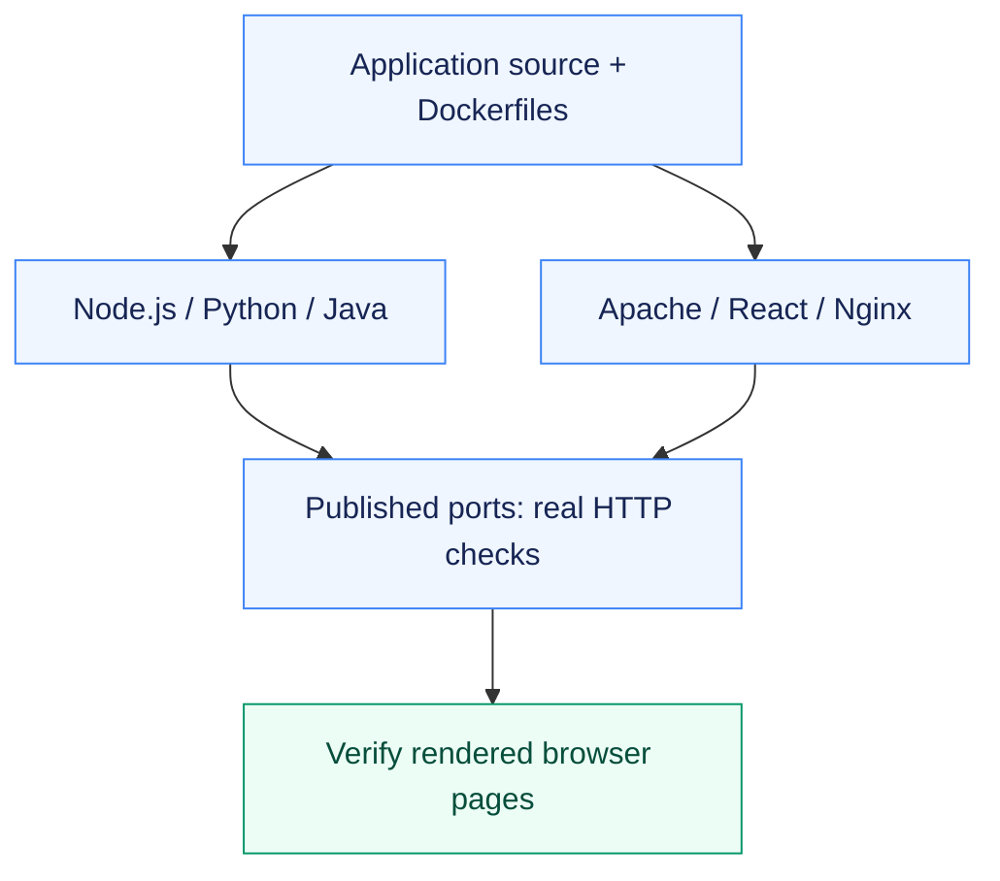

# Assignment 04 — Six Containerized Hello World Applications

Six working web applications packaged, started and verified with Docker.

[Portfolio](../README.md) · [Requirements](REQUIREMENTS.md) · [Execution evidence](evidence/)

## The problem

Applications built with different runtimes need their own packaging and startup configuration. A successful Docker build must also produce a reachable application.

## Approach

1. Created the six required application directories, each with its own source and Dockerfile.
2. Built and ran Node.js, Python, Java, Apache, React and Nginx examples.
3. Checked published HTTP responses and real browser pages, then removed the assignment containers after capture.

## How it works



## Implementation

| Component | Implementation | Behavior verified |
| --- | --- | --- |
| Node.js | [nodejs-app/Dockerfile](nodejs-app/Dockerfile) | Build the image and verify its HTTP page. |
| Python | [python-app/Dockerfile](python-app/Dockerfile) | Build the image and verify its HTTP page. |
| Java | [java-app/Dockerfile](java-app/Dockerfile) | Compile/package in Docker and serve Hello World. |
| Apache | [Apache-app/Dockerfile](Apache-app/Dockerfile) | Serve the actual page from Apache. |
| React | [React-app/Dockerfile](React-app/Dockerfile) | Build the frontend and verify rendered Hello World in a browser. |
| Nginx | [nginx-app/Dockerfile](nginx-app/Dockerfile) | Serve and verify the page with Nginx. |

**Tools:** Docker, Node.js, Python, Java, Apache HTTP Server, React and Nginx.

## Commands used

These are representative recorded commands. Complete scripts and output are linked in the evidence section.

```bash
docker build -t devops-a04-nodejs-app:local nodejs-app
# The complete six-application build/run sequence is in build-run.sh.
```

## Verification & results

All six images built and all six applications were checked through real HTTP/browser access. Seven screenshots include the command evidence and actual pages. Assignment-owned containers were removed after capture.

The linked records identify the original local execution environment. Privileged Docker/Minikube exercises used the prepared Ubuntu VM; application endpoints shown in that evidence are historical.

## Troubleshooting & decisions

A successful image build does not prove a web application works: verify the process, published port, HTTP response and rendered page.

## Evidence

- [01 build and run](evidence/01-build-and-run.md) — successful execution

## Screenshots

Actual application pages and recorded command-output views from the practical execution.


<details>
<summary>More screenshots: implementation, diagnostics and verification</summary>


</details>

## Key takeaways

Image creation, process startup, port publication and browser behavior are separate checks. Testing all four catches packaging errors that a build alone misses.
