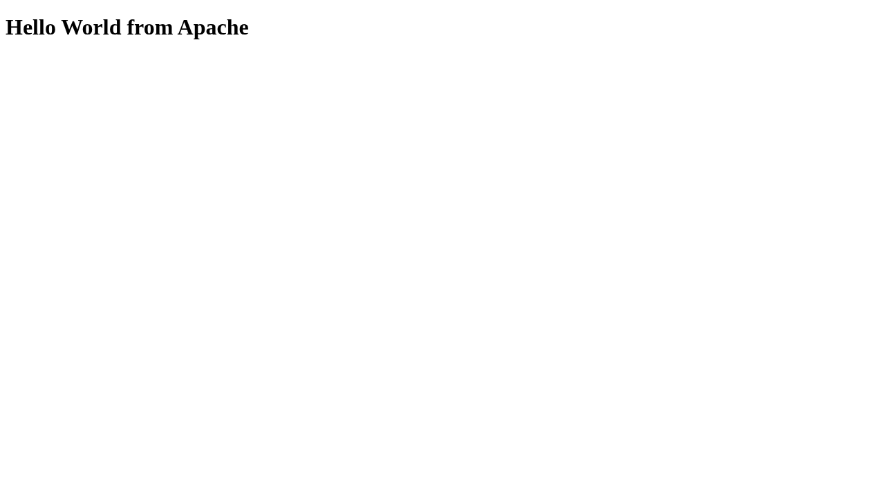
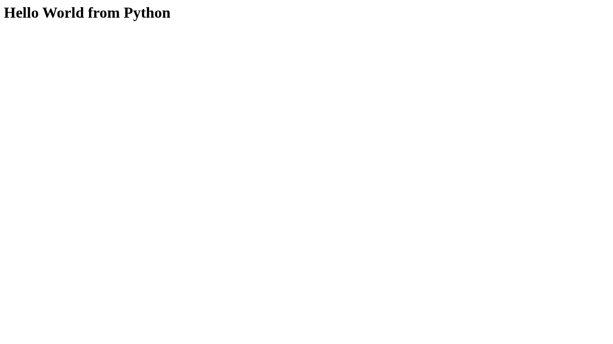

# 04 · Docker Hello World Applications

**Session 05** · **Local practical work verified**

[Portfolio](../README.md) · [Exact requirements](REQUIREMENTS.md) · [Submission readiness](../SUBMISSION_READINESS.md)

> Build and run six independent Hello World web applications, each with the exact application directory requested by the PDF.

| Assignment record | Details |
| --- | --- |
| PDF source | DevOps Homework.pdf · pages 5, 6 |
| Student | Rushi Jadhav · 10144 |
| Evidence | Successful transcripts: 1 · actual screenshots: 7 |
| Execution environment | Original local host / Ubuntu VM as identified in the transcripts |
| Review | 21 October 2026; historical output is retained unchanged |

## Requirement coverage

| PDF requirement | Implementation / document | Demonstrated behavior |
| --- | --- | --- |
| Node.js | [nodejs-app/Dockerfile](nodejs-app/Dockerfile) | Build the image and verify its HTTP page. |
| Python | [python-app/Dockerfile](python-app/Dockerfile) | Build the image and verify its HTTP page. |
| Java | [java-app/Dockerfile](java-app/Dockerfile) | Compile/package in Docker and serve Hello World. |
| Apache | [Apache-app/Dockerfile](Apache-app/Dockerfile) | Serve the actual page from Apache. |
| React | [React-app/Dockerfile](React-app/Dockerfile) | Build the frontend and verify rendered Hello World in a browser. |
| Nginx | [nginx-app/Dockerfile](nginx-app/Dockerfile) | Serve and verify the page with Nginx. |

## Commands and verification

Key commands are shown below. The evidence records contain the complete executed scripts, exact resource names, output and exit status.

```bash
docker build -t devops-a04-nodejs-app:local nodejs-app
# The complete six-application build/run sequence is in build-run.sh.
```

[Reproduction and tooling](../REPRODUCING.md) explains the original VM adapters, native-tool use and portable Git bundles. Full executed scripts and stdout/stderr are linked below.

## Observed result

All six images built and all six applications were checked through real HTTP/browser access. Seven screenshots include the command evidence and actual pages. Assignment-owned containers were removed after capture.

## Troubleshooting and observations

A successful image build does not prove a web application works: verify the process, published port, HTTP response and rendered page.

## Submission status

**COMPLETE.** The required practical work is documented and verified by the retained evidence. Publish the revised files and supply the final repository URL to submit.

## Execution evidence

- [01 build and run](evidence/01-build-and-run.md) — successful execution

## Screenshots

Actual application pages and explicitly labelled views of captured command output. Full text records preserve output omitted from an image.

<details>
<summary>Open the screenshot gallery (7 images)</summary>







</details>
