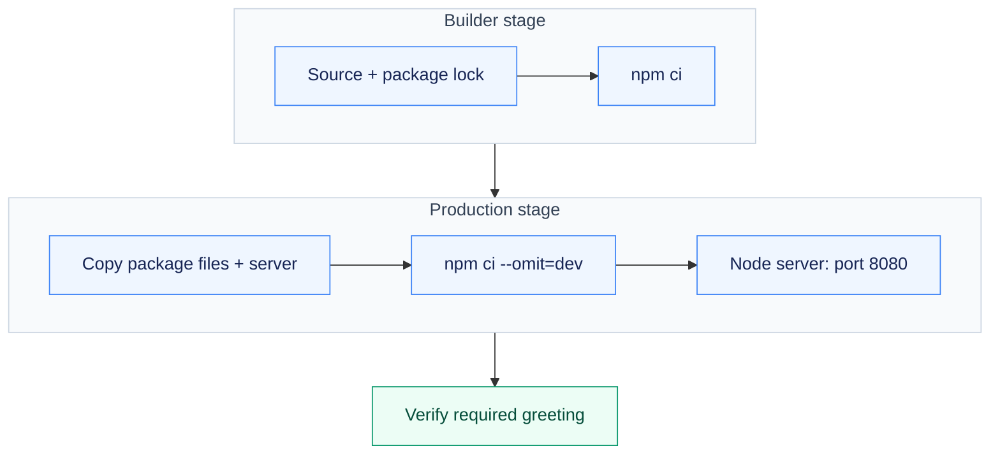

# Assignment 05 — Docker Multi-Stage Build

A Node.js multi-stage image serving the required greeting on port 8080, with additional runtime examples.

[Portfolio](../README.md) · [Requirements](REQUIREMENTS.md) · [Execution evidence](evidence/)

## The problem

Build dependencies and runtime dependencies have different purposes. The container must serve the required greeting on port 8080 while keeping the production stage focused on execution.

## Approach

1. Installed dependencies in a named Node.js builder stage.
2. Created a production stage with production-only dependencies and copied the server from the builder.
3. Built and ran the multi-stage application, verified the exact greeting on port 8080, and repeated container execution for Node.js, Python and Java examples.

## How it works



## Implementation

| Component | Implementation | Behavior verified |
| --- | --- | --- |
| Multi-stage build | [multi-stage-app/Dockerfile](multi-stage-app/Dockerfile) | Build and run the image; confirm Hello World from Docker multi-stage build. |
| Port and container evidence | [evidence/01-build-and-run.md](evidence/01-build-and-run.md) | HTTP verification and docker ps show the application on published port 8080. |
| Three application types | [Node.js](nodejs-app/), [Python](python-app/) and [Java](java-app/) | Node.js, Python and Java images were built and run. |

**Tools:** Docker multi-stage builds, Node.js/npm, Python and Java.

## Commands used

These are representative recorded commands. Complete scripts and output are linked in the evidence section.

```bash
docker build -t devops-a05-multistage:local multi-stage-app
docker run -d --name devops-a05-multistage --label devops.assignment=05 \
  -p 8080:8080 devops-a05-multistage:local
curl -fsS http://127.0.0.1:8080
docker ps --filter label=devops.assignment=05
```

## Verification & results

The required literal greeting was returned on port 8080. The three additional application types also served their expected responses.

The linked records identify the original local execution environment. Privileged Docker/Minikube exercises used the prepared Ubuntu VM; application endpoints shown in that evidence are historical.

## Troubleshooting & decisions

A multi-stage Dockerfile separates build tooling from the runtime. Verify the actual exposed service and port rather than inferring success from the image alone.

## Evidence

- [01 build and run](evidence/01-build-and-run.md) — successful execution

## Screenshots

Actual application pages and recorded command-output views from the practical execution.


<details>
<summary>More screenshots: implementation, diagnostics and verification</summary>


</details>

## Key takeaways

A stage boundary makes the build/runtime separation explicit. This Dockerfile still uses a Node.js runtime image; no unmeasured image-size reduction is claimed.
