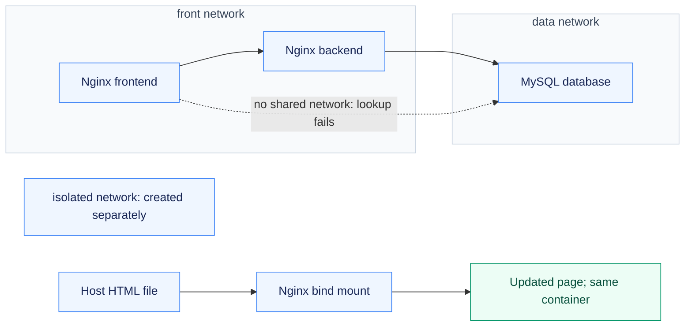
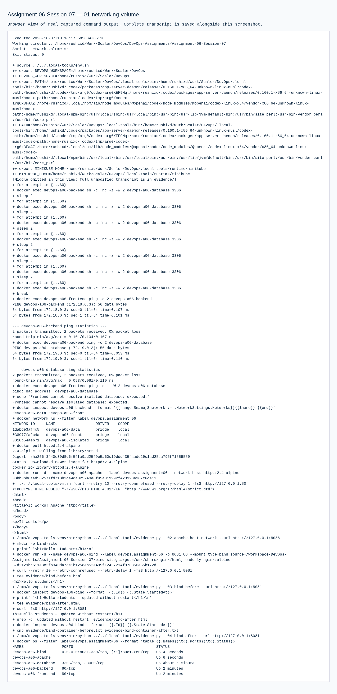

# Assignment 06 — Docker Network Isolation & Bind Mounts

Container connectivity, database isolation and live file updates tested through real network and mount behavior.

[Portfolio](../README.md) · [Requirements](REQUIREMENTS.md) · [Execution evidence](evidence/)

## The problem

Containers should reach the services they need without giving every component direct database access. Separately, a bind-mounted page should reflect file changes without replacing the container.

## Approach

1. Created front, data and isolated networks, connecting the backend to both front and data.
2. Verified frontend-to-backend and backend-to-database connectivity, then checked that the frontend could not resolve the database.
3. Ran the Apache host-network example in Ubuntu and edited the Nginx bind-mounted page while checking unchanged container identity and start time.

## How it works



## Implementation

| Component | Implementation | Behavior verified |
| --- | --- | --- |
| Three containers / three networks | [network-volume.sh](network-volume.sh) | Nginx frontend/backend and MySQL; backend connected to two networks; connectivity and isolation verified. |
| Apache host network | [evidence/01-networking-volume.md](evidence/01-networking-volume.md) | Apache served directly on port 80 of the Ubuntu VM; the host browser used the VM forward. |
| Bind mount | [bind-site/index.html](bind-site/index.html) | Hello students page changed without a container restart; container ID and start time stayed the same. |
| Overlay research | [overlay-networks.md](overlay-networks.md) | Cross-host overlay purpose, transport and use cases documented. |

**Tools:** Docker networks, Nginx, MySQL, Apache HTTP Server and bind mounts.

## Commands used

These are representative recorded commands. Complete scripts and output are linked in the evidence section.

```bash
docker network ls --filter label=devops.assignment=06
docker inspect devops-a06-backend
# network-volume.sh contains the actual creation and connectivity sequence.
```

## Verification & results

Backend-to-database connectivity succeeded while the frontend could not resolve the isolated database. Actual before/after bind-mount responses and unchanged container identity were retained.

The linked records identify the original local execution environment. Privileged Docker/Minikube exercises used the prepared Ubuntu VM; application endpoints shown in that evidence are historical.

## Troubleshooting & decisions

Network membership controls discovery/reachability. The host-network result is explicitly a VM result; overlay behavior is research, as requested by the PDF.

## Evidence

- [01 networking volume](evidence/01-networking-volume.md) — successful execution

## Screenshots

Actual application pages and recorded command-output views from the practical execution.



<details>
<summary>More screenshots: implementation, diagnostics and verification</summary>


</details>

## Key takeaways

Network membership controls service discovery and reachability. Bind mounts expose host-file changes directly, whereas the host-network example shares the Ubuntu VM network namespace.
