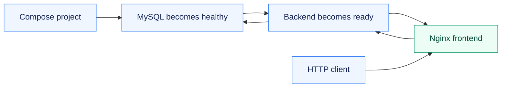

# Assignment 07 — Docker Compose & Service Readiness

Three Compose examples, including a database-backed application and a verified startup-order repair.

[Portfolio](../README.md) · [Requirements](REQUIREMENTS.md) · [Execution evidence](evidence/)

## The problem

A multi-container application needs consistent configuration and correct startup ordering. A running backend container may still be unready when Nginx starts routing traffic.

## Approach

1. Validated and ran the basic, compose-app and full-stack course examples as separate Compose projects.
2. Verified frontend/API responses, database discovery and a real MySQL create/insert/select sequence.
3. Diagnosed the startup race, added readiness ordering and reran the failing example successfully.

## How it works



## Implementation

| Component | Implementation | Behavior verified |
| --- | --- | --- |
| Basic Compose example | [basic/](basic/) | Build/start, HTTP verification and cleanup. |
| Application Compose example | [compose-app/](compose-app/) | Run and inspect the required services. |
| Full-stack exercise | [demo/](demo/) | Frontend/backend/MySQL verification including real database creation, insertion and selection. |
| Startup troubleshooting | [fix-startup.sh](fix-startup.sh) | Capture the Nginx/backend startup race and fix readiness ordering. |

**Tools:** Docker Compose, Nginx, Python backend, MySQL and health checks.

## Commands used

The verification script iterates over the three examples. `$project`, `$compose_file` and `$runtime_env` are the actual script variables for the selected project, manifest and private runtime values.

```bash
docker compose --env-file "$runtime_env" -p "$project" -f "$compose_file" config -q
docker compose --env-file "$runtime_env" -p "$project" -f "$compose_file" up -d --build
docker compose --env-file "$runtime_env" -p "$project" -f "$compose_file" ps
```

## Verification & results

All three examples were exercised. The initial backend startup race and successful health/dependency correction are preserved as actual troubleshooting evidence.

The linked records identify the original local execution environment. Privileged Docker/Minikube exercises used the prepared Ubuntu VM; application endpoints shown in that evidence are historical.

## Troubleshooting & decisions

A container starting is different from its application being ready. Health checks and dependency conditions address startup ordering.

## Evidence

- [01 compose exercises](evidence/01-compose-exercises.md) — successful execution
- [03 startup diagnosis and fix](evidence/03-startup-diagnosis-and-fix.md) — successful execution

## Screenshots

Actual application pages and recorded command-output views from the practical execution.


<details>
<summary>More screenshots: implementation, diagnostics and verification</summary>


</details>

## Key takeaways

Startup ordering needs application readiness, not just process existence. Compose project names keep example resources separate during validation and cleanup.
