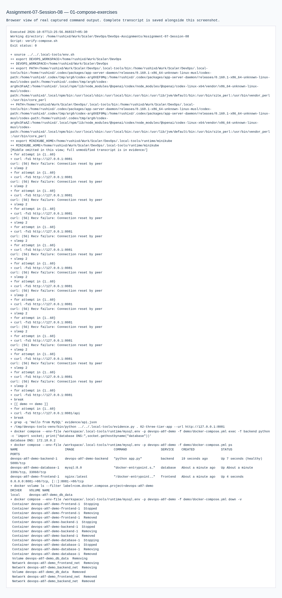

# 07 · Docker Networking & Volume: remaining session exercises

**Session 08** · **Local practical work verified**

[Portfolio](../README.md) · [Exact requirements](REQUIREMENTS.md) · [Submission readiness](../SUBMISSION_READINESS.md)

> Complete the remaining Docker networking/volume exercises using the three Compose examples in the instructor’s referenced Session 8 resources.

| Assignment record | Details |
| --- | --- |
| PDF source | DevOps Homework.pdf · pages 10 |
| Student | Rushi Jadhav · 10144 |
| Evidence | Successful transcripts: 2 · actual screenshots: 3 |
| Execution environment | Original local host / Ubuntu VM as identified in the transcripts |
| Review | 21 October 2026; historical output is retained unchanged |

## Requirement coverage

| PDF requirement | Implementation / document | Demonstrated behavior |
| --- | --- | --- |
| Basic Compose example | [basic/](basic/) | Build/start, HTTP verification and cleanup. |
| Application Compose example | [compose-app/](compose-app/) | Run and inspect the required services. |
| Full-stack exercise | [demo/](demo/) | Frontend/backend/MySQL verification including real database creation, insertion and selection. |
| Startup troubleshooting | [fix-startup.sh](fix-startup.sh) | Capture the Nginx/backend startup race and fix readiness ordering. |

## Commands and verification

Key commands are shown below. The evidence records contain the complete executed scripts, exact resource names, output and exit status.

```bash
docker compose config --quiet
docker compose up --build -d
docker compose ps
```

[Reproduction and tooling](../REPRODUCING.md) explains the original VM adapters, native-tool use and portable Git bundles. Full executed scripts and stdout/stderr are linked below.

## Observed result

All three examples were exercised. The initial backend startup race and successful health/dependency correction are preserved as actual troubleshooting evidence.

## Troubleshooting and observations

A container starting is different from its application being ready. Health checks and dependency conditions address startup ordering.

## Submission status

**COMPLETE.** The required practical work is documented and verified by the retained evidence. Publish the revised files and supply the final repository URL to submit.

**Mapping note:** PDF page 10 requests the remaining networking/volume session exercises; the referenced course repository supplies the Session 8 Compose examples. The PDF prints no separate Session 8 title.

## Execution evidence

- [01 compose exercises](evidence/01-compose-exercises.md) — successful execution
- [03 startup diagnosis and fix](evidence/03-startup-diagnosis-and-fix.md) — successful execution

## Screenshots

Actual application pages and explicitly labelled views of captured command output. Full text records preserve output omitted from an image.

<details>
<summary>Open the screenshot gallery (3 images)</summary>




</details>
