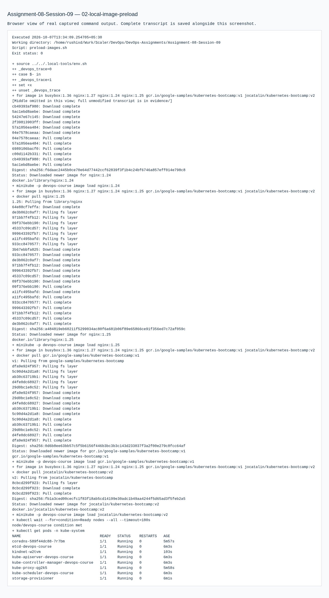
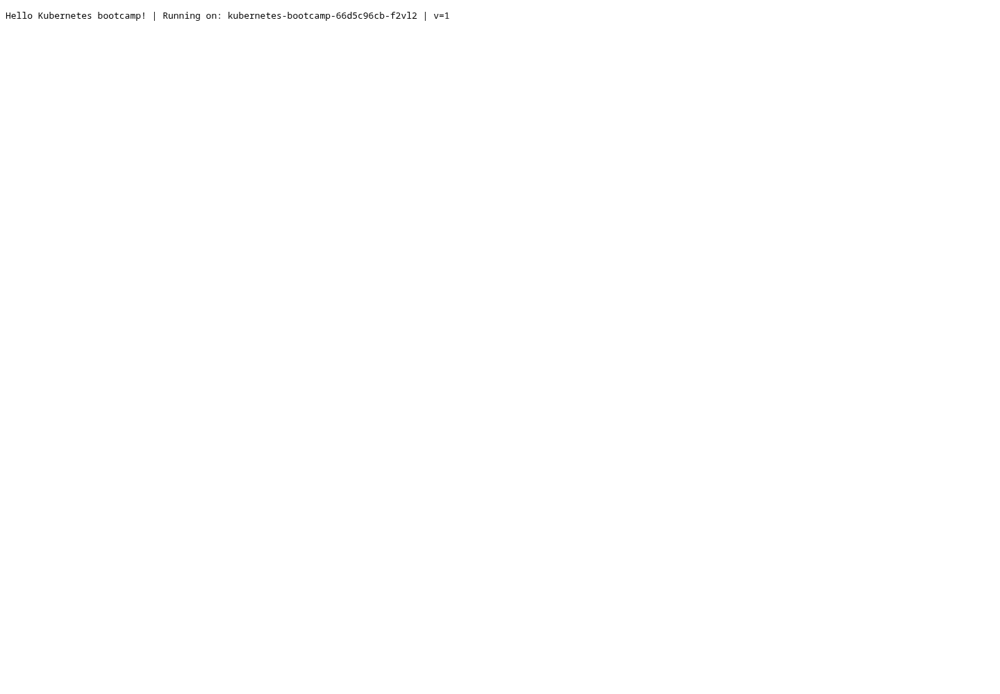
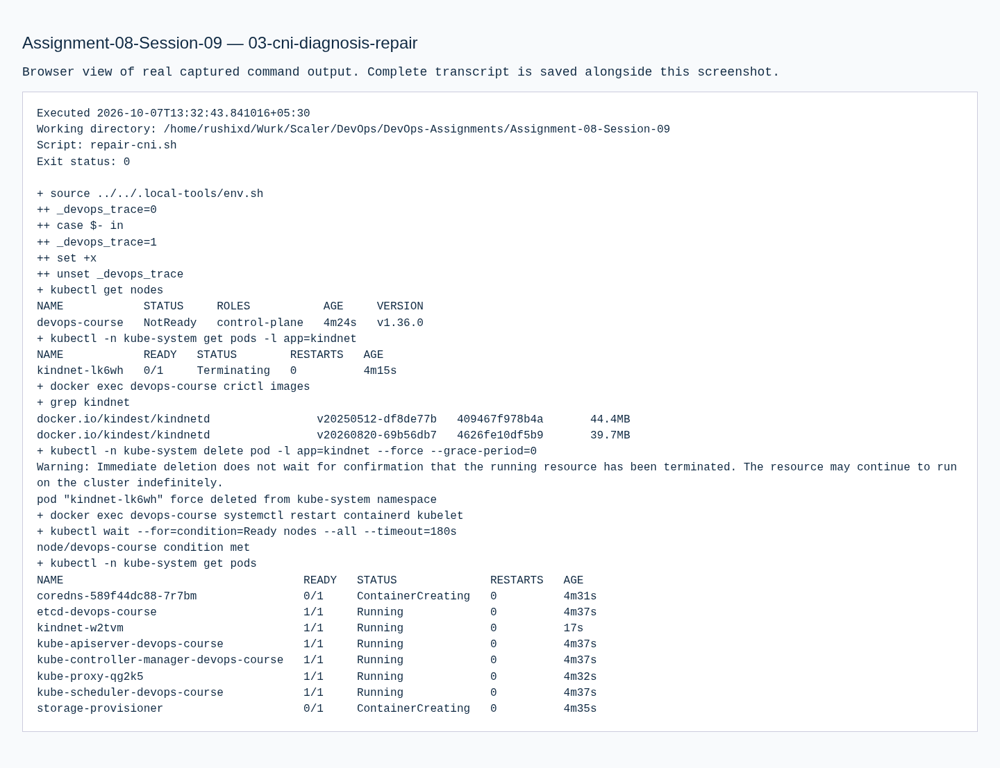
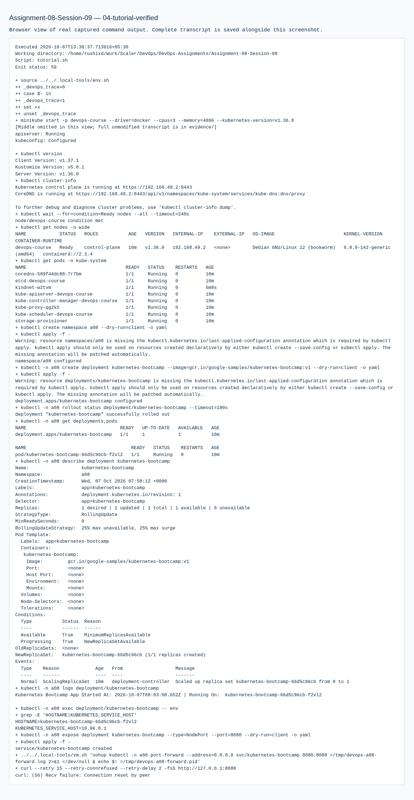
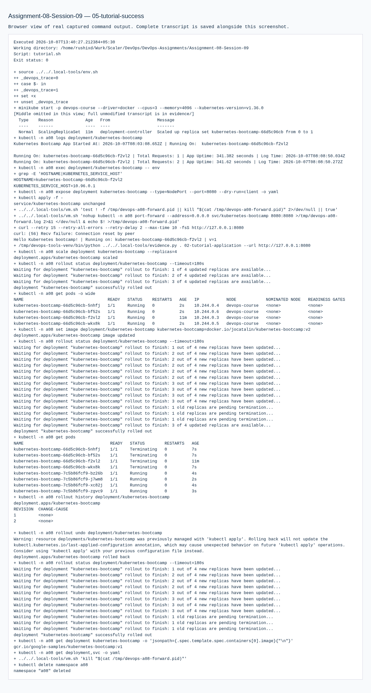

# 08 · Kubernetes Fundamentals

**Session 09** · **Local practical work verified**

[Portfolio](../README.md) · [Exact requirements](REQUIREMENTS.md) · [Submission readiness](../SUBMISSION_READINESS.md)

> Install/configure Minikube and complete the Kubernetes Basics tutorial with architecture notes and observable application behavior.

| Assignment record | Details |
| --- | --- |
| PDF source | DevOps Homework.pdf · pages 11, 12 |
| Student | Rushi Jadhav · 10144 |
| Evidence | Successful transcripts: 4 · actual screenshots: 7 |
| Execution environment | Original local host / Ubuntu VM as identified in the transcripts |
| Review | 21 October 2026; historical output is retained unchanged |

## Requirement coverage

| PDF requirement | Implementation / document | Demonstrated behavior |
| --- | --- | --- |
| Cluster installation and status | [tutorial.sh](tutorial.sh) | Local Minikube profile, node/control-plane inspection and basic Kubernetes objects. |
| Deploy, expose, scale, update and undo | [evidence/05-tutorial-success.md](evidence/05-tutorial-success.md) | Actual bootcamp application responses and Deployment transitions. |
| Explore/API/labels/replacement | [tutorial-api-and-failure.sh](tutorial-api-and-failure.sh) | kubectl proxy, Service proxy response, selectors and Pod replacement. |
| Failed update and repair | [evidence/06-tutorial-api-labels-failed-update.md](evidence/06-tutorial-api-labels-failed-update.md) | Invalid v10 image fails rollout; undo restores v1. |
| Environment troubleshooting | [repair-cni.sh](repair-cni.sh) | Preserved initial CNI problem and the real local repair. |

## Commands and verification

Key commands are shown below. The evidence records contain the complete executed scripts, exact resource names, output and exit status.

```bash
minikube status -p devops-course
kubectl get nodes
kubectl get pods -A
kubectl rollout undo deployment/kubernetes-bootcamp
```

[Reproduction and tooling](../REPRODUCING.md) explains the original VM adapters, native-tool use and portable Git bundles. Full executed scripts and stdout/stderr are linked below.

## Observed result

The local cluster became Ready and the tutorial application served real v1/v2 responses. The failed-update test demonstrated ErrImagePull and a verified rollback.

## Troubleshooting and observations

The API server accepts desired state, controllers reconcile it, the scheduler assigns nodes, and kubelet/container runtime execute Pods. CoreDNS and networking must work before application readiness can be trusted.

## Architecture notes

| Component | Responsibility in the local learning cluster |
| --- | --- |
| API server | Receives and validates resource requests |
| etcd | Persists cluster state |
| Scheduler | Selects a node for an unscheduled Pod |
| Controllers | Reconcile observed resources with desired state |
| Kubelet / container runtime | Start and supervise containers on the node |
| Service routing / CoreDNS | Stable service access and cluster-name resolution |

This single-node Minikube environment hosts control-plane components and application workloads together. A Deployment manages ReplicaSets/Pod replacement; its Service remains stable while Pod addresses change.

## Submission status

**COMPLETE.** The required practical work is documented and verified by the retained evidence. Publish the revised files and supply the final repository URL to submit.

## Execution evidence

- [01 cluster and tutorial](evidence/01-cluster-and-tutorial.md) — retained earlier attempt / diagnosis; use the successful retry for completion
- [02 local image preload](evidence/02-local-image-preload.md) — successful execution
- [03 cni diagnosis repair](evidence/03-cni-diagnosis-repair.md) — successful execution
- [04 tutorial verified](evidence/04-tutorial-verified.md) — retained earlier attempt / diagnosis; use the successful retry for completion
- [05 tutorial success](evidence/05-tutorial-success.md) — successful execution
- [06 tutorial api labels failed update](evidence/06-tutorial-api-labels-failed-update.md) — successful execution

## Screenshots

Actual application pages and explicitly labelled views of captured command output. Full text records preserve output omitted from an image.

<details>
<summary>Open the screenshot gallery (7 images)</summary>













</details>
