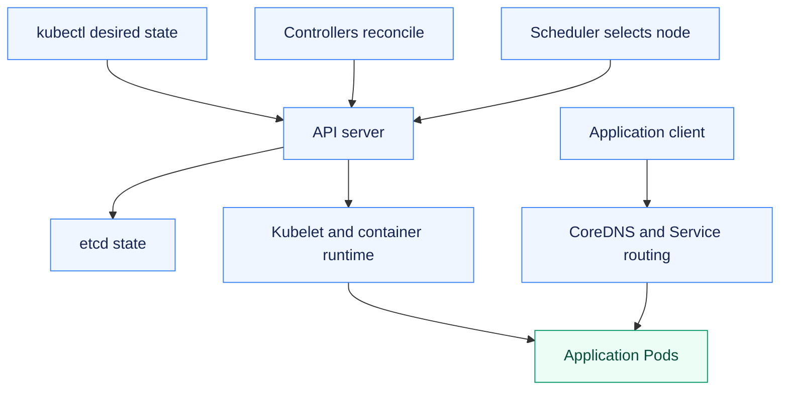

# Assignment 08 — Kubernetes Fundamentals on Minikube

A local learning cluster used to deploy, inspect, expose, scale, update and recover an application.

[Portfolio](../README.md) · [Requirements](REQUIREMENTS.md) · [Execution evidence](evidence/)

## The problem

Declaring a workload is only one part of operating Kubernetes. The cluster must schedule it, provide networking and discovery, recover failed Pods and safely handle application updates.

## Approach

1. Inspected the Minikube control plane and repaired the recorded local networking problem.
2. Completed deployment, exploration, exposure, scaling, update and rollback exercises with the bootcamp application.
3. Used labels and the API proxy, observed Pod replacement, and recovered from an intentionally invalid image update.

## How it works



## Implementation

| Component | Implementation | Behavior verified |
| --- | --- | --- |
| Cluster installation and status | [tutorial.sh](tutorial.sh) | Local Minikube profile, node/control-plane inspection and basic Kubernetes objects. |
| Deploy, expose, scale, update and undo | [evidence/05-tutorial-success.md](evidence/05-tutorial-success.md) | Actual bootcamp application responses and Deployment transitions. |
| Explore/API/labels/replacement | [tutorial-api-and-failure.sh](tutorial-api-and-failure.sh) | kubectl proxy, Service proxy response, selectors and Pod replacement. |
| Failed update and repair | [evidence/06-tutorial-api-labels-failed-update.md](evidence/06-tutorial-api-labels-failed-update.md) | Invalid v10 image fails rollout; undo restores v1. |
| Environment troubleshooting | [repair-cni.sh](repair-cni.sh) | Preserved initial CNI problem and the real local repair. |

**Tools:** Minikube, kubectl, Kubernetes Deployments/Services and the bootcamp application.

## Commands used

These are representative recorded commands. Complete scripts and output are linked in the evidence section.

```bash
minikube status -p devops-course
kubectl get nodes
kubectl get pods -A
kubectl rollout undo deployment/kubernetes-bootcamp
```

## Verification & results

The local cluster became Ready and the tutorial application served real v1/v2 responses. The failed-update test demonstrated ErrImagePull and a verified rollback.

The linked records identify the original local execution environment. Privileged Docker/Minikube exercises used the prepared Ubuntu VM; application endpoints shown in that evidence are historical.

## Architecture notes

| Component | Responsibility in the local learning cluster |
| --- | --- |
| API server | Receives and validates resource requests |
| etcd | Persists cluster state |
| Scheduler | Selects a node for an unscheduled Pod |
| Controllers | Reconcile observed resources with desired state |
| Kubelet / container runtime | Start and supervise containers on the node |
| Service routing / CoreDNS | Stable service access and cluster-name resolution |

This single-node Minikube environment hosts control-plane components and application workloads together. A Deployment manages ReplicaSets/Pod replacement; its Service remains stable while Pod addresses change.

## Troubleshooting & decisions

The API server accepts desired state, controllers reconcile it, the scheduler assigns nodes, and kubelet/container runtime execute Pods. CoreDNS and networking must work before application readiness can be trusted.

## Evidence

- [01 cluster and tutorial](evidence/01-cluster-and-tutorial.md) — retained earlier attempt / diagnosis; use the successful retry for completion
- [02 local image preload](evidence/02-local-image-preload.md) — successful execution
- [03 cni diagnosis repair](evidence/03-cni-diagnosis-repair.md) — successful execution
- [04 tutorial verified](evidence/04-tutorial-verified.md) — retained earlier attempt / diagnosis; use the successful retry for completion
- [05 tutorial success](evidence/05-tutorial-success.md) — successful execution
- [06 tutorial api labels failed update](evidence/06-tutorial-api-labels-failed-update.md) — successful execution

## Screenshots

Actual application pages and recorded command-output views from the practical execution.


<details>
<summary>More screenshots: implementation, diagnostics and verification</summary>


</details>

## Key takeaways

The control plane coordinates desired state; node components run the containers. A rollout is only verified after workload readiness and the application response have both been checked.
