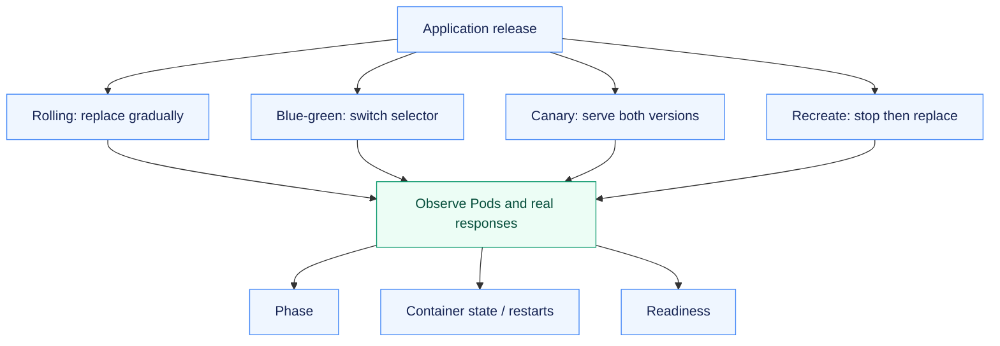
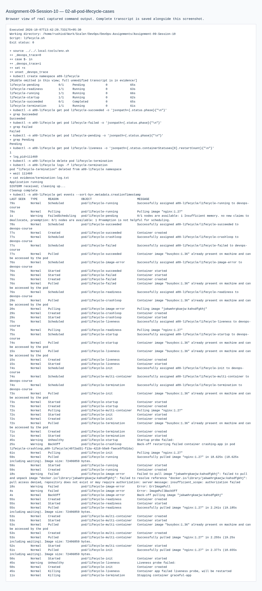
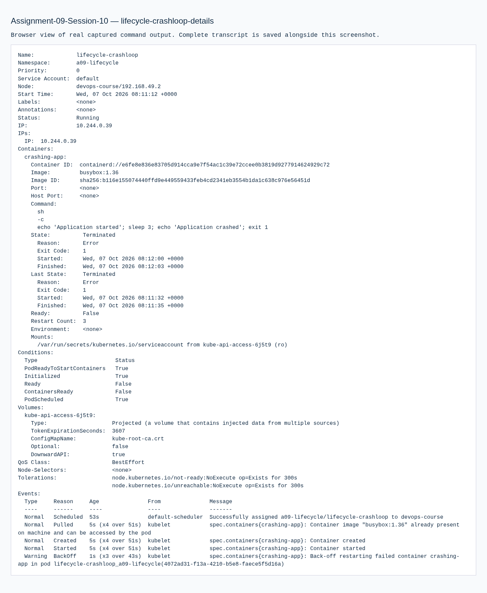
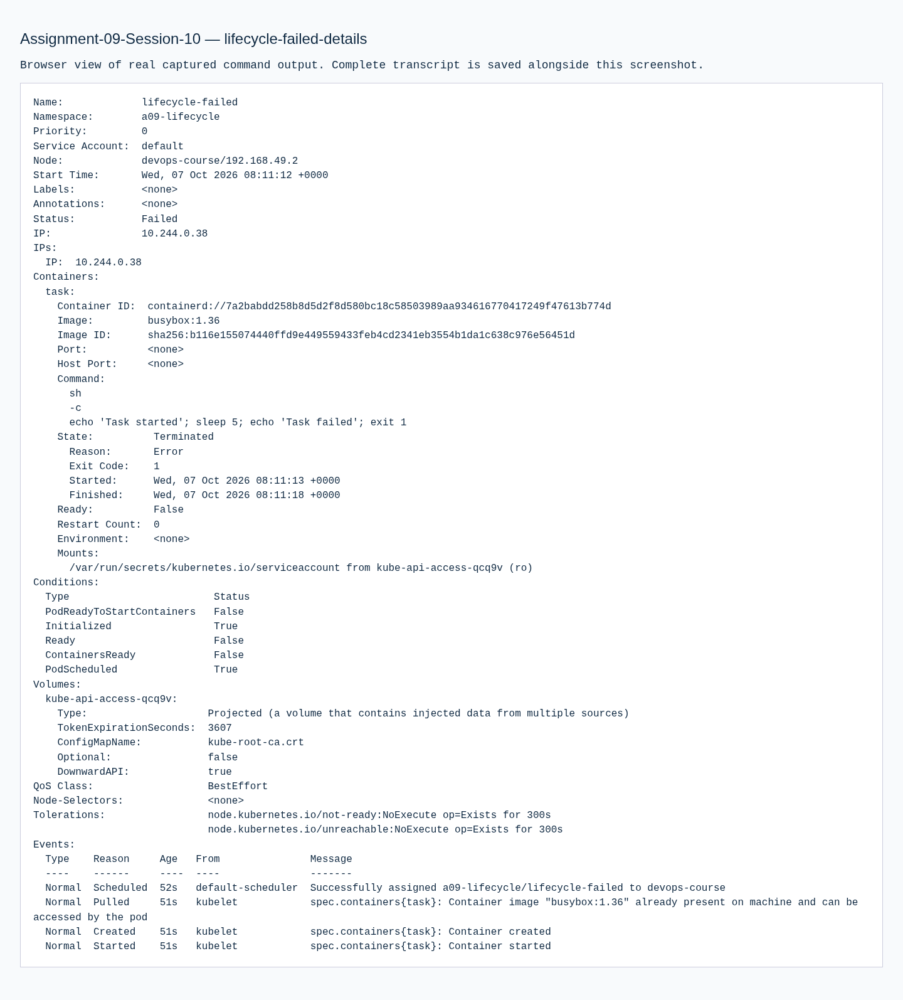
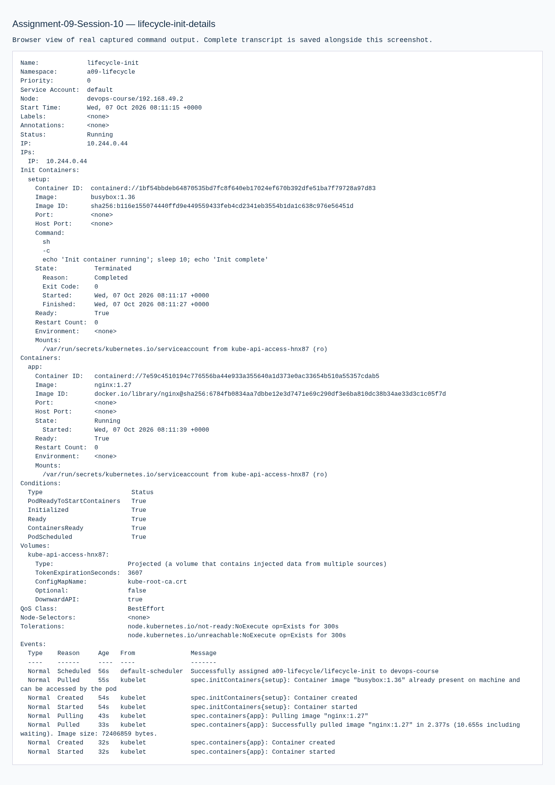
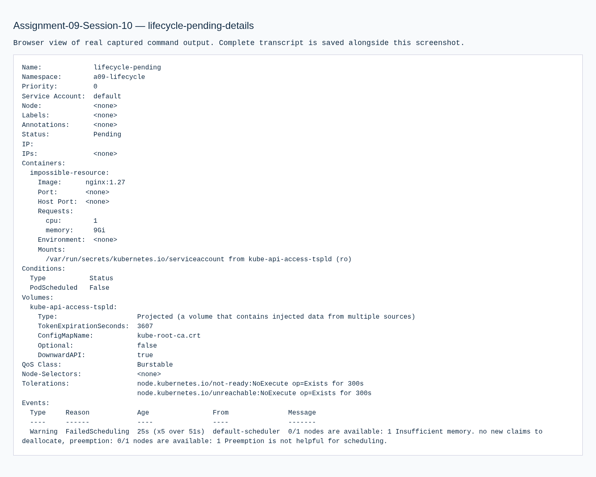
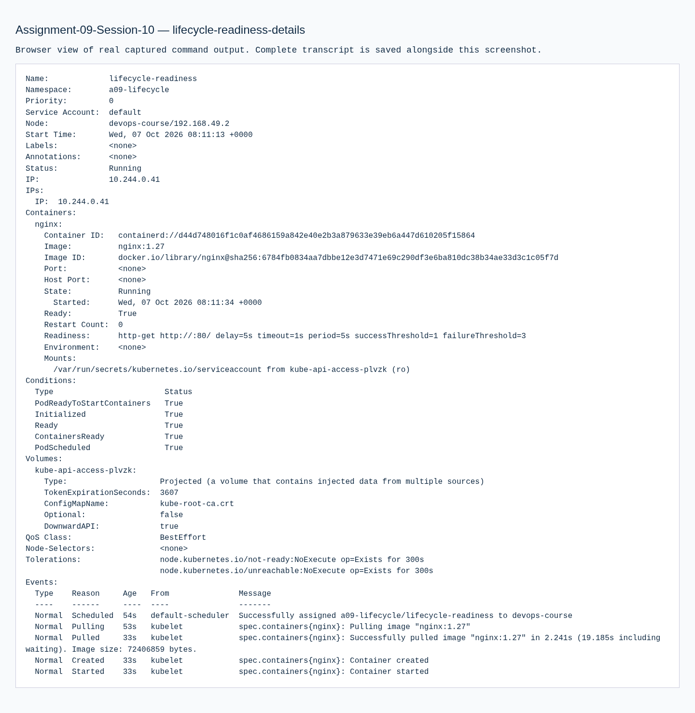

# Assignment 09 — Kubernetes Releases & Pod Lifecycle

Four release strategies and twelve lifecycle cases, observed through Pods, events and actual responses.

[Portfolio](../README.md) · [Requirements](REQUIREMENTS.md) · [Execution evidence](evidence/)

## The problem

Release strategies determine how a new version reaches users, while Pod conditions reveal why a workload is or is not serving traffic. These must be observed independently.

## Approach

1. Executed rolling, blue-green, canary and recreate releases, watching Pod replacement and Service selection.
2. Sampled stable/canary responses instead of assuming an exact traffic split.
3. Applied all twelve lifecycle examples and recorded status, events, readiness, restarts and termination behavior.

## How it works



## Implementation

| Component | Implementation | Behavior verified |
| --- | --- | --- |
| Rolling update | [strategies/](strategies/) | Observe old/new replica changes during an application update. |
| Blue-green and canary | [strategies/](strategies/) | Switch active Service selection; sample traffic across stable/canary Pods. |
| Recreate | [strategies/](strategies/) | Observe old Pods terminating before replacement Pods start. |
| All twelve lifecycle examples | [pod-lifecycle/](pod-lifecycle/) | Apply each YAML, record status/details, explain the observation and embed screenshots. |

**Tools:** kubectl, Deployments, Services, ReplicaSets and twelve Pod manifests.

## Commands used

These are representative recorded commands. Complete scripts and output are linked in the evidence section.

```bash
kubectl -n a09 apply -f strategies/rolling-v1.yaml
kubectl -n a09 apply -f strategies/rolling-v2.yaml
kubectl -n a09 rollout status deployment/rolling --timeout=180s
kubectl -n a09 get deployments,rs,pods -o wide
```

## Verification & results

All four strategies and all twelve lifecycle cases were executed. The canary sample recorded 14 canary and 86 stable responses out of 100 requests; this is a measured sample, not an exact traffic guarantee.

The linked records identify the original local execution environment. Privileged Docker/Minikube exercises used the prepared Ubuntu VM; application endpoints shown in that evidence are historical.

## Observed lifecycle cases

| Course YAML | Observation | Captured output |
| --- | --- | --- |
| [01-running.yaml](pod-lifecycle/01-running.yaml) | Long-running container reached Running/Ready. | [Actual details](evidence/lifecycle-running-details.txt) |
| [02-pending.yaml](pod-lifecycle/02-pending.yaml) | 9Gi request could not schedule on the 4Gi node; Pod stayed Pending. | [Actual details](evidence/lifecycle-pending-details.txt) |
| [03-succeeded.yaml](pod-lifecycle/03-succeeded.yaml) | Finite command completed successfully; phase Succeeded (Completed display). | [Actual details](evidence/lifecycle-succeeded-details.txt) |
| [04-failed.yaml](pod-lifecycle/04-failed.yaml) | Finite command exited unsuccessfully; phase Failed (Error display). | [Actual details](evidence/lifecycle-failed-details.txt) |
| [05-crashloopbackoff.yaml](pod-lifecycle/05-crashloopbackoff.yaml) | Repeated exit 1 caused restarts and CrashLoopBackOff delay. | [Actual details](evidence/lifecycle-crashloop-details.txt) |
| [06-imagepullbackoff.yaml](pod-lifecycle/06-imagepullbackoff.yaml) | Nonexistent image produced image-pull errors and retry backoff. | [Actual details](evidence/lifecycle-image-error-details.txt) |
| [07-readiness.yaml](pod-lifecycle/07-readiness.yaml) | Readiness failure prevented the running Pod from being ready for Service traffic. | [Actual details](evidence/lifecycle-readiness-details.txt) |
| [08-liveness.yaml](pod-lifecycle/08-liveness.yaml) | Removal of the health file failed liveness and caused container restarts. | [Actual details](evidence/lifecycle-liveness-details.txt) |
| [09-startup.yaml](pod-lifecycle/09-startup.yaml) | A 30-second startup delay was tolerated before normal health checks. | [Actual details](evidence/lifecycle-startup-details.txt) |
| [10-init-container.yaml](pod-lifecycle/10-init-container.yaml) | Init work completed before the main container could start. | [Actual details](evidence/lifecycle-init-details.txt) |
| [11-multi-container.yaml](pod-lifecycle/11-multi-container.yaml) | Application and sidecar both contributed to Pod readiness. | [Actual details](evidence/lifecycle-multi-container-details.txt) |
| [12-termination.yaml](pod-lifecycle/12-termination.yaml) | The SIGTERM trap performed cleanup during graceful termination. | [Actual details](evidence/lifecycle-termination-details.txt) |

Pod phase, container waiting/restart state and readiness are separate signals. The screenshot gallery below includes the individual cases.

## Troubleshooting & decisions

Service selection determines which replicas receive traffic; rollout settings determine replacement behavior. Pod phase and container waiting/restart conditions describe different aspects of lifecycle.

## Evidence

- [01 deployment strategies](evidence/01-deployment-strategies.md) — successful execution
- [02 all pod lifecycle cases](evidence/02-all-pod-lifecycle-cases.md) — successful execution

## Screenshots

Actual application pages and recorded command-output views from the practical execution.


<details>
<summary>More screenshots: implementation, diagnostics and verification</summary>
















</details>

## Key takeaways

Pod phase, container waiting state and readiness answer different questions. Service selectors govern traffic membership; Deployment strategy governs replacement behavior.
