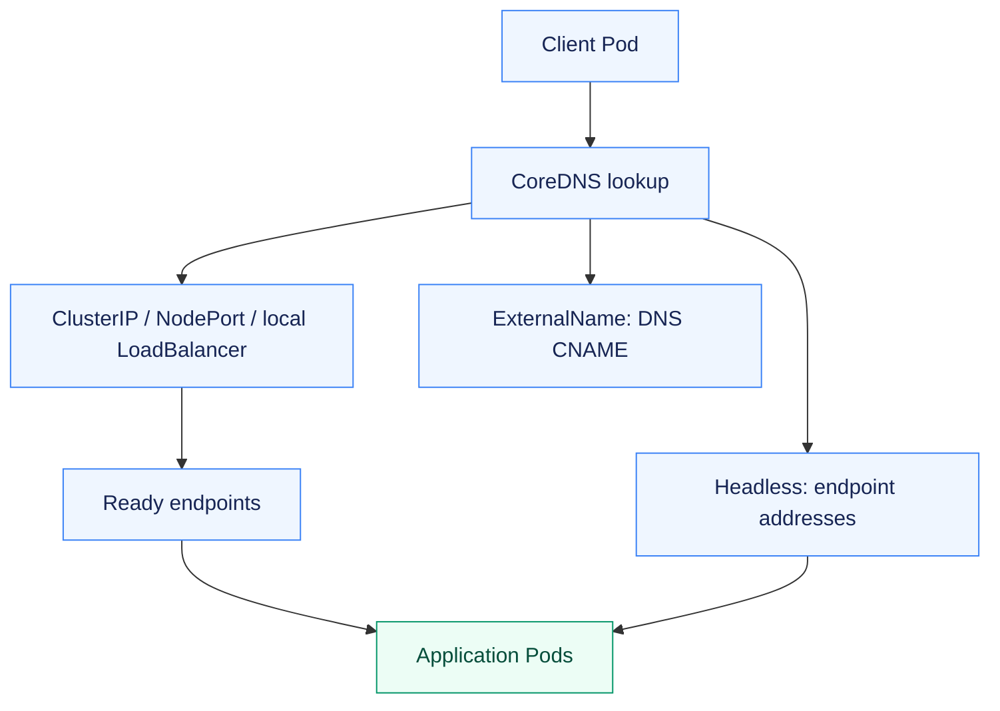
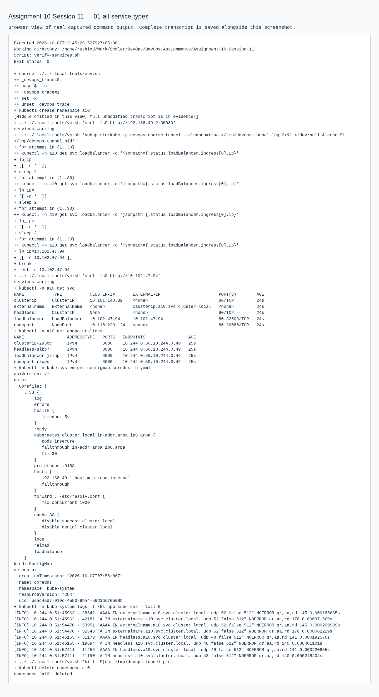

# Assignment 10 — Kubernetes Services & DNS

Five Service types compared through real DNS resolution, endpoint inspection and HTTP access.

[Portfolio](../README.md) · [Requirements](REQUIREMENTS.md) · [Execution evidence](evidence/)

## The problem

Pod addresses change as workloads are replaced. Clients need stable discovery, and different access requirements call for different Service behavior.

## Approach

1. Applied and checked ClusterIP, NodePort, LoadBalancer, ExternalName and headless examples.
2. Resolved Service names from a client Pod and verified actual HTTP behavior, using a local Minikube tunnel for LoadBalancer.
3. Documented FQDN/CoreDNS behavior and compared workload controllers with traffic-routing objects.

## How it works



## Implementation

| Component | Implementation | Behavior verified |
| --- | --- | --- |
| Five Service types | [manifests/](manifests/) | ClusterIP, NodePort, local-tunnel LoadBalancer, ExternalName and Headless all deployed and checked. |
| Object comparisons | [README.md](README.md) | Deployment/ReplicaSet, Deployment/DaemonSet/StatefulSet, and ReplicaSet/Service. |
| FQDN document | [fqdn/README.md](fqdn/README.md) | Namespace-qualified Service names and Pod-to-Service examples. |
| CoreDNS document | [coredns/README.md](coredns/README.md) | Configuration, discovery, query resolution and troubleshooting. |

**Tools:** kubectl, Kubernetes Services/EndpointSlices, CoreDNS and Minikube tunnel.

## Commands used

These are representative recorded commands. Complete scripts and output are linked in the evidence section.

```bash
kubectl -n a10 apply --dry-run=server -f manifests
kubectl -n a10 apply -f manifests
kubectl -n a10 get svc
kubectl -n a10 get endpointslices
kubectl -n kube-system get configmap coredns -o yaml
```

## Verification & results

Server-side dry-run accepted the manifests and real DNS/HTTP checks succeeded for all five types. The LoadBalancer result used a local Minikube tunnel rather than a cloud load balancer.

The linked records identify the original local execution environment. Privileged Docker/Minikube exercises used the prepared Ubuntu VM; application endpoints shown in that evidence are historical.

## Required object comparisons

| Aspect | Deployment | ReplicaSet |
| --- | --- | --- |
| Purpose | Declarative releases and update history | Maintain the desired number of matching Pods |
| Pod management | Creates/manages ReplicaSets, which manage Pods | Creates replacement Pods when its count is too low |
| Scaling | Sets desired replicas and distributes them to managed ReplicaSets | Adjusts the replica count of one Pod template |
| Rolling updates | Moves replicas from old to new ReplicaSet with surge/unavailability limits | Has no Deployment-style rolling release/history mechanism |
| Relationship | Owns ReplicaSets for each template revision | Usually owned by a Deployment; its owner controls releases |

| Aspect | Deployment | DaemonSet | StatefulSet |
| --- | --- | --- | --- |
| Use case / example | Interchangeable web/API replicas, such as this bootcamp app | Per-node agents, such as log collectors or node-exporter | Stateful replicas, such as a database requiring stable identity |
| Pod creation | ReplicaSets create replaceable Pods | Controller places one Pod on each eligible node | Controller creates Pods with stable ordinal names |
| Scaling | Change replicas or use HPA | Follows eligible node count and placement rules | Change replicas; creation/deletion can be ordered |
| Networking | Replaceable Pod addresses, normally behind a Service | Node-associated Pod addresses; host networking is optional | Stable DNS identities typically use a headless Service |
| Storage | Can mount claims but supplies no per-replica identity | Host/node storage is common for agents | volumeClaimTemplates provide distinct persistent claims per replica |

ReplicaSet keeps the selected replica count; a Service supplies discovery and a stable access point. A Service remains useful when replacement Pods receive new IPs. For ordinary selector-based Services, matching ready Pods appear in EndpointSlices, and traffic to the Service address is routed to those endpoints and target ports. ExternalName is a DNS alias; a headless Service returns endpoint addresses instead of the usual virtual IP.

Documentation sources: [Deployment](https://kubernetes.io/docs/concepts/workloads/controllers/deployment/), [DaemonSet](https://kubernetes.io/docs/concepts/workloads/controllers/daemonset/), [StatefulSet](https://kubernetes.io/docs/concepts/workloads/controllers/statefulset/), [Service](https://kubernetes.io/docs/concepts/services-networking/service/).

## Troubleshooting & decisions

Headless DNS resolves endpoint addresses, so clients must use the listening Pod port. ExternalName provides a CNAME rather than proxy endpoints.

## Evidence

- [01 all service types](evidence/01-all-service-types.md) — successful execution

## Screenshots

Actual application pages and recorded command-output views from the practical execution.



## Key takeaways

A Service is a stable access/discovery abstraction; it does not maintain replica count. Headless DNS returns endpoint addresses, so the client must use the application listening port.
