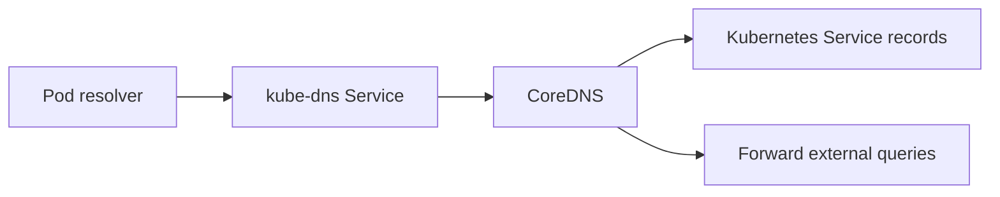

# CoreDNS & Cluster Discovery

Trace a Pod's name lookup from its resolver configuration to the Kubernetes Service or external DNS server.

[Assignment](../README.md) · [Actual Service/DNS transcript](../evidence/01-all-service-types.md)

## The problem

When a Service name does not resolve, the cause may be the name, namespace, client resolver settings, DNS endpoints or CoreDNS itself. Inspecting only the application Pod misses that path.

## How resolution works



CoreDNS uses Kubernetes resource information to answer cluster queries. Its Corefile configures the cluster zone, forwarding, caching and health behavior. The `kube-dns` Service provides a stable DNS server address for Pods.

## Approach and verification

The [verification script](../verify-services.sh) resolved the application's Service names, then inspected the real CoreDNS ConfigMap and logs:

```bash
kubectl -n kube-system get configmap coredns -o yaml
kubectl -n kube-system logs -l k8s-app=kube-dns --tail=8
```

No custom CoreDNS configuration was needed for the successful exercise.

| Diagnostic step | What it isolates |
| --- | --- |
| Check the Service name and namespace | Incorrect target name |
| Inspect client `/etc/resolv.conf` | Search domains and DNS server |
| Inspect kube-dns Service/EndpointSlices | DNS routing and available endpoints |
| Inspect CoreDNS readiness/logs/Corefile | Server health and query handling |

[Official DNS customization guide](https://kubernetes.io/docs/tasks/administer-cluster/dns-custom-nameservers/)
