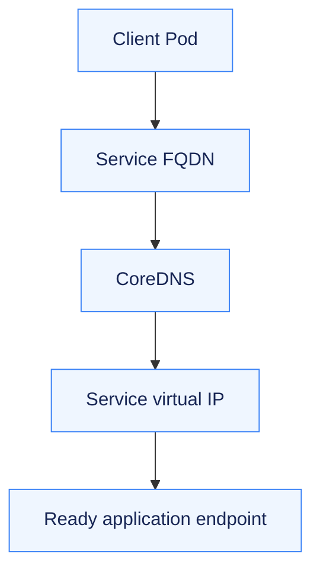

# Service DNS & Fully Qualified Names

A stable name lets a client find a Service after individual Pod addresses change.

[Assignment](../README.md) · [Recorded DNS and HTTP checks](../evidence/01-all-service-types.md)

## The problem

Short names depend on the calling Pod's namespace. Cross-namespace clients need a qualified name, and not every Service returns the same kind of DNS answer.

## Resolution model

A Service name follows `<service>.<namespace>.svc.<cluster-domain>`. The exercise uses `cluster.local`; the application Service resolves as `clusterip.a10.svc.cluster.local`. The Pod's search list expands short names within its namespace.

| Name form | Meaning |
| --- | --- |
| `clusterip` | Resolve using the client's namespace search path |
| `clusterip.a10` | Qualify the Service namespace |
| `clusterip.a10.svc.cluster.local` | Use the complete Service FQDN |

## What was verified

The client Pod ran `nslookup` for all five Service examples and issued HTTP requests. Ordinary Services resolved their virtual IP, the headless Service returned endpoint addresses, and ExternalName returned a CNAME. Headless clients used port 8080 because DNS discovery does not translate the application's listening port.

## Key takeaway

Choose the name and port together. Successful DNS resolution establishes discovery; an HTTP response separately verifies that the client reached the intended application.

[Kubernetes DNS for Services and Pods](https://kubernetes.io/docs/concepts/services-networking/dns-pod-service/)
