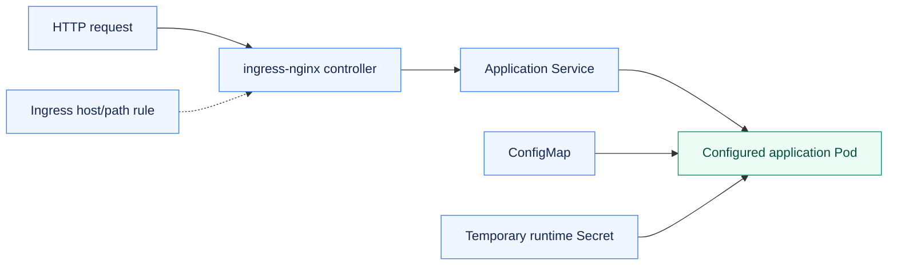
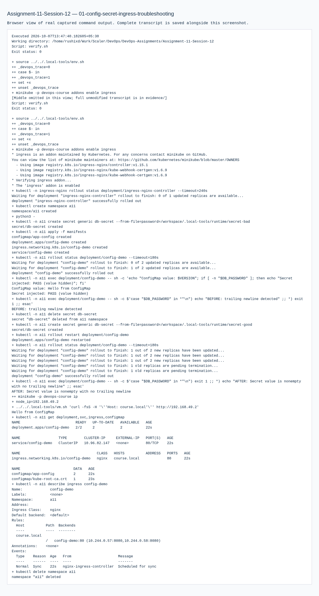
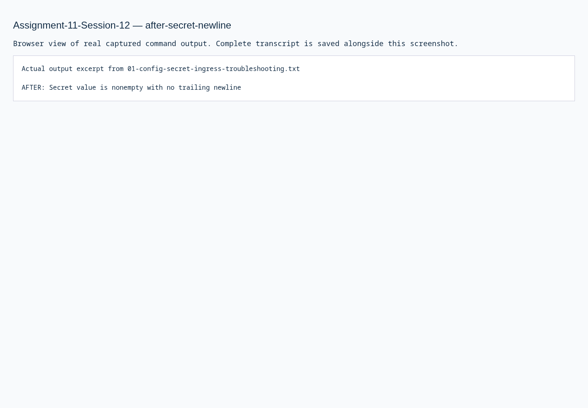
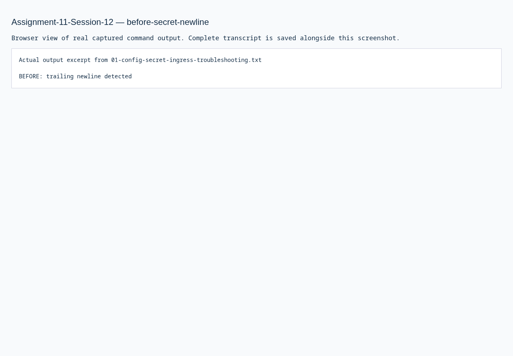

# Assignment 11 — Configuration, Secrets & Ingress

Runtime configuration and HTTP routing, with a reproduced and repaired Secret newline error.

[Portfolio](../README.md) · [Requirements](REQUIREMENTS.md) · [Execution evidence](evidence/)

## The problem

Applications need runtime configuration and HTTP routing, while a subtle newline in a secret source can change the value injected into a container.

## Approach

1. Injected a ConfigMap and temporary Secret into a real workload without exposing the secret value.
2. Routed requests through ingress-nginx to the application Service.
3. Detected a trailing newline, recreated the Secret from a newline-free source, restarted the consuming workload and verified the correction.

## How it works



## Implementation

| Component | Implementation | Behavior verified |
| --- | --- | --- |
| ConfigMap | [manifests/](manifests/) | Store configuration, inject it into the Pod and verify the observed value. |
| Secret template and runtime injection | [secret.yaml.example](secret.yaml.example) | Submit a placeholder template; verify runtime injection without printing the temporary value. |
| Ingress routing | [manifests/](manifests/) | Actual ingress-nginx routing through the application Service. |
| Troubleshooting | [evidence/01-config-secret-ingress-troubleshooting.md](evidence/01-config-secret-ingress-troubleshooting.md) | Before/after newline check, corrected Secret source and restarted workload. |

The temporary Secret was created before applying the workload. Its value is excluded from source and evidence output.

**Tools:** kubectl, ConfigMap, Secret, ingress-nginx and HTTP checks.

## Commands used

These are representative recorded commands. Complete scripts and output are linked in the evidence section.

```bash
kubectl -n a11 apply -f manifests
kubectl -n a11 rollout status deployment/config-demo --timeout=180s
kubectl -n a11 rollout restart deployment/config-demo
```

## Verification & results

The application received its ConfigMap/Secret and was accessed through the configured local Ingress. The original trailing newline was detected; the corrected runtime value no longer contained it.

The linked records identify the original local execution environment. Privileged Docker/Minikube exercises used the prepared Ubuntu VM; application endpoints shown in that evidence are historical.

## Secret handling and routing

A newline introduced by `echo` survives base64 encoding. Base64 is an encoding, not encryption; putting an actual Secret value into Git makes it recoverable from repository history. Only the placeholder YAML is submitted, while the demonstration creates the real temporary value at runtime.

The diagnostic inspected the injected value without printing it. Writing the value without a newline, recreating the Secret and replacing the environment-consuming Pods removed the trailing newline. This reproduces the source-value error; it does not claim a separate database authentication test.

Ingress declares HTTP host/path rules. The ingress-nginx controller watches those rules and implements routing to the Service. Other examples of controllers include Traefik and cloud load-balancer controllers; a Service alone does not interpret Ingress rules.

## Troubleshooting & decisions

Ingress declares HTTP routing; an Ingress controller implements it. The Secret demonstration checks the actual encoding mistake and does not claim a separate PostgreSQL authentication test.

## Evidence

- [01 config secret ingress troubleshooting](evidence/01-config-secret-ingress-troubleshooting.md) — successful execution

## Screenshots

Actual application pages and recorded command-output views from the practical execution.



<details>
<summary>More screenshots: implementation, diagnostics and verification</summary>





</details>

## Key takeaways

Base64 encoding preserves a newline; it does not encrypt a secret. An Ingress controller implements routing rules, and environment-variable consumers need replacement to read changed configuration.
