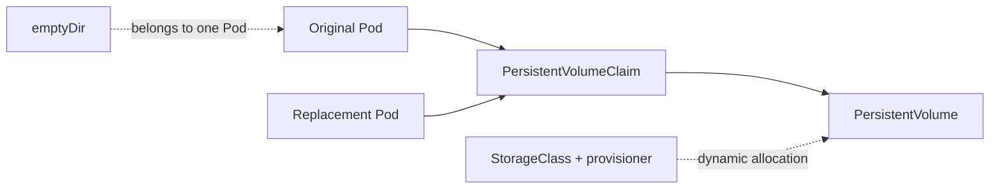

# Kubernetes Storage: Lifetime & Persistence

Use Pod replacement to show which storage survives, rather than inferring persistence from a mounted directory.

[Assignment](../README.md) · [Executed volume checks](../evidence/01-volume-lifetimes.md)

## The problem

Container restarts, Pod deletion and node replacement are different events. Storage choices need lifetimes and placement rules that match the data they hold.

## Storage model

## Approach

The [volume exercise](../volumes.sh) applied the examples in `a12-volumes`, wrote/read test data, and deleted/recreated Pods to compare the resulting storage behavior.

| Mechanism | Lifetime or responsibility | Observed exercise |
| --- | --- | --- |
| emptyDir | Pod-scoped storage; survives a container restart within the Pod | File disappeared after Pod replacement |
| hostPath | Directory on a particular node | File survived replacement on the same local node |
| PV | Cluster-scoped storage capacity, access mode and reclaim policy | Explicit retained hostPath PV |
| PVC | Namespaced storage request | Static claim bound to the selected PV |
| StorageClass | Provisioner and storage policy | Minikube `standard` class inspected |
| Dynamic provisioning | Provisioner allocates storage for a claim | PVC became Bound without a handwritten PV |

## Implementation decisions

The static claim uses an empty `storageClassName` to avoid triggering the default dynamic provisioner. `ReadWriteOnce` limits writable attachment to a node; it does not necessarily mean a single Pod. The single-node demonstration does not establish portability across nodes.

The static PV uses `Retain`, so claim deletion does not itself erase backing data. Assignment-owned storage resources were explicitly cleaned after verification.

## Result

The captured before/after reads distinguish Pod-scoped data, node-local data and persistent claim-backed data. [All manifests](./) and the [full execution record](../evidence/01-volume-lifetimes.txt) are included.
