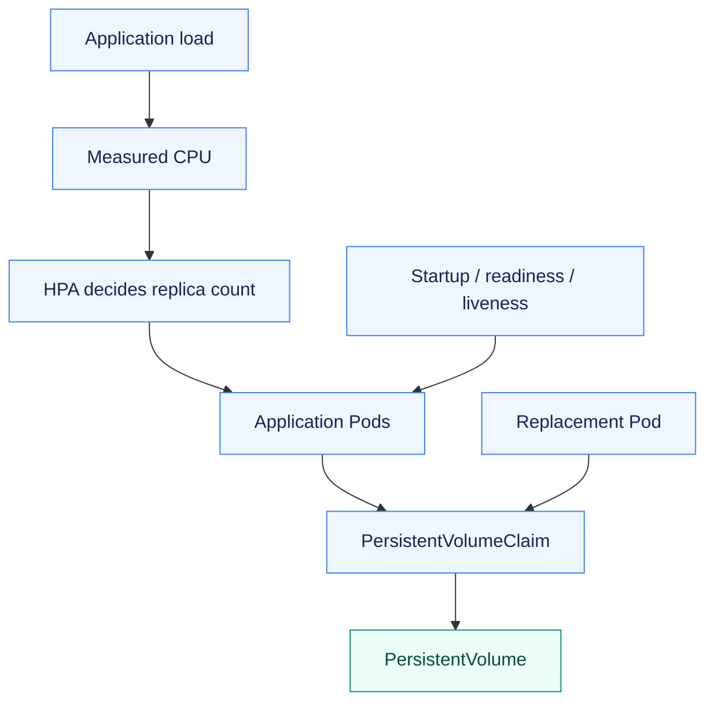
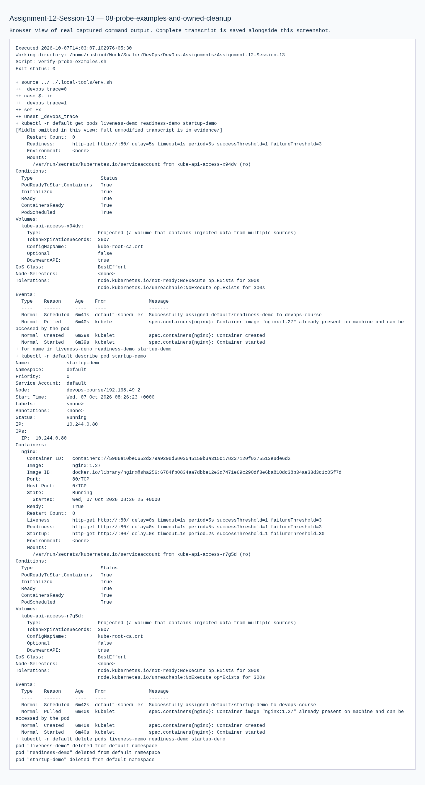

# Assignment 12 — Kubernetes Storage, Autoscaling & Probes

Persistent data, health probes and a measured autoscaling cycle verified in a local Kubernetes project.

[Portfolio](../README.md) · [Requirements](REQUIREMENTS.md) · [Execution evidence](evidence/)

## The problem

Data should survive the right failures, healthy workloads should receive traffic, and replica counts should adapt to measured demand. These are separate lifecycle concerns.

## Approach

1. Compared emptyDir, hostPath, static PV/PVC and dynamically provisioned storage by writing data and replacing Pods.
2. Configured startup, readiness and liveness probes in the persistent mini project.
3. Generated real CPU load, observed HPA scale-up and the default stabilization window, then verified recovery to two replicas and retained data.

## How it works



## Implementation

| Component | Implementation | Behavior verified |
| --- | --- | --- |
| Required volume documentation | [01-kubernetes-volumes/README.md](01-kubernetes-volumes/README.md) | emptyDir, hostPath, PV, PVC, StorageClass and dynamic provisioning. |
| HPA exercise and load generator | [hpa/hpa.yml](hpa/hpa.yml) | Actual CPU load, get hpa/pods, top pods and describe hpa. |
| Persistent mini project | [mini-project/](mini-project/) | PVC-backed content survives Pod replacement; startup/readiness/liveness probes inspected. |
| Default recovery behavior | [evidence/07-complete-default-scaling-cycle-retry.md](evidence/07-complete-default-scaling-cycle-retry.md) | Observed scale-up and return to two replicas using default stabilization. |

**Tools:** Kubernetes volumes/PV/PVC/StorageClass, Metrics Server, HPA, probes and kubectl.

## Commands used

These are representative recorded commands. Complete scripts and output are linked in the evidence section.

```bash
kubectl -n a12 get hpa,pods
kubectl -n a12 describe hpa hpa-demo
kubectl -n a12 get pods -o wide
kubectl -n production-webapp rollout status deployment/web-app --timeout=180s
```

## Verification & results

Volume lifetime/persistence checks succeeded. Real load caused scaling, and the repeated mini-project cycle recorded the default scale-down stabilization and return to two replicas.

The linked records identify the original local execution environment. Privileged Docker/Minikube exercises used the prepared Ubuntu VM; application endpoints shown in that evidence are historical.

## Probe responsibilities

| Probe | Purpose in the mini project |
| --- | --- |
| Startup | Allows application initialization before ordinary health enforcement |
| Readiness | Controls eligibility to receive Service traffic |
| Liveness | Restarts a container whose health check fails |

The successful final cycle records all three configurations plus a stored marker surviving Pod replacement. Failed early downscale/namespace attempts remain linked separately from that successful cycle.

## Troubleshooting & decisions

The persistence test used a historical placeholder marker stored on the volume. The important observation is that it survived Pod replacement. The single-node storage setup does not establish multi-node portability.

## Evidence

- [01 volume lifetimes](evidence/01-volume-lifetimes.md) — successful execution
- [02 hpa probes persistence](evidence/02-hpa-probes-persistence.md) — successful execution
- [03 service and identity placeholder](evidence/03-service-and-identity-placeholder.md) — successful execution
- [05 observed scale down](evidence/05-observed-scale-down.md) — retained earlier attempt / diagnosis; use the successful retry for completion
- [06 complete default scaling cycle](evidence/06-complete-default-scaling-cycle.md) — retained earlier attempt / diagnosis; use the successful retry for completion
- [07 complete default scaling cycle retry](evidence/07-complete-default-scaling-cycle-retry.md) — successful execution
- [08 probe examples and owned cleanup](evidence/08-probe-examples-and-owned-cleanup.md) — successful execution

## Screenshots

Actual application pages and recorded command-output views from the practical execution.


<details>
<summary>More screenshots: implementation, diagnostics and verification</summary>




</details>

## Key takeaways

Persistence, traffic eligibility and autoscaling must each be tested. A single-node ReadWriteOnce exercise does not establish multi-node storage portability.
