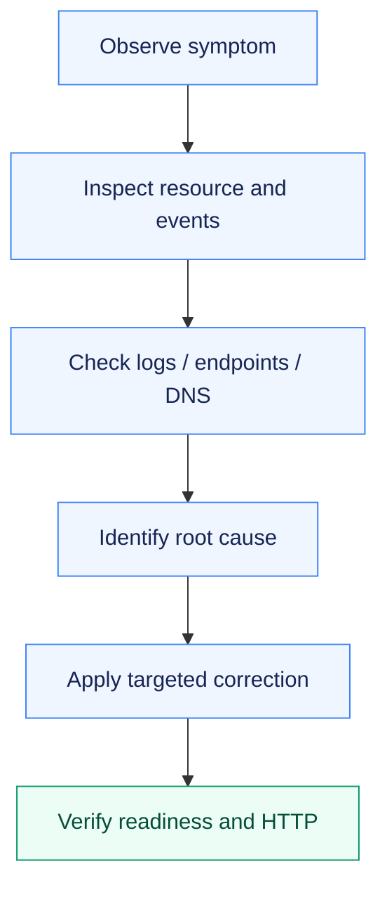

# Assignment 13 — Kubernetes Troubleshooting

Deliberate failures traced from symptoms to root causes, corrected and verified with before/after evidence.

[Portfolio](../README.md) · [Requirements](REQUIREMENTS.md) · [Execution evidence](evidence/)

## The problem

Similar symptoms can have unrelated causes: image retrieval, application crashes, scheduling constraints, missing configuration or incorrect Service/DNS/port selection.

## Approach

1. Introduced the required faults in an isolated namespace and captured the failing state.
2. Used object conditions, events, previous logs, in-container commands and endpoint checks to identify each root cause.
3. Applied targeted corrections and verified Ready Pods and working DNS/HTTP responses before cleanup.

## How it works



## Implementation

| Component | Implementation | Behavior verified |
| --- | --- | --- |
| All requested diagnostic commands | [verify.sh](verify.sh) | get, describe, logs, exec, events, explain, top and wide output. |
| Container and scheduling failures | [cases/](cases/) | CrashLoopBackOff, ErrImagePull/ImagePullBackOff, Pending, ContainerCreating and configuration errors. |
| Service / DNS / Pod addressing | [evidence/01-troubleshooting-before-and-after.md](evidence/01-troubleshooting-before-and-after.md) | Wrong selector, wrong DNS name and unopened client port repaired and tested. |
| Course mini project | [mini-project/](mini-project/) | Problem, investigation, cause, correction and successful verification documented. |

**Tools:** kubectl get/describe/logs/exec/events/explain/top, EndpointSlices and HTTP/DNS checks.

## Commands used

These are representative recorded commands. Complete scripts and output are linked in the evidence section.

```bash
kubectl -n a13 get pods -o wide
kubectl -n a13 events
kubectl -n a13 logs crashloop --previous
kubectl -n a13 exec deployment/troubleshooting-app -- sh -c 'curl -fsS localhost'
kubectl explain pod.spec.containers
kubectl -n a13 top pods
```

## Verification & results

All repaired Pods became Ready; corrected Services had usable endpoints, and DNS/HTTP checks succeeded. Before/after descriptions and screenshots are retained per failure.

The linked records identify the original local execution environment. Privileged Docker/Minikube exercises used the prepared Ubuntu VM; application endpoints shown in that evidence are historical.

## Diagnosed causes and fixes

| Failure | Evidence / root cause | Fix |
| --- | --- | --- |
| CrashLoopBackOff | Previous logs and exit 1 | Replace faulty command with long-running process |
| ErrImagePull / ImagePullBackOff | Invalid image/tag in events | Select existing nginx:1.27 |
| Pending | Unsatisfiable node selector | Recreate with valid scheduling requirements |
| ContainerCreating | Volume cannot mount missing Secret | Create runtime Secret without printing data |
| CreateContainerConfigError | Missing ConfigMap | Create expected configuration |
| Empty Service endpoints | Selector differs from Pod labels | Restore matching selector |
| DNS failure | Name references nonexistent Service | Use actual Service FQDN |
| Pod networking failure | Client uses unopened port | Use listening container port 80 |

The DNS and Pod-port examples diagnose application addressing; they do not claim a CNI outage. The separate cluster CNI repair is documented in Assignment 08.

## Mini-project answers

The broken Pod displayed ErrImagePull and then ImagePullBackOff. Events reported failure to find/pull its nonexistent image tag. `kubectl describe pod project-broken-pod` exposed that reason; replacing the tag with the available nginx:1.27 image made it Ready.

| Problem | What I saw | Diagnostic command | Root cause | Fix |
| --- | --- | --- | --- | --- |
| Broken Pod | Image pull errors | describe pod | Invalid tag | Use nginx:1.27 |
| Service | Empty selected endpoints | describe service, get pods --show-labels | wrong-app selector | Match troubleshooting-app labels |
| Image problem | ErrImagePull/backoff events | events, describe pod | Requested image does not exist | Use verified image |

`get` summarizes current object state; `describe` adds details, conditions and events. Logs expose application output; exec runs diagnostics inside the container. CrashLoopBackOff is increasing delay between repeated container failures. ImagePullBackOff is retry delay after image retrieval failure. Pending can indicate scheduling constraints or insufficient resources. A Service can lack ready endpoints when labels do not match, Pods are unready or target configuration is wrong. Selectors choose Pod labels. Kubernetes DNS resolves Service and supported Pod names so clients do not depend on changing Pod IPs.

## Troubleshooting & decisions

Treat DNS failure, selector mismatch and wrong destination port as separate causes. Pod networking in this exercise concerns application addressing; it does not assert a CNI outage.

## Evidence

- [01 troubleshooting before and after](evidence/01-troubleshooting-before-and-after.md) — successful execution

## Screenshots

Actual application pages and recorded command-output views from the practical execution.


<details>
<summary>More screenshots: implementation, diagnostics and verification</summary>


</details>

## Key takeaways

Fix the cause shown by the resource/log evidence. DNS resolution, matching Service selectors and the correct listening port need independent checks.
