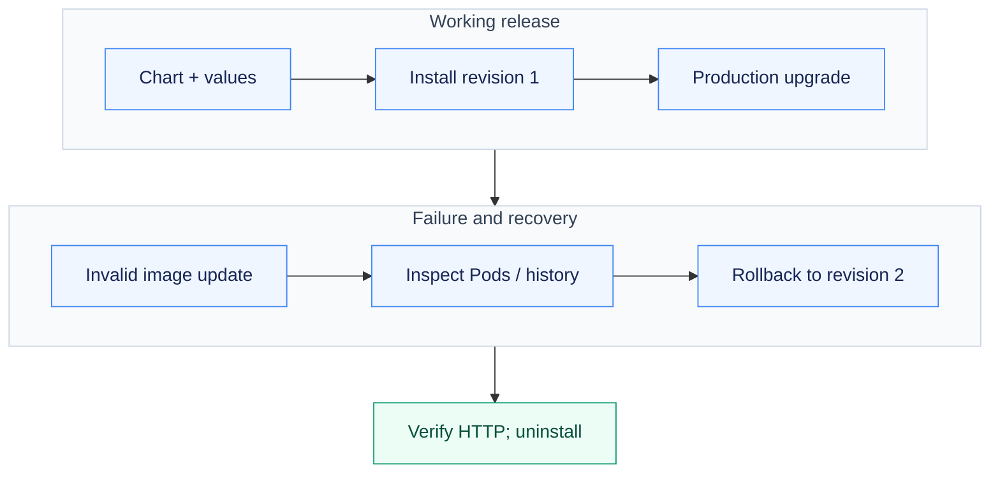

# Assignment 14 — Helm Packaging, Upgrades & Rollback

A reusable notes chart taken through installation, upgrades, failure diagnosis, rollback and cleanup.

[Portfolio](../README.md) · [Requirements](REQUIREMENTS.md) · [Execution evidence](evidence/)

## The problem

Reusable Kubernetes configuration needs explicit values and release history. A Helm release can be recorded as deployed while an application image is unavailable.

## Approach

1. Scaffolded and inspected a chart, then practised repository/search and release-management commands.
2. Installed the notes mini-project chart and upgraded it with production values.
3. Introduced a bad image tag, diagnosed the unhealthy workload, rolled back to revision 2 and verified HTTP/configuration before uninstalling.

## How it works



## Implementation

| Component | Implementation | Behavior verified |
| --- | --- | --- |
| Helm commands | [verify.sh](verify.sh) | create, install, list, status, get, upgrade, history, rollback, uninstall, repo and search. |
| Chart scaffold | [demo-chart/](demo-chart/) | The chart generated by helm create and its rendered manifest. |
| Mini-project chart | [mini-project/notes-chart/](mini-project/notes-chart/) | Deployment, ConfigMap, Service and environment-specific values. |
| Rollback verification | [evidence/01-helm-install-upgrade-rollback.md](evidence/01-helm-install-upgrade-rollback.md) | Bad-image upgrade diagnosed; rollback restores working HTTP response and configuration. |

**Tools:** Helm, kubectl, Nginx, chart templates and development/production values.

## Commands used

These are representative recorded commands. Complete scripts and output are linked in the evidence section.

```bash
helm lint mini-project/notes-chart
helm list -n a14
helm history notes-dev -n a14
helm rollback notes-dev 2 -n a14 --wait --timeout=3m
helm uninstall notes-dev -n a14
```

## Verification & results

Chart lint/render, installation, upgrades, history inspection, rollback and uninstall succeeded locally. Workload readiness and actual HTTP/version/configuration were checked separately from Helm release status.

The linked records identify the original local execution environment. Privileged Docker/Minikube exercises used the prepared Ubuntu VM; application endpoints shown in that evidence are historical.

## Troubleshooting & decisions

A release marked deployed can still contain unready Pods if upgrade does not wait. Rollback creates a new release revision; verify the running application afterward.

## Evidence

- [01 helm install upgrade rollback](evidence/01-helm-install-upgrade-rollback.md) — successful execution

## Screenshots

Actual application pages and recorded command-output views from the practical execution.


## Key takeaways

Verify running Pods and application behavior after every release operation. A rollback creates another Helm revision while restoring an earlier release configuration.
