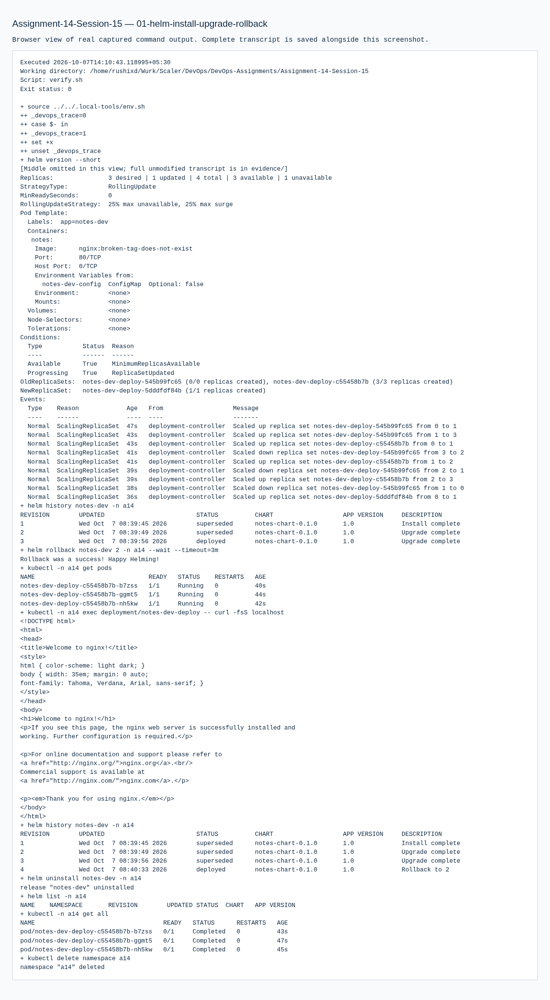

# 14 · Helm

**Session 15** · **Local practical work verified**

[Portfolio](../README.md) · [Exact requirements](REQUIREMENTS.md) · [Submission readiness](../SUBMISSION_READINESS.md)

> Practice the full Helm command set and complete install → upgrade → upgrade again → rollback, verifying the application at each stage.

| Assignment record | Details |
| --- | --- |
| PDF source | DevOps Homework.pdf · pages 29, 30, 31, 32 |
| Student | Rushi Jadhav · 10144 |
| Evidence | Successful transcripts: 1 · actual screenshots: 1 |
| Execution environment | Original local host / Ubuntu VM as identified in the transcripts |
| Review | 21 October 2026; historical output is retained unchanged |

## Requirement coverage

| PDF requirement | Implementation / document | Demonstrated behavior |
| --- | --- | --- |
| Helm commands | [verify.sh](verify.sh) | create, install, list, status, get, upgrade, history, rollback, uninstall, repo and search. |
| Chart scaffold | [demo-chart/](demo-chart/) | The chart generated by helm create and its rendered manifest. |
| Mini-project chart | [mini-project/notes-chart/](mini-project/notes-chart/) | Deployment, ConfigMap, Service and environment-specific values. |
| Rollback verification | [evidence/01-helm-install-upgrade-rollback.md](evidence/01-helm-install-upgrade-rollback.md) | Bad-image upgrade diagnosed; rollback restores working HTTP response and configuration. |

## Commands and verification

Key commands are shown below. The evidence records contain the complete executed scripts, exact resource names, output and exit status.

```bash
helm lint mini-project/notes-chart
helm list -n a14
helm history notes-dev -n a14
helm rollback notes-dev 2 -n a14 --wait --timeout=3m
helm uninstall notes-dev -n a14
```

[Reproduction and tooling](../REPRODUCING.md) explains the original VM adapters, native-tool use and portable Git bundles. Full executed scripts and stdout/stderr are linked below.

## Observed result

Chart lint/render, installation, upgrades, history inspection, rollback and uninstall succeeded locally. Workload readiness and actual HTTP/version/configuration were checked separately from Helm release status.

## Troubleshooting and observations

A release marked deployed can still contain unready Pods if upgrade does not wait. Rollback creates a new release revision; verify the running application afterward.

## Submission status

**COMPLETE.** The required practical work is documented and verified by the retained evidence. Publish the revised files and supply the final repository URL to submit.

## Execution evidence

- [01 helm install upgrade rollback](evidence/01-helm-install-upgrade-rollback.md) — successful execution

## Screenshots

Actual application pages and explicitly labelled views of captured command output. Full text records preserve output omitted from an image.

<details>
<summary>Open the screenshot gallery (1 images)</summary>



</details>
