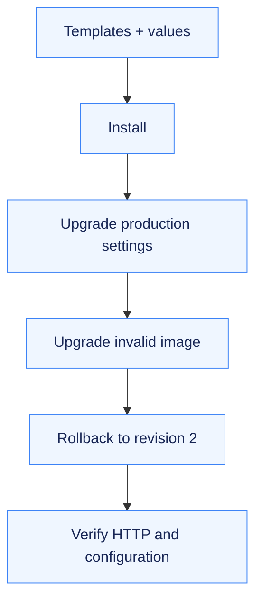

# Notes Chart: Reusable Helm Releases

One chart packages the Deployment, configuration and Service; values change the release without duplicating its templates.

[Assignment](../README.md) · [Chart defaults](notes-chart/values.yaml) · [Production values](notes-chart/values-prod.yaml)

## The problem

Environment-specific manifests can drift, and a recorded Helm release does not guarantee that its application Pods are healthy. The mini project tests both configuration reuse and recovery from a bad release.

## Release flow

## Chart design

| File or template | Responsibility |
| --- | --- |
| `Chart.yaml` | Package metadata |
| `values.yaml` / `values-prod.yaml` | Default and environment-specific settings |
| Deployment | Application image, replicas and configuration injection |
| ConfigMap | Environment-specific application values |
| Service | Stable access to matching ready Pods |

## Approach and result

The [actual transcript](../evidence/01-helm-install-upgrade-rollback.md) covers lint/render, install, status/get/list, a production upgrade, a second upgrade with an invalid image, workload inspection, rollback, successful HTTP/configuration checks and uninstall. [Screenshots](../README.md#screenshots) show the recorded workflow.

The failed image release exposed the distinction between Helm's release status and Pod readiness. Rolling back restored the working configuration, and application checks confirmed recovery before cleanup.
