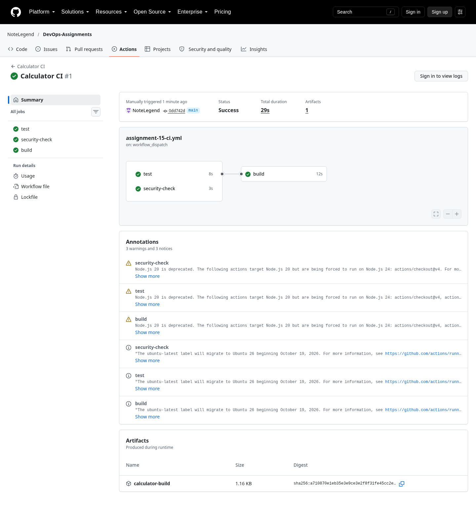
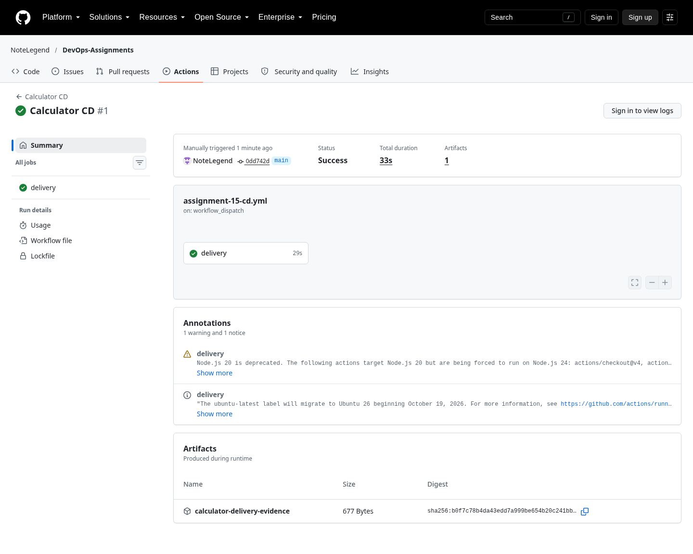

# 15 · CI/CD & GitHub Actions

**Session 16** · **Complete · hosted CI and CD verified**

[Portfolio](../README.md) · [Exact requirements](REQUIREMENTS.md) · [Submission readiness](../SUBMISSION_READINESS.md)

> Prepare and locally verify the PDF’s referenced calculator CI/CD demonstration, with separate continuous-integration and delivery workflows.

| Assignment record | Details |
| --- | --- |
| PDF source | DevOps Homework.pdf · pages 33, 34 |
| Student | Rushi Jadhav · 10144 |
| Evidence | Successful local/hosted records: 3 · actual screenshots: 3 |
| Execution environment | Original local host / Ubuntu VM; new GitHub-hosted Ubuntu runners |
| Review | 21 October 2026; historical output is retained unchanged |

## Requirement coverage

| PDF requirement | Implementation / document | Demonstrated behavior |
| --- | --- | --- |
| Referenced calculator application | [app/](app/) | Five unit tests, interactive calculator output and a timestamped build artifact. |
| Docker packaging | [Dockerfile](Dockerfile) | Image built and calculator executed in a container. |
| CI and CD definitions | [.github/workflows/](.github/workflows/) | Executable standalone definitions and root entry points; both CI and CD completed on GitHub. |
| Regression gate | [evidence/01-local-ci-build-workflow-check.md](evidence/01-local-ci-build-workflow-check.md) | Intentional arithmetic defect fails a test; restoring the implementation restores five passes. |

## Commands and verification

Key commands are shown below. The evidence records contain the complete executed scripts, exact resource names, output and exit status.

```bash
pytest -v
bash build.sh
docker build -t devops-a15-calculator:local .
```

[Reproduction and tooling](../REPRODUCING.md) explains the original VM adapters, native-tool use and portable Git bundles. Full executed scripts and stdout/stderr are linked below.

## Observed result

Local verification and real hosted CI/CD passed. [CI run 39584561631](https://github.com/NoteLegend/DevOps-Assignments/actions/runs/39584561631) passed tests, security-check and build jobs; [CD run 39584567670](https://github.com/NoteLegend/DevOps-Assignments/actions/runs/39584567670) retested the release, built and executed its image, and published it to GHCR. Both runs used source `0dd742d482d3b16761274ebd1f30cc822f10ccb7`. The container returned `Result: 15.0` for `10 + 5` before publication.

## Troubleshooting and observations

CI verifies and retains build artifacts; CD delivers a verified revision. A YAML file and a local test log are not substitutes for a real GitHub Actions result.

## Pipeline concepts used

| Concept | Role in this project |
| --- | --- |
| CI | Test changes and produce a build only after the test/security jobs succeed |
| CD | Deliver an approved application image to the configured registry |
| Workflow | YAML entry point containing the calculator jobs |
| Job / runner | A job executes its steps on an Ubuntu GitHub-hosted runner |
| Step | One command or reusable action inside a job |
| Dependencies | `needs` makes build wait for test and security-check jobs |
| Secrets | The runner-provided, masked `GITHUB_TOKEN` authenticates to GHCR; no personal registry secret is committed |
| Artifact | `calculator-build` retains the output of the build script |

The CI run produced the `calculator-build` artifact. CD published `ghcr.io/notelegend/devops-assignments-calculator:0dd742d482d3b16761274ebd1f30cc822f10ccb7`. Complete run/step records and logs are retained below. The [actual CI build artifact](evidence/hosted-ci-artifact/) and [CD container/push output](evidence/hosted-cd-artifact/) were downloaded before their short hosted retention period expired. Delivery uses the existing repository and GitHub Packages; no AWS resource or remote Kubernetes cluster is involved.

## Submission status

**COMPLETE.** The calculator source, Dockerfile, CI/CD definitions, build artifact, successful hosted run output and real GitHub screenshots satisfy the PDF deliverables.

## Hosted commands executed

```bash
gh workflow run assignment-15-ci.yml --repo NoteLegend/DevOps-Assignments
gh workflow run assignment-15-cd.yml --repo NoteLegend/DevOps-Assignments
gh run view 39584561631 --repo NoteLegend/DevOps-Assignments --log
gh run view 39584567670 --repo NoteLegend/DevOps-Assignments --log
```

## Execution evidence

- [01 local ci build workflow check](evidence/01-local-ci-build-workflow-check.md) — successful execution

- [Hosted calculator CI](evidence/02-hosted-calculator-ci.md) — five tests, build, container verification and artifact
- [Hosted calculator CD](evidence/03-hosted-calculator-cd.md) — tests, container execution and actual GHCR publication

## Screenshots

Actual application pages and explicitly labelled views of captured command output. Full text records preserve output omitted from an image.

<details>
<summary>Open the screenshot gallery (3 images)</summary>






</details>
