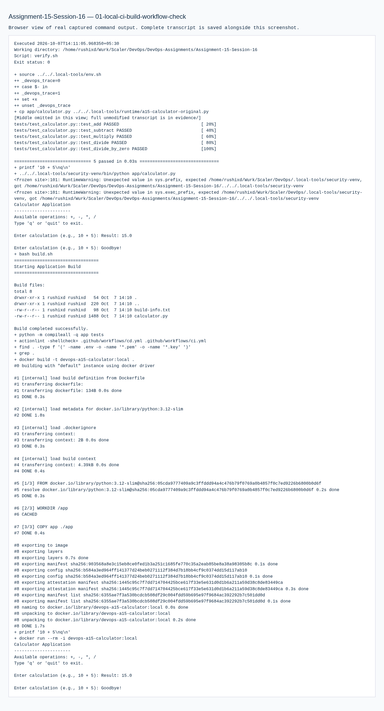

# 15 · CI/CD & GitHub Actions

**Session 16** · **Local work verified · required stages pending**

[Portfolio](../README.md) · [Exact requirements](REQUIREMENTS.md) · [Submission readiness](../SUBMISSION_READINESS.md)

> Prepare and locally verify the PDF’s referenced calculator CI/CD demonstration, with separate continuous-integration and delivery workflows.

| Assignment record | Details |
| --- | --- |
| PDF source | DevOps Homework.pdf · pages 33, 34 |
| Student | Rushi Jadhav · 10144 |
| Evidence | Successful transcripts: 1 · actual screenshots: 1 |
| Execution environment | Original local host / Ubuntu VM as identified in the transcripts |
| Review | 21 October 2026; historical output is retained unchanged |

## Requirement coverage

| PDF requirement | Implementation / document | Demonstrated behavior |
| --- | --- | --- |
| Referenced calculator application | [app/](app/) | Five unit tests, interactive calculator output and a timestamped build artifact. |
| Docker packaging | [Dockerfile](Dockerfile) | Image built and calculator executed in a container. |
| CI and CD definitions | [.github/workflows/](.github/workflows/) | Standalone templates retained; combined-repository entry points are now at repository root. |
| Regression gate | [evidence/01-local-ci-build-workflow-check.md](evidence/01-local-ci-build-workflow-check.md) | Intentional arithmetic defect fails a test; restoring the implementation restores five passes. |

## Commands and verification

Key commands are shown below. The evidence records contain the complete executed scripts, exact resource names, output and exit status.

```bash
pytest -v
bash build.sh
docker build -t devops-a15-calculator:local .
```

[Reproduction and tooling](../REPRODUCING.md) explains the original VM adapters, native-tool use and portable Git bundles. Full executed scripts and stdout/stderr are linked below.

## Observed result

Local build, tests, Docker execution and workflow lint passed. No successful hosted run of this calculator assignment is present. The separate TaskBoard run demonstrates a different application.

## Troubleshooting and observations

CI verifies and retains build artifacts; CD delivers a verified revision. A YAML file and a local test log are not substitutes for a real GitHub Actions result.

## Pipeline concepts used

| Concept | Role in this project |
| --- | --- |
| CI | Test changes and produce a build only after the test/security jobs succeed |
| CD | Deliver an approved application image to the configured registry |
| Workflow | YAML entry point containing the calculator jobs |
| Job / runner | A job executes its steps on an Ubuntu GitHub-hosted runner |
| Step | One command or reusable action inside a job |
| Dependencies | `needs` makes build wait for test and security-check jobs |
| Secrets | Registry credentials are referenced by name in the delivery environment |
| Artifact | `calculator-build` retains the output of the build script |

The real hosted execution and its successful run screenshots are still required. Repository-root entry points are prepared, but this documentation refresh has not triggered them.

## Submission status

**BLOCKED.** Run Assignment 15 CI and CD on GitHub after owner publication/approval; configure the delivery environment and registry credentials; retain genuine run, artifact and image-publication evidence.

## Execution evidence

- [01 local ci build workflow check](evidence/01-local-ci-build-workflow-check.md) — successful execution

## Screenshots

Actual application pages and explicitly labelled views of captured command output. Full text records preserve output omitted from an image.

<details>
<summary>Open the screenshot gallery (1 images)</summary>



</details>
