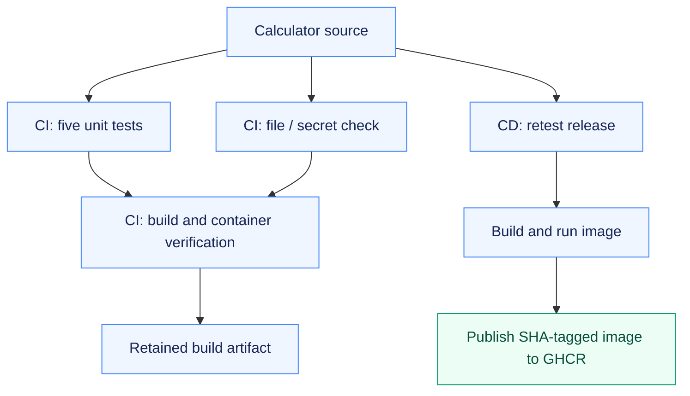

# Assignment 15 — Calculator CI/CD with GitHub Actions

A tested calculator delivered through separate, successful CI and CD workflows.

[Portfolio](../README.md) · [Requirements](REQUIREMENTS.md) · [Execution evidence](evidence/)

## The problem

A calculator change needs automatic regression checks, a reproducible build and a verified image delivery step. CI and CD should have distinct, observable responsibilities.

## Approach

1. Tested all four operations and divide-by-zero handling, then demonstrated that an intentional arithmetic defect fails the regression gate.
2. Used separate hosted CI jobs for tests/security checks and a dependent artifact/image build.
3. Ran hosted CD to retest the release, execute the built container and publish that verified revision to GHCR.

## How it works



## Implementation

| Component | Implementation | Behavior verified |
| --- | --- | --- |
| Referenced calculator application | [app/](app/) | Five unit tests, interactive calculator output and a timestamped build artifact. |
| Docker packaging | [Dockerfile](Dockerfile) | Image built and calculator executed in a container. |
| CI and CD definitions | [.github/workflows/](.github/workflows/) | Executable standalone definitions and root entry points; both CI and CD completed on GitHub. |
| Regression gate | [evidence/01-local-ci-build-workflow-check.md](evidence/01-local-ci-build-workflow-check.md) | Intentional arithmetic defect fails a test; restoring the implementation restores five passes. |

**Tools:** Python, pytest, Docker, GitHub Actions, build artifacts and GHCR.

## Commands used

These are representative recorded commands. Complete scripts and output are linked in the evidence section.

```bash
pytest -v
bash build.sh
docker build -t devops-a15-calculator:local .
```

### Hosted execution

```bash
gh workflow run assignment-15-ci.yml --repo NoteLegend/DevOps-Assignments
gh workflow run assignment-15-cd.yml --repo NoteLegend/DevOps-Assignments
gh run view 39584561631 --repo NoteLegend/DevOps-Assignments --log
gh run view 39584567670 --repo NoteLegend/DevOps-Assignments --log
```

## Verification & results

Local verification and real hosted CI/CD passed. [CI run 39584561631](https://github.com/NoteLegend/DevOps-Assignments/actions/runs/39584561631) passed tests, security-check and build jobs; [CD run 39584567670](https://github.com/NoteLegend/DevOps-Assignments/actions/runs/39584567670) retested the release, built and executed its image, and published it to GHCR. Both runs used source revision `0dd742d`; the full SHA is retained in the run records. The container returned `Result: 15.0` for `10 + 5` before publication.

## Pipeline concepts used

| Concept | Role in this project |
| --- | --- |
| CI | Test changes and produce a build only after the test/security jobs succeed |
| CD | Deliver an approved application image to the configured registry |
| Workflow | YAML entry point containing the calculator jobs |
| Job / runner | A job executes its steps on an Ubuntu GitHub-hosted runner |
| Step | One command or reusable action inside a job |
| Dependencies | `needs` makes build wait for test and security-check jobs |
| Secrets | The runner-provided, masked `GITHUB_TOKEN` authenticates to GHCR; no personal registry secret is committed |
| Artifact | `calculator-build` retains the output of the build script |

The CI run produced the `calculator-build` artifact. CD published the commit-tagged calculator image in `ghcr.io/notelegend/devops-assignments-calculator`. Complete run/step records and logs are retained below. The [actual CI build artifact](evidence/hosted-ci-artifact/) and [CD container/push output](evidence/hosted-cd-artifact/) were downloaded before their short hosted retention period expired. Delivery uses the existing repository and GitHub Packages; no AWS resource or remote Kubernetes cluster is involved.

## Troubleshooting & decisions

CI verifies and retains build artifacts; CD delivers a verified revision. A YAML file and a local test log are not substitutes for a real GitHub Actions result.

## Evidence

- [01 local ci build workflow check](evidence/01-local-ci-build-workflow-check.md) — successful execution

- [Hosted calculator CI](evidence/02-hosted-calculator-ci.md) — five tests, build, container verification and artifact
- [Hosted calculator CD](evidence/03-hosted-calculator-cd.md) — tests, container execution and actual GHCR publication

## Screenshots

Actual application pages and recorded command-output views from the practical execution.


<details>
<summary>More screenshots: implementation, diagnostics and verification</summary>


</details>

## Key takeaways

CI establishes that a revision passes its checks; CD delivers the verified artifact. The workflow connects those claims to actual runner logs and a published image.
