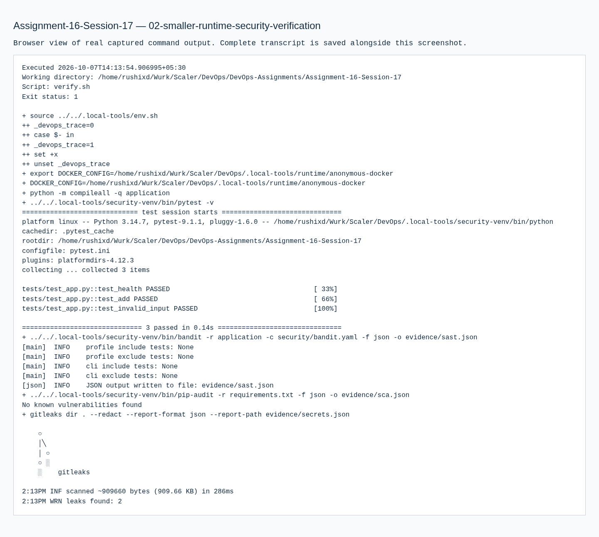
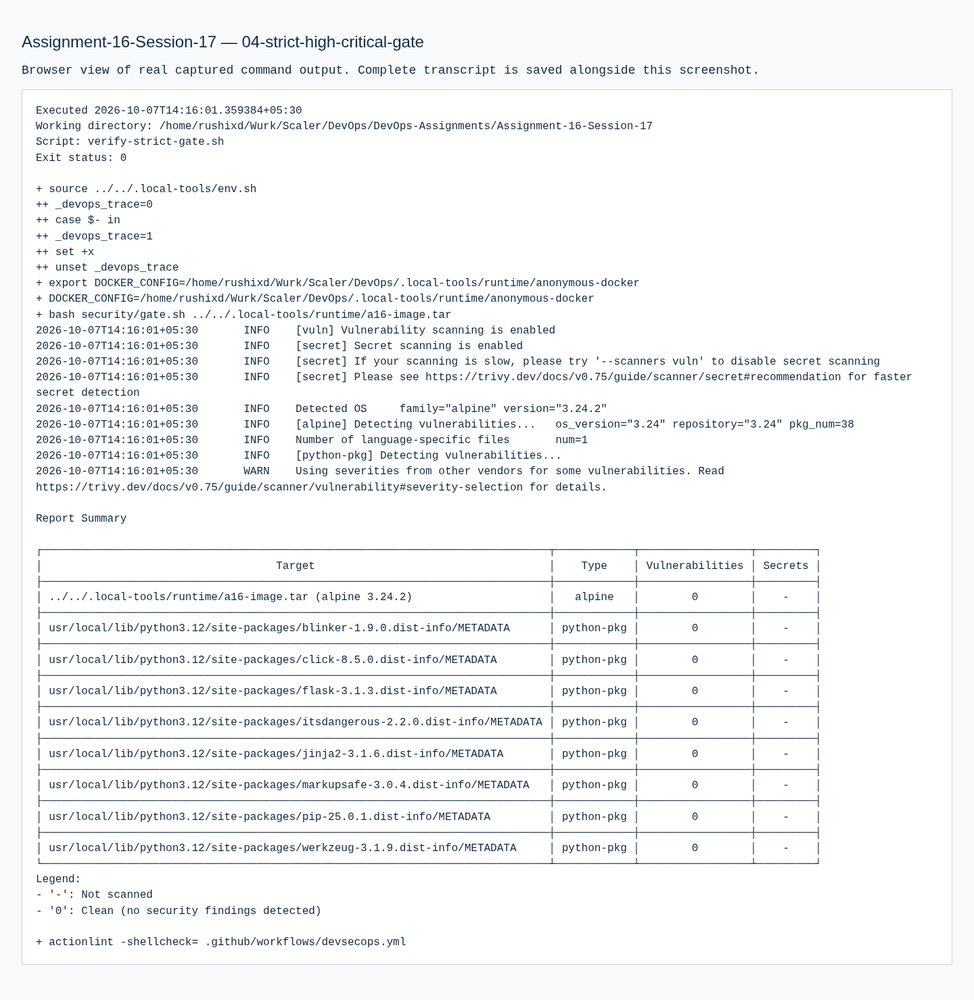
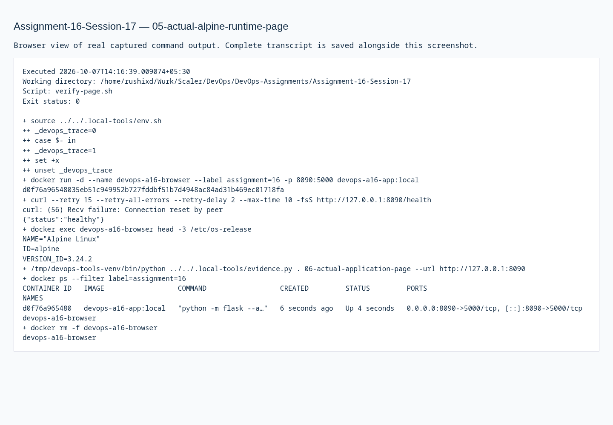

# 16 · Complete CI/CD & DevSecOps

**Session 17** · **Local work verified · required stages pending**

[Portfolio](../README.md) · [Exact requirements](REQUIREMENTS.md) · [Submission readiness](../SUBMISSION_READINESS.md)

> Build a security-gated application pipeline with real local tests, four scanner categories, Docker execution and Kubernetes deployment.

| Assignment record | Details |
| --- | --- |
| PDF source | DevOps Homework.pdf · pages 35, 36, 37 |
| Student | Rushi Jadhav · 10144 |
| Evidence | Successful transcripts: 5 · actual screenshots: 7 |
| Execution environment | Original local host / Ubuntu VM as identified in the transcripts |
| Review | 21 October 2026; historical output is retained unchanged |

## Requirement coverage

| PDF requirement | Implementation / document | Demonstrated behavior |
| --- | --- | --- |
| Application build and tests | [application/](application/) | Three application tests and compile validation. |
| SAST / SCA / secret scanning | [security/](security/) | Bandit, pip-audit and Gitleaks with actual retained reports. |
| Container scanning and gate | [security/gate.sh](security/gate.sh) | Trivy rejects all HIGH/CRITICAL findings, including unfixed findings. |
| Kubernetes and artifact integrity | [kubernetes/](kubernetes/) | Real local two-replica deployment; saved/loaded scanned image IDs are identical. |
| Hosted pipeline preparation | [.github/workflows/](.github/workflows/) | Repository-root manual workflow prepared; hosted execution still pending. |

## Commands and verification

Key commands are shown below. The evidence records contain the complete executed scripts, exact resource names, output and exit status.

```bash
python -m pytest -v
bandit -r application -c security/bandit.yaml
pip-audit -r requirements.txt
docker build -t devops-a16-app:local .
```

[Reproduction and tooling](../REPRODUCING.md) explains the original VM adapters, native-tool use and portable Git bundles. Full executed scripts and stdout/stderr are linked below.

## Observed result

Recorded final local scans: Bandit 0, dependency advisories 0, source-secret findings 0 and image HIGH/CRITICAL 0. Seven lower-severity image entries remain in the full dated report. The initial Debian scan and repair are retained.

## Troubleshooting and observations

The initial image had 44 HIGH/CRITICAL findings. Changing the runtime and rerunning the strict gate produced the recorded clean high-severity result; no unfixed-finding bypass is claimed.

## Security stages and retained reports

| Stage | Tool / gate | Actual report |
| --- | --- | --- |
| Source analysis | Bandit | [SAST report](evidence/sast.json) |
| Dependency analysis | pip-audit | [SCA report](evidence/sca.json) |
| Secret detection | Gitleaks with redaction | [Secret report](evidence/secrets.json) |
| Image analysis | Trivy; all HIGH/CRITICAL findings fail | [Full image report](evidence/image-scan.json) |

Generated image metadata initially matched two public signing-key fingerprints during secret scanning. Those redacted false positives were retained; generated evidence is separated from the source scan rather than being presented as an actual leaked runtime credential.

## Submission status

**BLOCKED.** Execute the assignment’s complete hosted pipeline, publish its scanned image and verify delivery to an approved Kubernetes target. Keep real successful pipeline/registry/deployment evidence; TaskBoard’s image-only Trivy stage does not cover all four required scanner stages.

## Execution evidence

- [01 local devsecops pipeline](evidence/01-local-devsecops-pipeline.md) — successful execution
- [02 smaller runtime security verification](evidence/02-smaller-runtime-security-verification.md) — retained earlier attempt / diagnosis; use the successful retry for completion
- [03 alpine source scans and deployment](evidence/03-alpine-source-scans-and-deployment.md) — successful execution
- [04 strict high critical gate](evidence/04-strict-high-critical-gate.md) — successful execution
- [05 actual alpine runtime page](evidence/05-actual-alpine-runtime-page.md) — successful execution
- [06 shared image artifact identity](evidence/06-shared-image-artifact-identity.md) — successful execution

## Screenshots

Actual application pages and explicitly labelled views of captured command output. Full text records preserve output omitted from an image.

<details>
<summary>Open the screenshot gallery (7 images)</summary>










</details>
