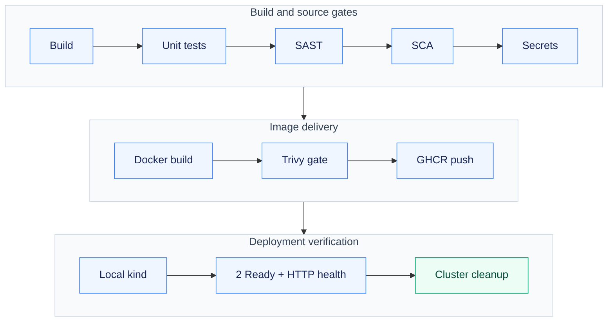
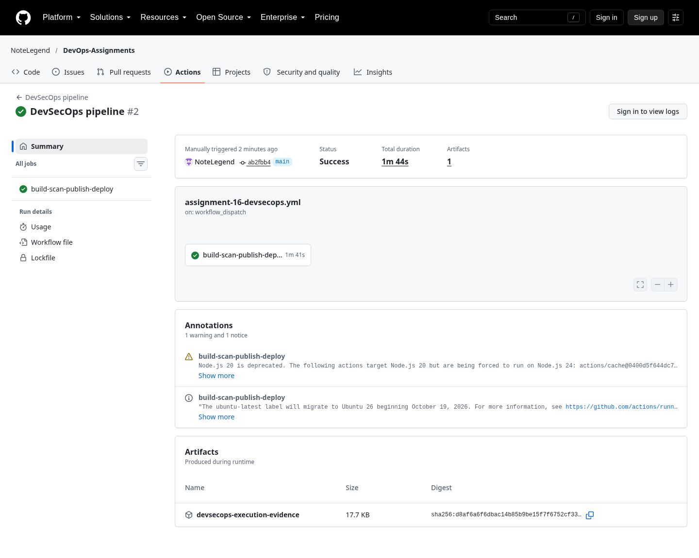

# Assignment 16 — Security-Gated CI/CD & Kubernetes Delivery

A complete build-to-deployment pipeline that blocks delivery until source, dependency, secret and image gates pass.

[Portfolio](../README.md) · [Requirements](REQUIREMENTS.md) · [Execution evidence](evidence/)

## The problem

A pipeline should stop unsafe source, vulnerable dependencies, exposed secrets and vulnerable images before publication. Deployment must use the same image that passed the gates.

## Approach

1. Compiled and unit-tested the application before running SAST, SCA and secret scanning.
2. Built the Docker image and rejected HIGH/CRITICAL findings, including unfixed findings, before GHCR publication.
3. Loaded the verified image into an isolated runner-local kind cluster, checked two Ready replicas and HTTP health, then deleted the cluster.

## How it works



## Implementation

| Component | Implementation | Behavior verified |
| --- | --- | --- |
| Application build and tests | [application/](application/) | Three application tests and compile validation. |
| SAST / SCA / secret scanning | [security/](security/) | Bandit, pip-audit and Gitleaks with actual retained reports. |
| Container scanning and gate | [security/gate.sh](security/gate.sh) | Trivy rejects all HIGH/CRITICAL findings, including unfixed findings. |
| Kubernetes and artifact integrity | [kubernetes/](kubernetes/) | Real local two-replica deployment; saved/loaded scanned image IDs are identical. |
| Hosted delivery | [.github/workflows/](.github/workflows/) | Repository-root manual workflow executed successfully; all security, publication and Kubernetes verification stages passed. |

**Tools:** Python/pytest, Bandit, pip-audit, Gitleaks, Docker, Trivy, GHCR, kind and kubectl.

## Commands used

These are representative recorded commands. Complete scripts and output are linked in the evidence section.

```bash
python -m pytest -v
bandit -r application -c security/bandit.yaml
pip-audit -r requirements.txt
docker build -t devops-a16-app:local .
```

## Verification & results

[The complete hosted run](https://github.com/NoteLegend/DevOps-Assignments/actions/runs/39584880376) passed tests, all four scanner categories, the delivery gates, GHCR publication and Kubernetes HTTP verification. Both replicas were Ready, the built/published image IDs matched, and the temporary kind cluster was deleted.

### Earlier local security results

Recorded final local scans: Bandit 0, dependency advisories 0, source-secret findings 0 and image HIGH/CRITICAL 0. Seven lower-severity image entries remain in the full dated report. The initial Debian scan and repair are retained.

## Security stages and retained reports

| Stage | Tool / gate | Actual report |
| --- | --- | --- |
| Source analysis | Bandit | [SAST report](evidence/sast.json) |
| Dependency analysis | pip-audit | [SCA report](evidence/sca.json) |
| Secret detection | Gitleaks with redaction | [Secret report](evidence/secrets.json) |
| Image analysis | Trivy; all HIGH/CRITICAL findings fail | [Full image report](evidence/image-scan.json) |

Generated image metadata initially matched two public signing-key fingerprints during secret scanning. Those redacted false positives were retained; generated evidence is separated from the source scan rather than being presented as an actual leaked runtime credential.

## Hosted delivery

The successful run used commit `ab2fbb4` and published its SHA-tagged image in `ghcr.io/notelegend/devops-assignments-devsecops`. Bandit, pip-audit, Gitleaks and the strict image gate passed. The built and published Docker image IDs are identical in the [downloaded evidence](evidence/hosted-devsecops/); this is the same image loaded into kind and used by the verified Deployment.

```bash
gh workflow run assignment-16-devsecops.yml --repo NoteLegend/DevOps-Assignments
gh run view 39584880376 --repo NoteLegend/DevOps-Assignments --log
gh run download 39584880376 --repo NoteLegend/DevOps-Assignments \
  --name devsecops-execution-evidence --dir evidence/hosted-devsecops
```

The first hosted attempt passed scans and image publication but failed when `kubectl set image` also encountered a Service in a combined manifest. Deployment and Service were separated, the local image patch was checked, and the complete rerun passed. The [original failure record](evidence/hosted-devsecops/initial-deployment-failure.json) is retained; it is not labelled successful. No AWS or remote Kubernetes cluster was used.

[Successful complete pipeline](https://github.com/NoteLegend/DevOps-Assignments/actions/runs/39584880376) · [Downloaded verification artifacts](evidence/hosted-devsecops/)

## Troubleshooting & decisions

The initial image had 44 HIGH/CRITICAL findings. Changing the runtime and rerunning the strict gate produced the recorded clean high-severity result; no unfixed-finding bypass is claimed.

## Evidence

- [01 local devsecops pipeline](evidence/01-local-devsecops-pipeline.md) — successful execution
- [02 smaller runtime security verification](evidence/02-smaller-runtime-security-verification.md) — retained earlier attempt / diagnosis; use the successful retry for completion
- [03 alpine source scans and deployment](evidence/03-alpine-source-scans-and-deployment.md) — successful execution
- [04 strict high critical gate](evidence/04-strict-high-critical-gate.md) — successful execution
- [05 actual alpine runtime page](evidence/05-actual-alpine-runtime-page.md) — successful execution
- [06 shared image artifact identity](evidence/06-shared-image-artifact-identity.md) — successful execution

- [Successful hosted DevSecOps pipeline](evidence/07-hosted-devsecops.md) — complete real log and run/step record
- [Downloaded scanner, image identity, Kubernetes and HTTP results](evidence/hosted-devsecops/)

## Screenshots

Actual application pages and recorded command-output views from the practical execution.



<details>
<summary>More screenshots: implementation, diagnostics and verification</summary>


</details>

## Key takeaways

A scan must gate delivery, not merely run alongside it. Recording built/published image identity connects the security result to the application that Kubernetes actually executes.
