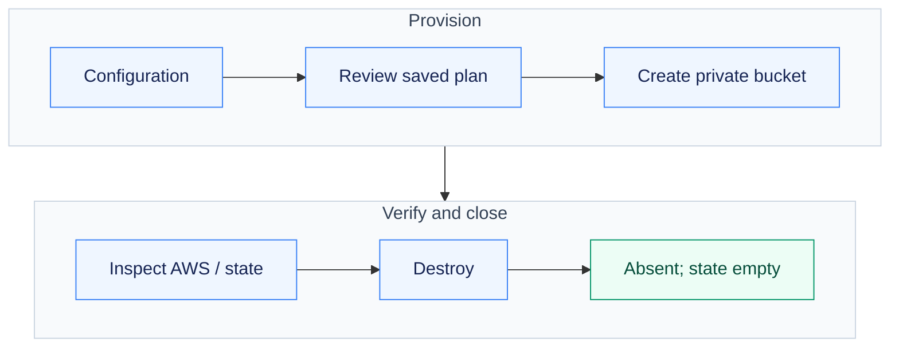
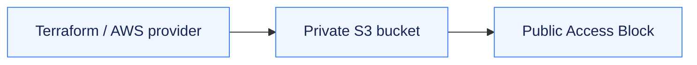
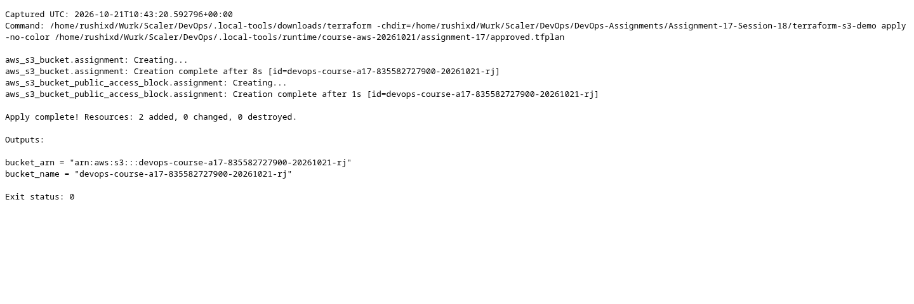
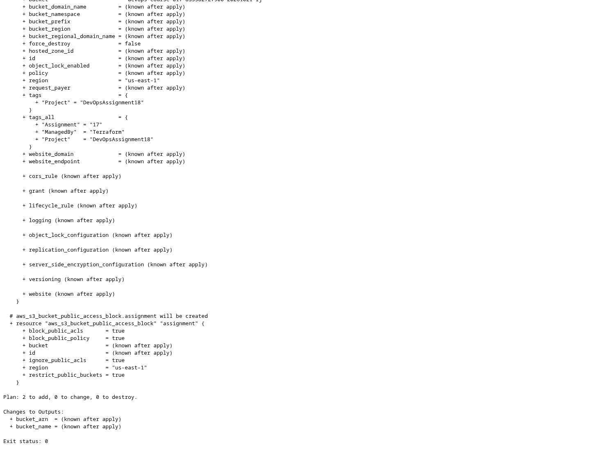
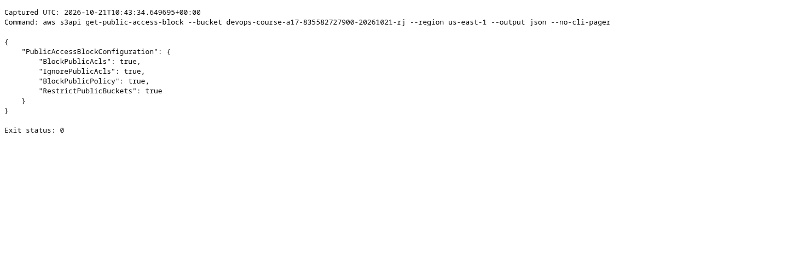
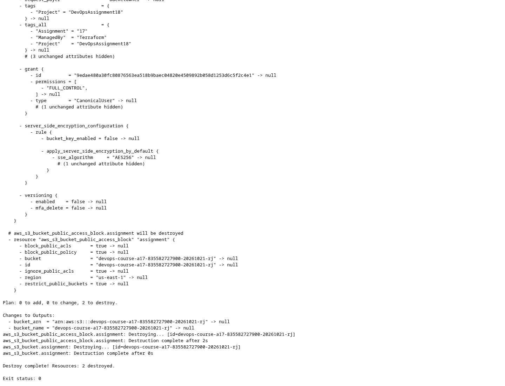

# Assignment 17 — Terraform S3 Lifecycle & AWS Foundations

A real private S3 bucket created, inspected and removed with Terraform, alongside AWS service research.

[Portfolio](../README.md) · [Requirements](REQUIREMENTS.md) · [Execution evidence](evidence/)

## The problem

Infrastructure code must demonstrate actual resource creation and cleanup, not just valid syntax. The exercise pairs a real S3 lifecycle with the required AWS service research.

## Approach

1. Defined the bucket and public-access block, locked the provider and validated the exact nonsecret inputs.
2. Reviewed the saved plan, applied it after approval, and inspected real bucket protection, encryption, state and outputs.
3. Destroyed the resources and checked bucket absence and empty state; documented IAM, EC2, S3, VPC and database concepts separately.

## How it works



## Implementation

| Component | What was implemented and checked |
| --- | --- |
| Terraform project | Required files exist in [terraform-s3-demo/](terraform-s3-demo/); provider lock retained. |
| Initialization and validation | Actual init, fmt, fmt -check and validate succeeded. |
| Plan and apply | 2 resources created in `us-east-1` after explicit approval. |
| State and outputs | Actual `show`, `output -json` and `state list` captured; state itself stays private. |
| AWS verification | Bucket existence, public-access blocking and default encryption checked using AWS CLI. |
| Destroy and absence checks | All 2 managed resources destroyed; Terraform state is empty and the bucket is absent. |
| AWS services research | Separate required READMEs cover IAM, EC2, S3, VPC and DynamoDB/RDS. |

**Tools:** Terraform 1.16.5, AWS provider 6.67.0, AWS CLI 2.37.9 and temporary browser-authorized credentials.

### Resource layout



### Project files

| File | Responsibility |
| --- | --- |
| provider.tf | Local state backend, locked AWS provider, region and allowed-account guard |
| main.tf | AWS resources and reference-based dependencies |
| variables.tf | Typed region and resource inputs |
| outputs.tf | Values read from the created resources |
| terraform.tfvars | Actual nonsecret inputs used for this dated demonstration |
| terraform.tfvars.example | Input template for an independently approved rerun |
| .terraform.lock.hcl | AWS provider 6.67.0 dependency lock |

## Commands used

The private runtime directory is abbreviated below as `$PRIVATE_RUNTIME`; the evidence retains the exact executed paths.

```bash
terraform init -reconfigure -backend-config="path=$PRIVATE_RUNTIME/terraform.tfstate"
terraform fmt
terraform fmt -check
terraform validate
terraform plan -out="$PRIVATE_RUNTIME/approved.tfplan"
terraform apply "$PRIVATE_RUNTIME/approved.tfplan"
terraform show "$PRIVATE_RUNTIME/terraform.tfstate"
terraform output -json -state="$PRIVATE_RUNTIME/terraform.tfstate"
terraform state list -state="$PRIVATE_RUNTIME/terraform.tfstate"
terraform destroy -auto-approve -state="$PRIVATE_RUNTIME/terraform.tfstate"
terraform state list -state="$PRIVATE_RUNTIME/terraform.tfstate"
```

## Verification & results

The real AWS lifecycle completed on **21 October 2026** in **67.3 seconds**. Terraform created and destroyed **2 resources**; the final managed state is empty. The bucket was verified private and encrypted before deletion.

| Check | Genuine command output |
| --- | --- |
| Init / format / validate | [Init](evidence/aws-init.txt) · [fmt](evidence/aws-fmt.txt) · [fmt check](evidence/aws-fmt-check.txt) · [validate](evidence/aws-validate.txt) |
| Resource plan | [Actual plan](evidence/aws-plan.txt) · [Structured plan summary](evidence/aws-plan-summary.json) |
| Creation | [Terraform apply](evidence/aws-apply.txt) |
| State / computed outputs | [show](evidence/aws-show.txt) · [output](evidence/aws-output.txt) · [state list](evidence/aws-state-list.txt) |
| Bucket protection | [Exists](evidence/aws-bucket-exists.txt) · [private access](evidence/aws-bucket-private.txt) · [encryption](evidence/aws-bucket-encryption.txt) |
| Teardown | [Destroy](evidence/aws-destroy.txt) · [empty state](evidence/aws-state-empty.txt) · [bucket absence](evidence/aws-bucket-removed.txt) |

The lifecycle includes a successful destroy and subsequent expected not-found checks. Resource IDs remain in the evidence; the cloud resources are no longer running.

## AWS services research

- [IAM — governance](aws-services/01-iam/README.md): users, groups, roles, policies, permissions, least privilege and best practices.
- [EC2 — compute](aws-services/02-ec2/README.md): AMIs, instance types, keys, Security Groups, EBS, addressing and lifecycle.
- [S3 — storage](aws-services/03-s3/README.md): objects, classes, versioning, lifecycle, encryption and policies.
- [VPC — networking](aws-services/04-vpc/README.md): CIDR, subnets, routing, gateways, Security Groups and NACLs.
- [DynamoDB and RDS](aws-services/05-dynamodb-rds/README.md): NoSQL/relational models, keys, engines, backups, Multi-AZ and replicas.

These are research deliverables; unrelated IAM/database resources were not provisioned.

## Troubleshooting & decisions

Browser approval had to finish the AWS CLI callback before the temporary profile became available. Terraform plans/state stayed outside the submission. The reviewed lifecycle used existing Free-plan credits and did not upgrade the account.

## Evidence

- [Complete lifecycle result](evidence/aws-lifecycle-summary.json) — created resources, outputs, command statuses and verified cleanup.
- [Actual Terraform plan](evidence/aws-plan.txt), [apply](evidence/aws-apply.txt) and [destroy](evidence/aws-destroy.txt).
- [State inspection](evidence/aws-show.txt) and [computed outputs](evidence/aws-output.txt).

## Screenshots

Browser captures of the recorded AWS/Terraform output; the corresponding text logs are linked above.



<details>
<summary>More screenshots: implementation, diagnostics and verification</summary>








</details>

## Key takeaways

Validation checks configuration; apply creates real infrastructure. State/outputs and independent AWS checks make the lifecycle observable, while verified destroy closes it.
