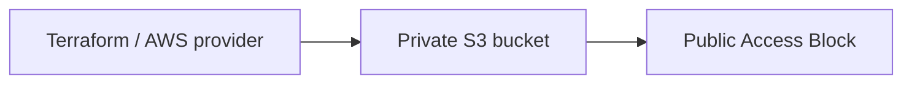

# Assignment 17 — Terraform & Infrastructure as Code

**Session 18 · COMPLETE · Real AWS lifecycle verified and cleaned up**

[Portfolio](../README.md) · [Exact PDF requirements](REQUIREMENTS.md) · [Terraform project](terraform-s3-demo/) · [Lifecycle result](evidence/aws-lifecycle-summary.json)

## Objective

Create a real private AWS S3 bucket with Terraform, verify its properties and outputs, then remove it. Document the five required AWS service families.

## Tasks performed

| Required work | Actual result |
| --- | --- |
| Terraform project | Required files exist in [terraform-s3-demo/](terraform-s3-demo/); provider lock retained. |
| Initialization and validation | Actual init, fmt, fmt -check and validate succeeded. |
| Plan and apply | 2 resources created in account `835582727900`, region `us-east-1` after explicit approval. |
| State and outputs | Actual `show`, `output -json` and `state list` captured; state itself stays private. |
| AWS verification | Bucket existence, public-access blocking and default encryption checked using AWS CLI. |
| Destroy and absence checks | All 2 managed resources destroyed; Terraform state is empty and the bucket is absent. |
| AWS services research | Separate required READMEs cover IAM, EC2, S3, VPC and DynamoDB/RDS. |

## Tools used

Terraform 1.16.5 · AWS provider 6.67.0 · AWS CLI 2.37.9 · host Bash/Python. Browser-based AWS CLI sign-in supplied temporary credentials; no access key or token is stored in this project.

## Implementation



| File | Responsibility |
| --- | --- |
| provider.tf | Local state backend, locked AWS provider, region and allowed-account guard |
| main.tf | AWS resources and reference-based dependencies |
| variables.tf | Typed region and resource inputs |
| outputs.tf | Values read from the created resources |
| terraform.tfvars | Actual nonsecret inputs used for this dated demonstration |
| terraform.tfvars.example | Input template for an independently approved rerun |
| .terraform.lock.hcl | AWS provider 6.67.0 dependency lock |

The provider restricts execution to the approved account. Terraform's local backend was initialized to a private runtime path outside both repositories; saved plans, state and plugin data were excluded from submission.

## Commands executed

The following are the executed Terraform operations, with the private runtime directory abbreviated as `$PRIVATE_RUNTIME`. The linked command records retain the exact paths and output.

```bash
terraform init -reconfigure -backend-config="path=$PRIVATE_RUNTIME/terraform.tfstate"
terraform fmt
terraform fmt -check
terraform validate
terraform plan -out="$PRIVATE_RUNTIME/approved.tfplan"
terraform apply "$PRIVATE_RUNTIME/approved.tfplan"
terraform show "$PRIVATE_RUNTIME/terraform.tfstate"
terraform output -json -state="$PRIVATE_RUNTIME/terraform.tfstate"
terraform state list -state="$PRIVATE_RUNTIME/terraform.tfstate"
terraform destroy -auto-approve -state="$PRIVATE_RUNTIME/terraform.tfstate"
terraform state list -state="$PRIVATE_RUNTIME/terraform.tfstate"
```

## Verification

| Check | Genuine command output |
| --- | --- |
| Init / format / validate | [Init](evidence/aws-init.txt) · [fmt](evidence/aws-fmt.txt) · [fmt check](evidence/aws-fmt-check.txt) · [validate](evidence/aws-validate.txt) |
| Resource plan | [Actual plan](evidence/aws-plan.txt) · [Structured plan summary](evidence/aws-plan-summary.json) |
| Creation | [Terraform apply](evidence/aws-apply.txt) |
| State / computed outputs | [show](evidence/aws-show.txt) · [output](evidence/aws-output.txt) · [state list](evidence/aws-state-list.txt) |
| Bucket protection | [Exists](evidence/aws-bucket-exists.txt) · [private access](evidence/aws-bucket-private.txt) · [encryption](evidence/aws-bucket-encryption.txt) |
| Teardown | [Destroy](evidence/aws-destroy.txt) · [empty state](evidence/aws-state-empty.txt) · [bucket absence](evidence/aws-bucket-removed.txt) |

## Output / results

```json
{
  "bucket_arn": "arn:aws:s3:::devops-course-a17-835582727900-20261021-rj",
  "bucket_name": "devops-course-a17-835582727900-20261021-rj"
}
```

The full lifecycle ran from **2026-10-21T10:43:04.800271+00:00** to **2026-10-21T10:44:12.103235+00:00**, taking **67.3 seconds**. **Destroy succeeded; zero managed state objects remain.** The identifiers above are historical evidence, not running resources.

After deletion, the bucket existence check intentionally returns a nonzero not-found response. That expected absence, together with successful destroy and empty state, verifies cleanup; it is not an unhandled assignment failure.

## AWS services research

- [IAM — governance](aws-services/01-iam/README.md): users, groups, roles, policies, permissions, least privilege and best practices.
- [EC2 — compute](aws-services/02-ec2/README.md): AMIs, instance types, keys, Security Groups, EBS, addressing and lifecycle.
- [S3 — storage](aws-services/03-s3/README.md): objects, classes, versioning, lifecycle, encryption and policies.
- [VPC — networking](aws-services/04-vpc/README.md): CIDR, subnets, routing, gateways, Security Groups and NACLs.
- [DynamoDB and RDS](aws-services/05-dynamodb-rds/README.md): NoSQL/relational models, keys, engines, backups, Multi-AZ and replicas.

These are research deliverables; unrelated IAM/database resources were not provisioned.

## Screenshots

The following are real browser captures of the saved command-output files. They preserve actual AWS/Terraform results and are not mock terminal screens or fabricated console dashboards.


## Troubleshooting / observations

CLI authorization had to complete the browser approval callback before the temporary profile became available. The account/Free-plan check, reviewed resource plan and explicit lifecycle approval preceded apply. Local schema validation alone was not treated as evidence of AWS provisioning.

The account retained its Free plan; there was no account upgrade. Usage consumes existing credits and settled billing can lag. Saved plans/state and all runtime credentials remain outside Git.

## Lessons learned

References between resources establish Terraform dependencies. Outputs provide actual created IDs, while state maps those IDs to resource addresses. Plan review, resource inspection and verified teardown are distinct steps; successful syntax validation does not replace them.
