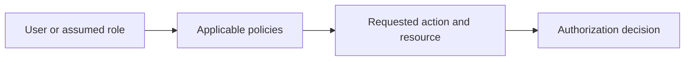

# IAM: Identity, Permissions & Governance

Access needs to identify the caller and limit the actions that caller can perform.

[Assignment](../../README.md) · [Service research](../../README.md#aws-services-research)

## How it fits

## Concepts and design choices

| Concept | Purpose |
| --- | --- |
| User | Identity for a person or workload; may have assigned permissions |
| Group | Collection of IAM users sharing permission policies |
| Role | Assumable identity used with temporary credentials |
| Policy | JSON rules describing allowed/denied actions, resources and conditions |
| Permissions | Effective access after applicable policy evaluation |
| Least privilege | Limit actions and resources to what the task requires |

An explicit deny overrides an applicable allow. Prefer temporary credentials and federation, use MFA for privileged access, avoid daily root-account use and review unused access. Typical patterns include application roles for S3 access and scoped policies for separate environments.

## Connection to the practical work

This research document does not provision IAM users, roles or policies. The real S3 exercise used temporary browser-authorized CLI credentials.

[Official service documentation](https://docs.aws.amazon.com/IAM/latest/UserGuide/introduction.html)
