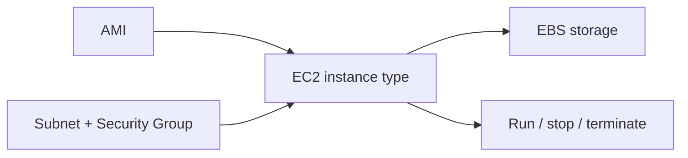

# EC2: Compute, Images & Instance Lifecycle

A virtual machine needs a repeatable operating-system image, suitable compute capacity, storage and controlled network access.

[Assignment](../../README.md) · [Service research](../../README.md#aws-services-research)

## How it fits

## Concepts and design choices

| Concept | Role |
| --- | --- |
| AMI | Operating-system and software image used at launch |
| Instance type | CPU, memory and network capacity |
| Key pair | Public/private key material for supported SSH access |
| Security Group | Stateful instance-level traffic filtering |
| EBS | Persistent block storage attached to an instance |
| Private / public IP | VPC communication versus eligible internet addressing |

Instances progress through pending/running and stopping/stopped or shutting-down/terminated states. Stopping preserves EBS according to configuration; termination removes volumes configured for deletion. Common use cases include application servers, batch processing and development environments.

## Connection to the practical work

[Assignment 18](../../../Assignment-18-Session-19/README.md) actually created and removed a private EC2 instance. It passed both status checks, had no public IP or inbound rule, and used an encrypted root disk. Those results are distinct from this research deliverable.

[Official service documentation](https://docs.aws.amazon.com/AWSEC2/latest/UserGuide/concepts.html)
