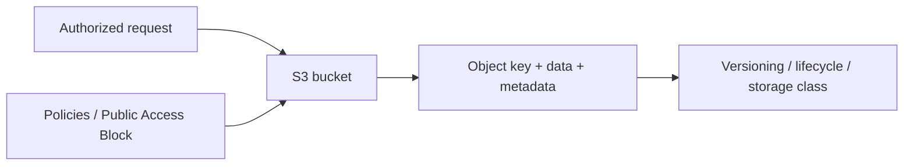

# S3: Objects, Protection & Storage Lifecycle

Applications need durable object storage with an access policy and lifecycle appropriate to the data.

[Assignment](../../README.md) · [Service research](../../README.md#aws-services-research)

## How it fits

## Concepts and design choices

| Concept | Purpose |
| --- | --- |
| Bucket / object | Namespace containing data addressed by object keys |
| Storage class | Storage/retrieval behavior suited to the access pattern |
| Versioning | Preserve multiple versions of a key |
| Lifecycle rules | Transition or expire objects and versions |
| Encryption | Protect stored object data using supported server-side options |
| Bucket policy | Resource-based access rules |
| Public Access Block | Guard against public exposure |

Examples of storage classes include Standard, Intelligent-Tiering, infrequent-access and archive classes. Common uses are static assets, backups, data lakes and build artifacts.

## Connection to the practical work

The [Terraform S3 demo](../../terraform-s3-demo/README.md) created a real bucket, verified protection and encryption, then destroyed it. Research features such as object versioning and lifecycle rules are explained here; they are not claimed as separately deployed resources.

[Official service documentation](https://docs.aws.amazon.com/AmazonS3/latest/userguide/Welcome.html)
