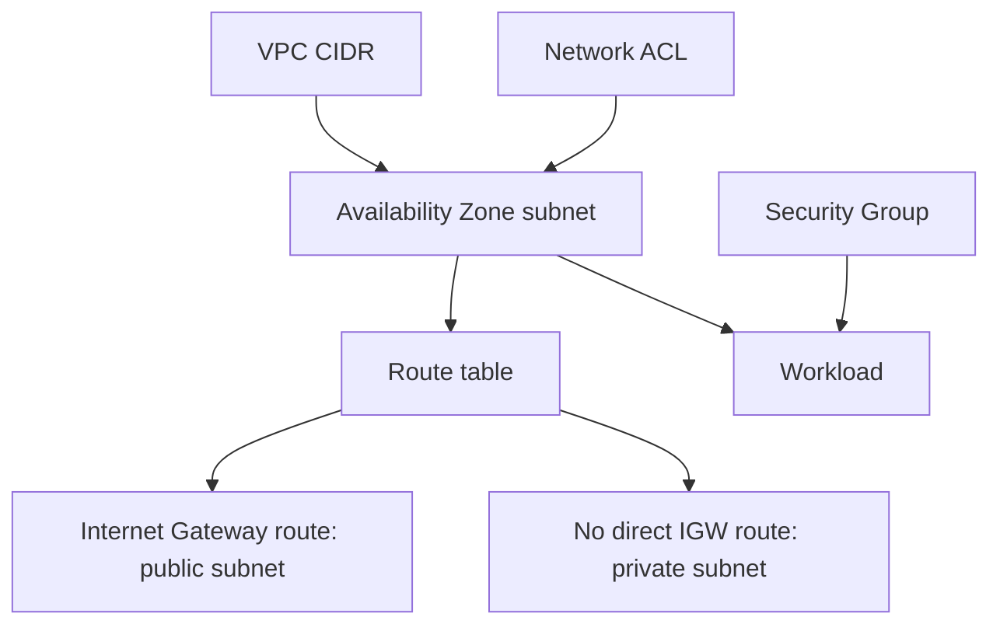

# VPC: Addressing, Routing & Isolation

Cloud workloads need defined address ranges, routes and traffic controls so that reachability matches the application design.

[Assignment](../../README.md) · [Service research](../../README.md#aws-services-research)

## How it fits

## Concepts and design choices

| Concept | Responsibility |
| --- | --- |
| VPC / CIDR | Isolated virtual network and its address range |
| Subnet | An Availability Zone segment of the address range |
| Route table | Destination and next-hop selection |
| Internet Gateway | Internet routing for eligible public resources |
| NAT Gateway | Outbound IPv4 access for private-subnet resources without direct public addressing |
| Security Group | Stateful resource-level filtering |
| Network ACL | Stateless subnet-level filtering |

A public subnet has a route to an Internet Gateway; a private subnet lacks that direct route. A route alone does not assign a public IP. NAT is an optional design choice, not a requirement for every private subnet.

## Connection to the practical work

The [executed Assignment 18](../../../Assignment-18-Session-19/README.md) used a private subnet without Internet/NAT Gateway and an EC2 instance without a public IP. Its VPC and dependent resources were removed after verification.

[Official service documentation](https://docs.aws.amazon.com/vpc/latest/userguide/what-is-amazon-vpc.html)
