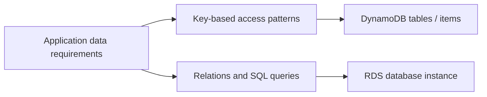

# DynamoDB & RDS: Choosing a Data Model

Access patterns and relational requirements determine whether a key-oriented NoSQL model or a relational database is appropriate.

[Assignment](../../README.md) · [Service research](../../README.md#aws-services-research)

## How it fits

## Concepts and design choices

| Aspect | DynamoDB | RDS |
| --- | --- | --- |
| Model | Managed NoSQL tables containing items and attributes | Managed relational database instances |
| Data access | Partition key; optional sort key for related items | SQL supported by the selected engine |
| Typical use | Key-value application state, carts, event metadata | Transactions and relational reporting |
| Design focus | Model keys around the required access patterns | Design tables, relationships and queries |

## DynamoDB concepts

An item contains attributes. The partition key identifies a partition-key value; an optional sort key distinguishes and orders items that share it. Key selection is central to efficient application access.

## RDS concepts

RDS supports relational engines such as PostgreSQL and MySQL. VPC placement, Security Groups, authentication and encryption control access. Automated backups and snapshots support recovery. Multi-AZ configurations provide availability options; supported read-replica configurations address read scaling and are distinct from standby failover configurations.

## Connection to the practical work

This is the required database research document. No DynamoDB table or RDS instance was needed or provisioned for the S3 lifecycle.

[Official service documentation](https://docs.aws.amazon.com/AmazonRDS/latest/UserGuide/Welcome.html)

[Official DynamoDB introduction](https://docs.aws.amazon.com/amazondynamodb/latest/developerguide/Introduction.html)
