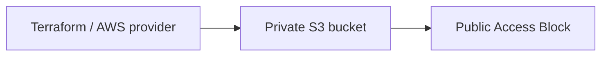

# Terraform S3: From Plan to Verified Cleanup

One project defines a private S3 bucket and its public-access block and demonstrates the complete infrastructure lifecycle.

[Assignment 17](../README.md) · [Inputs](variables.tf) · [Outputs](outputs.tf) · [Executed lifecycle](../evidence/aws-lifecycle-summary.json)

## The problem

Infrastructure declarations need reproducible dependencies, inspectable state and an explicit cleanup path. A successful validation result alone cannot establish that the resources were created or removed.

## Architecture

## Project structure

| File | Responsibility |
| --- | --- |
| provider.tf | Local state backend, locked AWS provider, region and allowed-account guard |
| main.tf | AWS resources and reference-based dependencies |
| variables.tf | Typed region and resource inputs |
| outputs.tf | Values read from the created resources |
| terraform.tfvars | Actual nonsecret inputs used for this dated demonstration |
| terraform.tfvars.example | Input template for an independently approved rerun |
| .terraform.lock.hcl | AWS provider 6.67.0 dependency lock |

## Approach and result

The project was initialized, formatted and validated before an actual saved plan was reviewed. After approval, Terraform applied the plan; AWS CLI checks and Terraform state/outputs confirmed the created resources. Destroy then removed the project, and independent absence checks verified cleanup.

All two Terraform-managed resources were destroyed on 21 October 2026. The bucket no longer existed and state was empty. Full commands, results and screenshots are in the [assignment README](../README.md).

## State and credentials

The local backend used a private runtime path supplied during initialization. Saved plans, state, provider caches and temporary credentials remain outside the submission. `terraform.tfvars` records nonsecret inputs for the dated demonstration; a new resource lifecycle needs its own current plan and approval.
