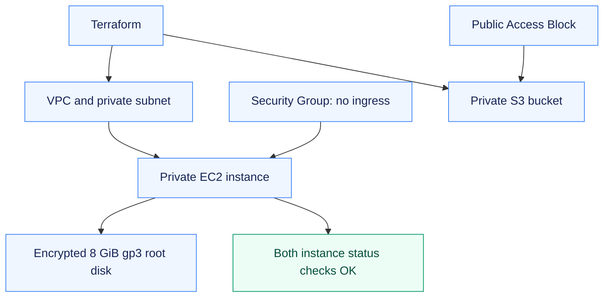

# Assignment 18 — Terraform VPC, EC2 & S3 Infrastructure

A private network, EC2 instance and S3 bucket provisioned, inspected and fully removed with Terraform.

[Portfolio](../README.md) · [Requirements](REQUIREMENTS.md) · [Execution evidence](evidence/)

## The problem

A small cloud environment needs explicit dependencies, bounded exposure and a verifiable teardown. Terraform should connect the network, compute and storage components into one inspectable project.

## Approach

1. Declared a VPC, private subnet, Security Group, EC2 instance and private S3 bucket with typed inputs and resource-derived outputs.
2. Applied the reviewed six-resource plan and verified instance health, network attachment, IMDSv2, encrypted storage and standard CPU credits.
3. Destroyed the exact project resources and independently checked instance termination, VPC/bucket absence and root-volume deletion.

## How it works



## Implementation

| Component | What was implemented and checked |
| --- | --- |
| Terraform project | Required files exist in [terraform-project/](terraform-project/); provider lock retained. |
| Initialization and validation | Actual init, fmt, fmt -check and validate succeeded. |
| Plan and apply | 6 resources created in `us-east-1` after explicit approval. |
| State and outputs | Actual `show`, `output -json` and `state list` captured; state itself stays private. |
| AWS verification | Bucket existence, public-access blocking and default encryption checked using AWS CLI. |
| Destroy and absence checks | All 6 managed resources destroyed; Terraform state is empty and the bucket is absent. |
| EC2 and network verification | Instance reached running with both status checks OK; VPC/subnet/SG/root-volume properties inspected. |

**Tools:** Terraform 1.16.5, AWS provider 6.67.0, AWS CLI 2.37.9, Amazon Linux 2023 and t3.micro.

The instance had no public IP, Internet/NAT Gateway or inbound Security Group rule. IMDSv2 was required; the encrypted root disk was configured for deletion on termination.

### Project files

| File | Responsibility |
| --- | --- |
| provider.tf | Local state backend, locked AWS provider, region and allowed-account guard |
| main.tf | AWS resources and reference-based dependencies |
| variables.tf | Typed region and resource inputs |
| outputs.tf | Values read from the created resources |
| terraform.tfvars | Actual nonsecret inputs used for this dated demonstration |
| terraform.tfvars.example | Input template for an independently approved rerun |
| .terraform.lock.hcl | AWS provider 6.67.0 dependency lock |

## Commands used

The private runtime directory is abbreviated below as `$PRIVATE_RUNTIME`; the evidence retains the exact executed paths.

```bash
terraform init -reconfigure -backend-config="path=$PRIVATE_RUNTIME/terraform.tfstate"
terraform fmt
terraform fmt -check
terraform validate
terraform plan -out="$PRIVATE_RUNTIME/approved.tfplan"
terraform apply "$PRIVATE_RUNTIME/approved.tfplan"
terraform show "$PRIVATE_RUNTIME/terraform.tfstate"
terraform output -json -state="$PRIVATE_RUNTIME/terraform.tfstate"
terraform state list -state="$PRIVATE_RUNTIME/terraform.tfstate"
terraform destroy -auto-approve -state="$PRIVATE_RUNTIME/terraform.tfstate"
terraform state list -state="$PRIVATE_RUNTIME/terraform.tfstate"
```

## Verification & results

The real AWS lifecycle completed on **21 October 2026** in **292.9 seconds**. Terraform created and destroyed **6 resources**; the final managed state is empty. The EC2 instance passed both status checks before teardown; instance termination, VPC/bucket absence and root-volume deletion were confirmed.

| Check | Genuine command output |
| --- | --- |
| Init / format / validate | [Init](evidence/aws-init.txt) · [fmt](evidence/aws-fmt.txt) · [fmt check](evidence/aws-fmt-check.txt) · [validate](evidence/aws-validate.txt) |
| Resource plan | [Actual plan](evidence/aws-plan.txt) · [Structured plan summary](evidence/aws-plan-summary.json) |
| Creation | [Terraform apply](evidence/aws-apply.txt) |
| State / computed outputs | [show](evidence/aws-show.txt) · [output](evidence/aws-output.txt) · [state list](evidence/aws-state-list.txt) |
| Bucket protection | [Exists](evidence/aws-bucket-exists.txt) · [private access](evidence/aws-bucket-private.txt) · [encryption](evidence/aws-bucket-encryption.txt) |
| Teardown | [Destroy](evidence/aws-destroy.txt) · [empty state](evidence/aws-state-empty.txt) · [bucket absence](evidence/aws-bucket-removed.txt) |
| EC2 readiness | [Running](evidence/aws-instance-running.txt) · [both status checks OK](evidence/aws-instance-health.txt) |
| Actual infrastructure | [Instance](evidence/aws-ec2-instance.txt) · [VPC](evidence/aws-vpc.txt) · [subnet](evidence/aws-subnet.txt) · [security groups](evidence/aws-security-groups.txt) |
| Storage / CPU credits | [Encrypted root volume](evidence/aws-encrypted-root-volume.txt) · [standard credits](evidence/aws-standard-cpu-credits.txt) |
| Cloud absence | [Instance terminated](evidence/aws-instance-terminated.txt) · [VPC removed](evidence/aws-vpc-removed.txt) · [EBS root volume removed](evidence/aws-root-volume-removed.txt) |

[Infrastructure property assertions](evidence/aws-infrastructure-assertions.json) confirm the actual private address, IMDSv2, attached Security Group rules, encrypted disk and CPU-credit setting.

The lifecycle includes a successful destroy and subsequent expected not-found checks. Resource IDs remain in the evidence; the cloud resources are no longer running.

## Troubleshooting & decisions

Browser approval had to finish the AWS CLI callback before the temporary profile became available. Terraform plans/state stayed outside the submission. The reviewed lifecycle used existing Free-plan credits and did not upgrade the account.

## Evidence

- [Complete lifecycle result](evidence/aws-lifecycle-summary.json) — created resources, outputs, command statuses and verified cleanup.
- [Actual Terraform plan](evidence/aws-plan.txt), [apply](evidence/aws-apply.txt) and [destroy](evidence/aws-destroy.txt).
- [State inspection](evidence/aws-show.txt) and [computed outputs](evidence/aws-output.txt).
- [Infrastructure property assertions](evidence/aws-infrastructure-assertions.json) and [root-volume absence](evidence/aws-root-volume-removed.txt).

## Screenshots

Browser captures of the recorded AWS/Terraform output; the corresponding text logs are linked above.


<details>
<summary>More screenshots: implementation, diagnostics and verification</summary>


</details>

## Key takeaways

Resource references express dependencies; outputs and state connect declarations to actual IDs. Successful provisioning and successful cleanup require separate evidence.
